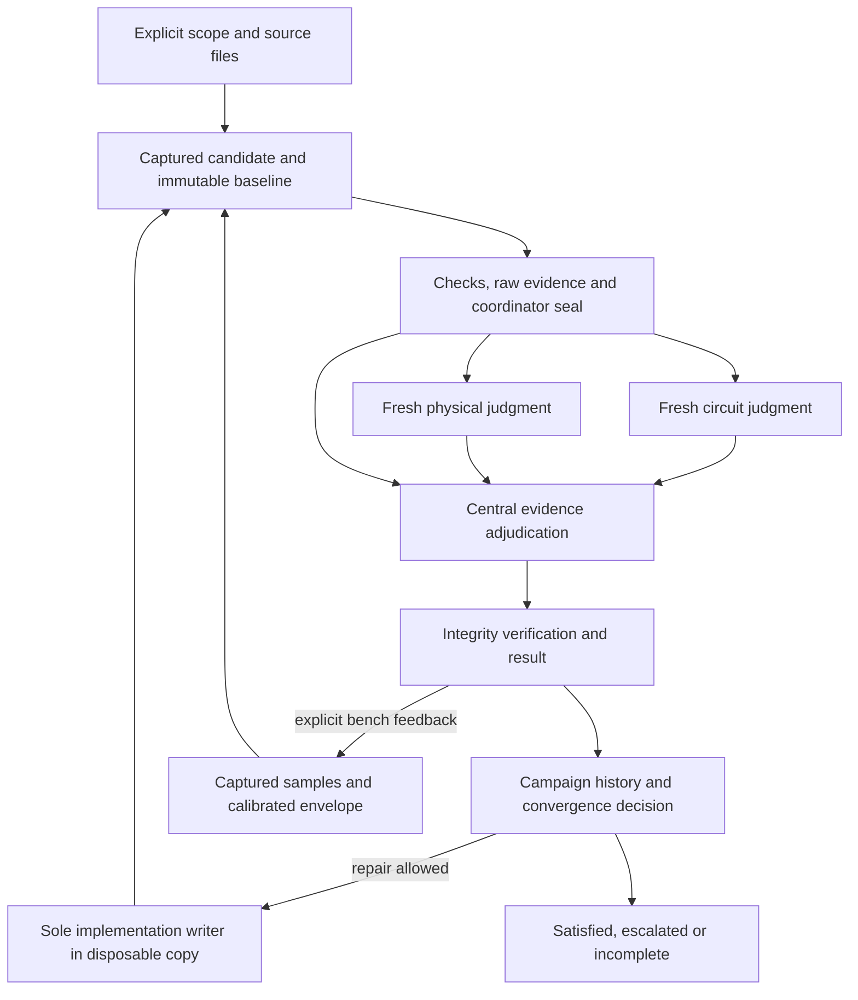
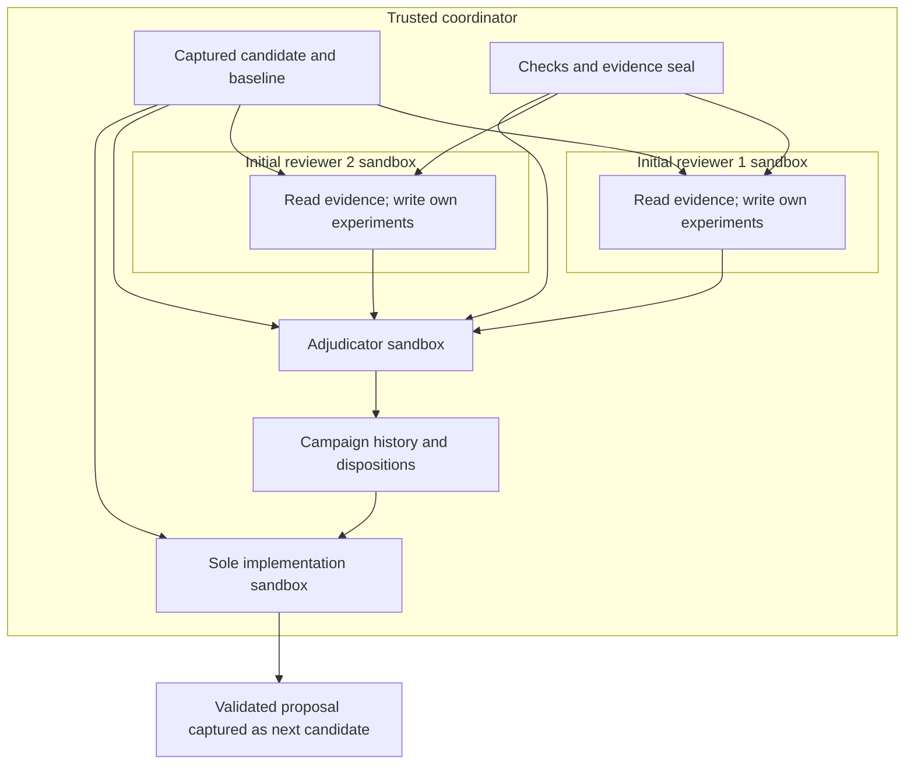

# Architecture and lifecycle

agent-ee keeps review execution in a small standard-library Python application.
The skill tells an existing coding agent how to invoke it; the CLI owns capture,
native checks, fresh model calls, records and acceptance interpretation.
FOME-MC-specific input choices stay in scopes and references.

## Data flow

The two initial judgments run concurrently in separate contexts and workspaces.
The coordinator waits for both calls to settle before adjudication and projects
reviews and execution records in profile role order. Profiles with additional
roles run at most two initial calls at once. Parallel execution does not prove
epistemic independence.

## Modules and seams

| Module | Responsibility |
| --- | --- |
| [candidate.py](../src/agent_ee/candidate.py) | Resolve explicit sources, select files, copy/hash, verify snapshot/current source |
| [executor.py](../src/agent_ee/executor.py) | Construct Bubblewrap view; run/cancel subprocess groups; persist raw execution |
| [checks.py](../src/agent_ee/checks.py) | Hierarchy validation, native report interpretation, criteria and passive deck generation |
| [geometry_probe.py](../src/agent_ee/geometry_probe.py) | Saved pcbnew geometry extraction inside the sandbox |
| [profiles.py](../src/agent_ee/profiles.py) | Validate explicit role, subscription harness, model, effort and timeout definitions |
| [harnesses.py](../src/agent_ee/harnesses.py) | Native subscription command construction, sandbox mounts and response parsing |
| [reviewers.py](../src/agent_ee/reviewers.py) | Bounded packets, subscription adapter, initial lenses and adjudicator prompts/schemas |
| [findings.py](../src/agent_ee/findings.py) | Validate review/citation records, collect all claims, adjudicate without voting, closure invariants |
| [baseline.py](../src/agent_ee/baseline.py) | Immutable requirements, criteria, source identities and verification evidence seal |
| [measurements.py](../src/agent_ee/measurements.py) | Pinned tool execution, isolated parsers and cross-domain margin evaluation |
| [empirical.py](../src/agent_ee/empirical.py) | Candidate-bound bench ingestion, accumulated residual intervals and fresh verification |
| [campaign.py](../src/agent_ee/campaign.py) | Single implementation writer, immutable history snapshots and empirical epochs |
| [convergence.py](../src/agent_ee/convergence.py) | Protected criteria, margin progress and bounded escalation |
| [locking.py](../src/agent_ee/locking.py) | Process writer leases including enclosing campaigns |
| [storage.py](../src/agent_ee/storage.py) | Canonical identities, digests and atomic JSON writes |
| [cli.py](../src/agent_ee/cli.py) | Command parser, work lifecycle, result projections, freshness and operator mutations |

There is no database, daemon, queue service or hidden remote agent coordinator.
The explicit campaign driver performs bounded automatic repairs; its
[closed-loop contracts](closed-loop.md) define writer ownership and stop rules. Run directories are the persistence interface.
Installing another model CLI does not add an adapter. The repository does not
vendor the concurrent FOME-MC toolchain or execute it from its changing checkout.

## Capture and isolation

Capture hashes selected source files, copies each file, verifies the copied
digest, then compares current source selection/hashes and scope bytes with the
initial state. Candidate identity covers parsed scope and captured file hashes.
Source revisions are recorded separately. This detects many races but is not an
atomic multi-file filesystem snapshot.

Each subprocess receives the captured inputs read-only at `/candidate`, package
source read-only at `/app`, and its own writable scratch at `/work`. Native tools
have no network. Review inference has network and a read-only credential mount,
with ordinary tools enabled and fresh harness settings. Other initial reviewers' scratch and the source checkout are absent from initial
review calls. The adjudicator additionally sees prior experiment directories
read-only. Implementation has a disposable writable design copy; the generic
measurement parser has read-only producer output and request mounts. These are OS-enforced child-process permissions; the privileged host
remains outside this boundary. Details are in [security](security.md).

## Persistence and completion

The run starts with an explicit `running` result. Each check is written to its
own JSON record immediately after interpretation; each validated review and
adapter outcome is also persisted. Check/review collection and result/report
projections are saved at lifecycle boundaries. On a caught interruption/error,
the CLI recovers durable work and inserts unknown placeholders for unfinished
checks/roles. It does not manufacture a successful empty review.

Finalization verifies captured and current source identity, loaded/current
Python policy, and runtime fingerprints. A complete process state can still
produce incomplete outcome when required execution coverage is unknown.
The [result rules](result-reference.md) define acceptance separately from process
completion. Provider schema failure, native malformed output and solver failure
cannot become an electrical pass through aggregation.

An adjudication appends an event and regenerates projections. Correction
linkage additionally binds a distinct changed candidate, unchanged criteria and
requirement bytes, fresh affected checks, and a wholly satisfying new review.
The semantic relationship between repair and finding still needs engineering
inspection. The CLI does not automatically derive repair impact.

## Freshness strategy

The implementation conservatively reruns rather than selectively reusing old
checks. `resume` preserves the old run and starts a fresh capture/execution.
Changing relevant selected bytes invalidates normal freshness even if the source
Git revision stays unchanged. Changing any Python module or fingerprinted tool
invalidates prior policy/runtime freshness. An unselected dependency can still
escape this inventory; input completeness is an explicit operator responsibility.

Artifact inventories bind retained raw evidence and projections to recorded
hashes. They are consistency checks on trusted storage, not an independent
signing system against an owner who can rewrite all records. Historical
`--snapshot-only` verification preserves the original candidate while skipping
live-source availability. It still checks implementation and runtime equality.

## Design tradeoffs

The [decision record](decisions.md) gives the original reasoning. The practical
costs are intentional and visible: full reruns spend inference again; reviewers may omit useful tool investigations;
explicit model profiles still can share blind spots; and whole-review closure is
stricter than closing one local defect while unrelated blockers remain.
Broader analyses need explicit check/model/extraction additions and their own
independent expectations, not longer unsupported reviewer assertions.

## Information and write authority

| Context | Reads | Writes | Excluded context |
| --- | --- | --- | --- |
| Native or declared producer tool | Captured candidate, baseline; generic producer request | Its own check/tool scratch | Other reviewer judgments, host source checkout, network |
| Measurement parser | Candidate, baseline, read-only request and producer files | Its own parser scratch/report | Writable producer output, reviewer judgments, network |
| Initial reviewer | Candidate, baseline, sealed checks, packet; its own investigations | Its own scratch/experiments | Other initial judgments, campaign history, implementation summary |
| Adjudicator | Same ground truth plus all current findings/reviews and prior experiment directories | Its own scratch and structured decision response | Candidate write access |
| Implementation agent | Prior candidate, baseline, convergence history, accepted check findings | Disposable `/work/design` proposal and own scratch | Authority to edit requirements, verification programs, file inventory or unlisted inputs |
| Parent coordinator | Host files and all retained records | Capture, evidence seal, validated projections/history/events | No OS sandbox restricts the parent itself |

Arrows are permitted information flows, not shared writable files. The parent
serializes model calls and owns result mutation. Nonblocking process leases
protect supported writer entry points; campaign descendants also acquire the
root lease. A read-only `inspect` does not claim writer ownership or establish
liveness. Arbitrary direct host edits are outside the lease/sandbox guarantee.

## Closed-loop composition

The standalone review pipeline is reused by campaigns and empirical re-review;
there is no second acceptance implementation. The [campaign reducer](campaign-guide.md)
adds historical progress/termination rules. [Bench ingestion](bench-feedback.md)
adds accumulated empirical observations and a new captured candidate while keeping
normative baseline criteria fixed. [Measurement adapters](measurement-adapters.md)
provide the producer/parser seam and expose cross-domain margins.

A physical feedback epoch is a change in empirical knowledge. It is neither a
new requirement baseline nor permission to discard historical failures. Initial
reviewers receive retained raw samples and tool-only source predictions, while
campaign history stays in the coordinator/implementation context. This preserves
the reviewer information boundary across empirical iterations.
