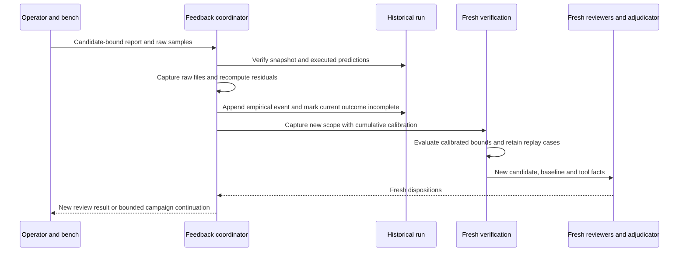
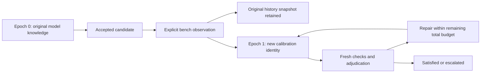

# Bench observations and calibrated re-review

Bench feedback binds physical observations to the candidate that was measured,
retains raw sample evidence, and re-enters verification and adjudication. It does
not acquire instrument data automatically. The operator supplies the report,
raw samples, prototype identity, measurement procedure and instrument provenance.

Use `bench-review` for a standalone run. Use `campaign-feedback` to continue an
accepted [campaign](campaign-guide.md) under updated empirical knowledge.
The implementation is [empirical.py](../src/agent_ee/empirical.py); it supports
metrics from `measurements` and scope/2 `rc_transient` checks.

## Admission and commands

Before submitting a report:

1. Identify the exact captured `candidate_id` corresponding to the prototype.
   A matching filename, schematic revision label or run UUID is insufficient.
2. Ensure the source run passes snapshot/policy/runtime/evidence verification.
   Its original live source can have moved; ingestion uses snapshot verification.
3. Use an executed measurement check with the required metric. Its execution
   must be `ok`; the measured design can have passed or failed its limits.
   Native RC checks need at least one bounded measurement to apply empirical
   correction during re-review; an entirely unbounded RC check stays informational.
4. Declare a nonempty `params.calibration_inputs` list for that check in advance.
   These captured files define model applicability. Generic producer program
   inputs and the parser are also bound to their original hashes.
5. Match the source metric's unit and condition exactly. For the native RC
   control, the first sample's condition is
   `ideal-unloaded-1.0V-step-at-1.0ms`; read the actual check JSON rather than
   constructing this string by assumption.

Current standalone limitation: `bench-review` retains an embedded scope
`review_profile`, but does not forward a source run's external `--profile FILE`.
Use an embedded profile when preparing a standalone source run for bench feedback.
If only an external profile was used, ingestion can supersede old acceptance and
execute calibrated checks, but the new adversarial review remains incomplete.
Campaign continuation explicitly passes its captured campaign profile.

Commands below require an existing run/campaign and an intentionally prepared
report. The output directory must be new:

```sh
./bin/agent-ee bench-review build/review bench/report.json \
  --out build/bench-followup --max-seconds 1200
./bin/agent-ee campaign-feedback build/my-campaign bench/report.json \
  --out build/campaign-bench-followup --max-seconds 1200
```

Do not submit the same physical observation through both commands as a way to
retry a failure. They are alternatives for different orchestration contexts.
`campaign-feedback` admits a last candidate whose verified campaign state is
`criteria_satisfied` or `empirical_superseded`. A standalone source run need not
have a completed passing adversarial review, provided the required captured
baseline and executed measurement exist. An unknown measurement cannot calibrate
another unknown.

Both commands default to 1200 seconds. `campaign-feedback` validates a finite
1–86400-second budget before ingestion. `bench-review` delegates its budget check
to the later review, where 0–86400 is accepted; ingestion and feedback registration
can already have occurred before an invalid review budget is refused. Use a
positive valid budget and inspect retained state on failure. Neither command
provides a transactional rollback of physical evidence registration.

## Report and raw sample contracts

A report uses `agent-ee.bench/1`:

| Field | Contract |
| --- | --- |
| `candidate_id` | Exact candidate hash of the measured source run |
| `prototype` | Nonempty description/identifier of the physical prototype |
| `instrument` | Nonempty instrument identity |
| `instrument_calibration` | Nonempty calibration provenance description |
| `procedure` | Nonempty measurement procedure description/reference |
| `observed_utc` | Nonempty observation timestamp string; use UTC ISO 8601, though syntax is not currently parsed |
| `artifacts` | Nonempty list of `{path, sha256}` for raw files relative to the report directory |
| `observations` | Nonempty list of the sample references described below |

Raw artifact paths must remain inside the report directory, with no traversal
or live final-file symlink. Duplicate paths or checksum mismatches are refused.
The file consumed by an observation must be JSON with a `samples` array.
Instrument CSV/binary data needs a separately qualified conversion to this
sample contract; retain the original export among the report artifacts when
needed for traceability.

Each observation contains `check_id`, `metric`, finite numeric `value`, finite
nonnegative `uncertainty`, `unit`, `condition`, `artifact`, and `locator`.
`artifact` names a listed raw file. `locator` is the canonical nonnegative array
index as a string, for example `"0"`; `"00"`, `"-1"`, and a freeform page reference
are invalid. All six sample fields (`check_id`, `metric`, `value`, `uncertainty`,
`unit`, `condition`) must exactly equal the corresponding raw sample.

This is a **synthetic format example**, not bench evidence. Its values explain
the residual calculation below:

```json
{
  "samples": [
    {"check_id": "response", "metric": "output", "value": 12,
     "uncertainty": 1, "unit": "V", "condition": "load"}
  ]
}
```

A corresponding observation adds `"artifact": "instrument.json"` and
`"locator": "0"` to that sample. The report's artifact entry needs the actual
SHA-256 of the raw file; obtain it with `sha256sum bench/instrument.json` after
saving the file. Populate the report's identity and provenance from the actual
run and measurement records. Descriptive instrument fields are operator
attestations: the software does not validate a calibration certificate or prove
that samples came from a physical instrument.

## Capture and re-entry



Feedback registration occurs after successful ingestion but **before** the fresh
review. Once registered, the old run's current outcome is `incomplete`, even if
the observation would still meet its original limits or the later model call
fails. Physical evidence does not inherit an old approval. The historical
candidate, checks and judgments remain available.

Standalone output contains `empirical/calibration.json`, content-addressed files
under `empirical/artifacts/`, `scope.json` and `review/`. A campaign feedback
output contains the same bundle/scope, but the fresh review is placed in the
next `CAMPAIGN/runs/N` directory. The source run records
`events/bench-BUNDLE_SHA256.json` and an `empirical_feedback` entry with schema
`agent-ee.empirical-feedback/1`, `bundle`, `bundle_sha256` and `review` paths.

## Residual envelope

For each source observation, let `p` be its nominal simulated prediction, `m`
the measured value and `u` its nonnegative uncertainty:

```text
residual_lower = m - u - p
residual_upper = m + u - p
new_lower = new_nominal_prediction + residual_lower
new_upper = new_nominal_prediction + residual_upper
```

With nominal 5 V and the synthetic 12 ± 1 V observation above, the residual is
[6, 8] V. The unchanged prediction becomes [11, 13] V and fails a 10 V maximum.
A later nominal prediction of 1 V becomes [7, 9] V. Both bounds, rather than just
the displayed midpoint, participate in acceptance.

This is an additive discrepancy model local to the declared operating condition
and unchanged model applicability. It is not parameter fitting, a statistical
confidence model or a guarantee that the discrepancy transfers across arbitrary
design changes. The operator must justify that applicability. It does not infer
unobserved operating points, new physical faults or missing uncertainty sources.

Repeated observations accumulate. For a metric, the coordinator takes the
smallest corrected lower bound and largest corrected upper bound across retained
observations; later small discrepancies cannot erase earlier ones. The metric
retains `nominal`, `lower`, `upper` and midpoint `value`. Existing producer
intervals are not automatically combined as an independent uncertainty budget;
the empirical correction is computed from the reported nominal/value contract.

`work/CHECK_ID/bench-replay.json` retains each observation and corrected bounds.
These are generated measurement replay cases, not automatically synthesized
hardware fault-injection scenarios. Coupling checks consume calibrated source
intervals. Acceptance limits and normative requirements remain unchanged.

## Calibration provenance and reviewer independence

`agent-ee.calibration/1` contains:

| Field | Meaning |
| --- | --- |
| `candidate_id` | Candidate most recently measured for this bundle |
| `baseline_id` | Immutable requirement/criteria/model baseline identity |
| `source_result_sha256` | Source result digest at ingestion |
| `model_inputs` | Applicable captured model/program/parser paths and hashes |
| `artifacts` | Captured content-addressed evidence paths and hashes |
| `observations` | Cumulative samples with prediction, residual bounds, candidate and retained report/prediction references |

Each observation's `artifact`, `report` and `source_result` references must be
retained in the artifact map. Later checks re-read samples and source predictions,
check candidate/unit/condition identities and recompute the residual arithmetic.
Changed applicable files or missing provenance fail validation. The captured
prediction record includes tool check facts and the source result digest, but
excludes reviewer judgments and adjudication prose. This lets fresh initial
reviewers inspect physical evidence without inheriting previous model opinions.

The generated scope reserves the top-level `empirical` destination for this
bundle and replaces that destination on subsequent feedback. Do not place
unrelated native design files there. Keep feedback output directories available:
prior event bundle paths and new scope source paths can refer to them even after
a later candidate has captured copies.

## Campaign epochs and recovery



A new epoch separates margins computed with different empirical knowledge. Its
transition must match the preceding run's registered bundle hash and new review
path; an edited epoch number cannot reset convergence. Within an epoch, protected
passes, metric regression checks and repeated-design detection apply. All epochs
consume the original automatic iteration allowance. See the
[exact convergence order](campaign-guide.md#states-and-stop-rules).

After failure, inspect the source event, feedback bundle, new run and campaign
state separately. Invalid input can leave an output directory without a usable
bundle. A failure after registration leaves the source superseded. A failure
after the next run directory was created can make a second campaign feedback
attempt collide with that directory. There is no general in-place retry or
transaction rollback. Preserve the attempt and diagnose the stage; do not delete
samples, forge a passing old outcome or edit history to force continuation.
