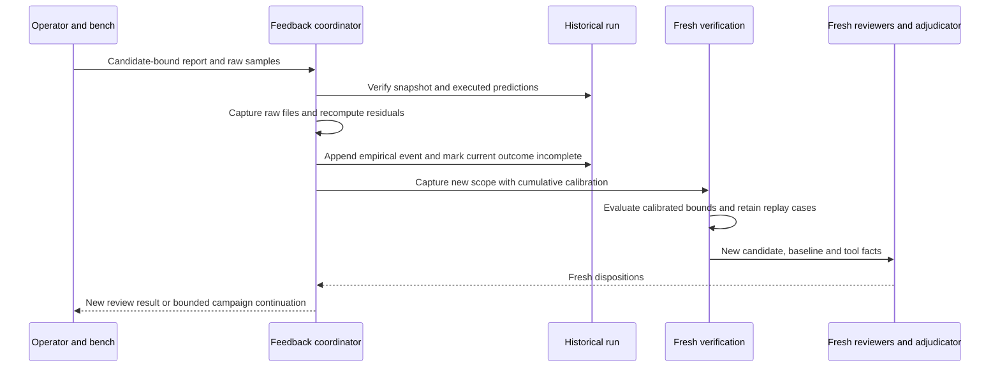
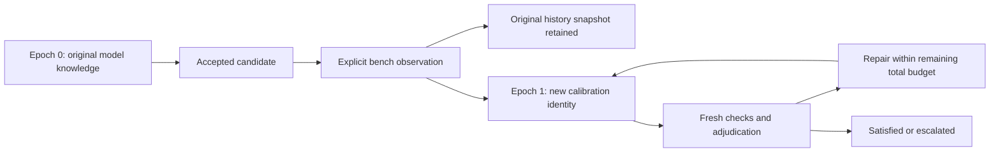

# Bench observations and calibrated re-review

Bench feedback binds physical observations to the candidate that was measured,
retains raw sample evidence, and re-enters verification and adjudication. It does
not acquire instrument data automatically. The operator supplies the report,
raw samples, prototype identity, measurement procedure and instrument provenance.

Use `bench-review` for a standalone run. Use `campaign-feedback` to continue an
accepted [campaign](campaign-guide.md) under updated empirical knowledge.
The implementation is [empirical.py](../src/agent_ee/empirical.py); it supports
metrics from `measurements` and scope/2 or scope/3 `rc_transient` checks.

## Admission and commands

Before submitting a report:

1. Identify the exact captured `candidate_id` corresponding to the prototype.
   A matching filename, schematic revision label or run UUID is insufficient.
2. Ensure the source run passes snapshot/policy/runtime/evidence verification.
   Its original live source can have moved; ingestion uses snapshot verification.
3. Use an executed measurement check with the required metric. Its execution
   must be `ok`, or be coordinator-recorded `unavailable` solely because exact
   calibration applicability failed after a successful nominal measurement.
   The latter retains `executed-unqualified/1` metrics and a sealed recalibration
   request; it cannot establish acceptance. The measured design can have passed
   or failed its limits.
   Native RC checks need at least one bounded measurement to apply empirical
   correction during re-review; an entirely unbounded RC check stays informational.
4. Declare a nonempty `params.calibration_inputs` list for that check in advance.
   These captured files define model applicability. Generic producer program
   inputs and the parser are also bound to their original hashes.
5. Match the source metric's unit and condition exactly. For the native RC
   control, the first sample's condition is
   `ideal-unloaded-1.0V-step-at-1.0ms`; read the actual check JSON rather than
   constructing this string by assumption.

Standalone `bench-review` retains the source candidate's captured `review_profile`.
This includes profiles originally supplied through `--profile FILE`: capture
embeds their parsed content in the candidate scope, which bench re-entry copies.
It does not reload the external profile file. Campaign continuation explicitly
passes its captured campaign profile. Neither bench command offers a new profile
override; provider availability and fresh review execution are still required.

Commands below require an existing run/campaign and an intentionally prepared
report. The output directory must be new:

```sh
./bin/agent-ee bench-review build/review bench/report.json \
  --out build/bench-followup --max-seconds 1200
./bin/agent-ee campaign-feedback build/my-campaign bench/report.json \
  --out build/campaign-bench-followup --max-seconds 1200
```

Do not submit the same physical observation through both commands as a way to
retry a failure. They are alternatives for different orchestration contexts.
`campaign-feedback` admits a last candidate whose verified campaign state is
`criteria_satisfied` or `empirical_superseded`, or an intact `incomplete` run
whose nonexecuted checks all contain verified exact-applicability requests and
executed nominal predictions. Arbitrary incomplete states cannot re-enter.
A standalone source run need not
have a completed passing adversarial review, provided the required captured
baseline and executed measurement exist. An unknown measurement cannot calibrate
another unknown.

Both commands default to 1200 seconds. `campaign-feedback` validates a finite
1–86400-second budget before ingestion. `bench-review` delegates its budget check
to the later review, where 0–86400 is accepted; ingestion and feedback registration
can already have occurred before an invalid review budget is refused. Use a
positive valid budget and inspect retained state on failure. Neither command
provides a transactional rollback of physical evidence registration.

## Report and raw sample contracts

A report uses `agent-ee.bench/1`:

| Field | Contract |
| --- | --- |
| `candidate_id` | Exact candidate hash of the measured source run |
| `prototype` | Nonempty description/identifier of the physical prototype |
| `instrument` | Nonempty instrument identity |
| `instrument_calibration` | Nonempty calibration provenance description |
| `procedure` | Nonempty measurement procedure description/reference |
| `observed_utc` | Nonempty observation timestamp string; use UTC ISO 8601, though syntax is not currently parsed |
| `artifacts` | Nonempty list of `{path, sha256}` for raw files relative to the report directory |
| `observations` | Nonempty list of the sample references described below |

Raw artifact paths must remain inside the report directory, with no traversal
or live final-file symlink. Duplicate paths or checksum mismatches are refused.
The file consumed by an observation must be JSON with a `samples` array.
Instrument CSV/binary data needs a separately qualified conversion to this
sample contract; retain the original export among the report artifacts when
needed for traceability.

Each observation contains `check_id`, `metric`, finite numeric `value`, finite
nonnegative `uncertainty`, `unit`, `condition`, `artifact`, and `locator`.
`artifact` names a listed raw file. `locator` is the canonical nonnegative array
index as a string, for example `"0"`; `"00"`, `"-1"`, and a freeform page reference
are invalid. All six sample fields (`check_id`, `metric`, `value`, `uncertainty`,
`unit`, `condition`) must exactly equal the corresponding raw sample.

This is a **synthetic format example**, not bench evidence. Its values explain
the residual calculation below:

```json
{
  "samples": [
    {"check_id": "response", "metric": "output", "value": 12,
     "uncertainty": 1, "unit": "V", "condition": "load"}
  ]
}
```

A corresponding observation adds `"artifact": "instrument.json"` and
`"locator": "0"` to that sample. The report's artifact entry needs the actual
SHA-256 of the raw file; obtain it with `sha256sum bench/instrument.json` after
saving the file. Populate the report's identity and provenance from the actual
run and measurement records. Descriptive instrument fields are operator
attestations: the software does not validate a calibration certificate or prove
that samples came from a physical instrument.

## Capture and re-entry



Feedback registration occurs after successful ingestion but **before** the fresh
review. Once registered, the old run's current outcome is `incomplete`, even if
the observation would still meet its original limits or the later model call
fails. Physical evidence does not inherit an old approval. The historical
candidate, checks and judgments remain available.

Standalone output contains `empirical/calibration.json`, content-addressed files
under `empirical/artifacts/`, `scope.json` and `review/`. A campaign feedback
output contains the same bundle/scope, but the fresh review is placed in the
next `CAMPAIGN/runs/N` directory. The source run records
`events/bench-BUNDLE_SHA256.json` and an `empirical_feedback` entry with schema
`agent-ee.empirical-feedback/1`, `bundle`, `bundle_sha256` and `review` paths.

## Residual envelope

For each source observation, let `p` be its nominal simulated prediction, `m`
the measured value and `u` its nonnegative uncertainty:

```text
residual_lower = m - u - p
residual_upper = m + u - p
new_lower = new_nominal_prediction + residual_lower
new_upper = new_nominal_prediction + residual_upper
```

With nominal 5 V and the synthetic 12 ± 1 V observation above, the residual is
[6, 8] V. The unchanged prediction becomes [11, 13] V and fails a 10 V maximum.
A changed design predicting 1 V cannot inherit that correction: it requires
new observations for its exact dependencies. Both interval bounds, rather than
just the displayed midpoint, participate in acceptance.

This is an additive discrepancy model local to the declared operating condition
and exact captured design/model applicability. It is not parameter fitting or
a statistical confidence model. No topology similarity or unchanged nominal
output permits transfer to a different design. It does not infer
unobserved operating points, new physical faults or missing uncertainty sources.

Repeated observations accumulate within the same exact design applicability. For a metric, the coordinator takes the
smallest corrected lower bound and largest corrected upper bound across retained
observations; later small discrepancies cannot erase earlier ones. The metric
retains `nominal`, `lower`, `upper` and midpoint `value`. Existing producer
intervals are not automatically combined as an independent uncertainty budget;
the empirical correction is computed from the reported nominal/value contract.

`work/CHECK_ID/bench-replay.json` retains each observation and corrected bounds.
These are generated measurement replay cases, not automatically synthesized
hardware fault-injection scenarios. Coupling checks consume calibrated source
intervals. Acceptance limits and normative requirements remain unchanged.

## Calibration provenance and reviewer independence

New ingestion emits `agent-ee.calibration/2`. Historical `calibration/1` bundles
retain their scope/1 and scope/2 verification semantics; they cannot gain strict
scope/3 qualification. Scope/3 reports a migration need. Because upgrading scope
changes baseline identity, establish a fresh uncalibrated prediction under the
new baseline and ingest candidate-linked bench observations. Do not relabel old
bundle baseline IDs.

Both versions contain:

| Field | Meaning |
| --- | --- |
| `candidate_id` | Candidate most recently measured for this bundle |
| `baseline_id` | Immutable requirement/criteria/model baseline identity |
| `source_result_sha256` | Source result digest at ingestion |
| `model_inputs` | Applicable captured model/program/parser paths and hashes |
| `artifacts` | Captured content-addressed evidence paths and hashes |
| `observations` | Cumulative samples with prediction, residual bounds, candidate and retained report/prediction references |

Each observation's `artifact`, `report` and `source_result` references must be
retained in the artifact map. Later checks re-read samples and source predictions,
check candidate/unit/condition identities and recompute the residual arithmetic.
Changed applicable files or missing provenance fail validation. The captured
prediction record includes tool check facts and the source result digest, but
excludes reviewer judgments and adjudication prose. This lets fresh initial
reviewers inspect physical evidence without inheriting previous model opinions.

Version 2 additionally records the source/report references, parent epoch,
complete correction obligations, and per-observation exact design inventory,
model hashes, producer executable hashes and coordinator derivation code identity.
The source snapshot binds its scope/files, baseline and criteria, tool predictions
and file partition.
Retained reports reconstruct the complete observation list; dropping an adverse
sample or adding an arbitrary artifact to the exclusion set is refused.

The coordinator partitions captured inputs into immutable baseline files,
validated empirical provenance closure, and every remaining design dependency.
Only the exact validated content-addressed closure and bundle path are excluded.
There is no directory prefix exclusion or author omit list. Libraries and
unclassified inputs count even when the implementation cannot edit them.
Path additions/removals, component values, connectivity and PCB changes fail the
exact predicate. Changed raw samples or model identities fail integrity validation.

For a design mismatch, checks retain nominal measurements as unqualified evidence,
report execution `unavailable` and outcome `unknown`, and write
`work/CHECK_ID/calibration-applicability.json` and `recalibration-request.json`.
The request lists changed paths/hashes, source correction identities, current
candidate/design inventory and missing correction obligations. It is missing
evidence, not a fabricated defect. New bench observations must cover all prior
correction obligations for that exact design before calibrated acceptance is
available again. Old epochs remain retained; their corrections are never widened.

Bench re-entry replaces only the validated closure and preserves other files,
including unclassified inputs under `empirical/`. Keep feedback output directories
available: prior event bundle paths and new scope source paths can refer to them even after
a later candidate has captured copies.

## Campaign epochs and recovery



A new epoch separates margins computed with different empirical knowledge. Its
transition must match the preceding run's registered bundle hash and new review
path; an edited epoch number cannot reset convergence. Within an epoch, protected
passes, metric regression checks and repeated-design detection apply. All epochs
consume the original automatic iteration allowance. See the
[exact convergence order](campaign-guide.md#states-and-stop-rules).

After failure, inspect the source event, feedback bundle, new run and campaign
state separately. Invalid input can leave an output directory without a usable
bundle. A failure after registration leaves the source superseded. A failure
after the next run directory was created can make a second campaign feedback
attempt collide with that directory. There is no general in-place retry or
transaction rollback. Preserve the attempt and diagnose the stage; do not delete
samples, forge a passing old outcome or edit history to force continuation.

## Source consumers and integration seams

`applicability.validate_bundle` reconstructs provenance without testing current
design applicability. `empirical.calibration_for` uses that closure before
`applicability.evaluate` selects the exact design class. Generic measurement
requests use provenance-only validation so their producer can execute a fresh
nominal prediction. `measurements.finish` applies applicability after production;
both generic measurements and native RC finishing share that boundary.
`empirical.ingest` accepts successful predictions or the narrowly marked
unqualified nominal evidence, retains parent epochs, and enforces complete
obligations. `campaign_feedback` verifies the sealed request before admitting
an incomplete campaign. Existing writer leases cover ingestion and continuation;
initial reviewer scheduling and centralized adjudication are unchanged.

Base `bced40f` has no AGENTEE-18 facts handler or AGENTEE-19 active
SPICE handler. Their future integration must declare capability descriptors and
immutable source/model dependencies, and route any calibrated numeric consumer
through the same post-production finishing boundary. Execution registration or
facts verification alone must not grant calibrated acceptance. No coverage for
those absent handlers is claimed here.

### Interrupted supersession

Bench ingestion refuses a source that already records empirical feedback. If a
follow-up review was interrupted, its retained epoch and the source supersession
remain in place; retrying against that source cannot publish another epoch or
restore its old acceptance. Explicit transaction recovery is required for that
partial state. After a completed follow-up review, ingest subsequent observations
against the new review candidate. Every new calibration/2 bundle is validated
against its complete provenance closure before publication.

## Recoverable feedback transactions

New feedback can opt into `agent-ee.bench-transaction/1` with a caller operation
ID. Existing feedback without an operation ID retains its historical behavior;
partial legacy directories are diagnostic inputs and cannot be converted by
these commands.

```sh
agent-ee bench-review build/source bench/report.json --out build/feedback \
  --operation-id prototype-a-20261017 --max-seconds 1200
agent-ee bench-status build/feedback
agent-ee bench-recover build/feedback
agent-ee bench-launch build/feedback
```

The initial `bench-review` authorizes one fresh review. Repeating the same
operation returns or reconciles its retained transaction; it does not authorize
another provider call. Changing the report, raw bytes, source, output, review
configuration or budget under the same ID conflicts. An equivalent report for
the same source under another ID returns the existing operation identity.
Recovery uses captured preparation, so the original report directory need not
remain available for `bench-recover`.

The four hash-linked receipts are `prepared`, `supersession_committed`,
`review_started` and `completed`. Preparation retains the original source result,
report bytes, validated calibration closure and staged candidate inputs. Private
source results stay outside the review candidate; empirical prediction inputs
contain tool facts without prior review prose. A source-side publication intent
precedes the deterministic feedback event and result projection. Ordinary
verification refuses partial publication, including a stale report projection.
Publication does not roll back when later checks, inference or cancellation fail.

`bench-status` reads under existing shared leases and never repairs records.
`bench-recover` acquires the full writer lease set and reconciles only the exact
prepared event and source projection. Incomplete preparation, changed evidence,
foreign output or inconsistent campaign history produces a structured refusal.
Temporary files do not prove a phase. Persistent sibling lock files must remain
in place; process exit releases the kernel lease.

If recovery proves no review start was recorded, it reports
`ready_for_explicit_review`; `bench-launch` explicitly spends inference for the
first attempt. After a start intent, missing or partial execution evidence is
`uncertain_execution`. Neither recovery nor another launch automatically replays
that attempt. A fully verified terminal result with coordinator completion time
can be adopted without another call, including an incomplete or interrupted
outcome. `completed` describes transaction settlement, not engineering acceptance.

To authorize another review after uncertain execution, choose a new attempt ID
and a fresh directory:

```sh
agent-ee bench-new-attempt build/feedback --attempt-id operator-retry-2 \
  --out build/review-attempt-2
```

All previous attempt directories and start receipts remain retained. This command
only launches a review of the pinned candidate. It does not acquire instrument
data, edit designs or re-ingest observations. A settled transaction is immutable;
a further review can use the retained `prepared/scope.json` through the ordinary
explicit `review` command.

`campaign-feedback --operation-id ID` applies the same bounded transaction to
the campaign's declared next review. Its terminal projection advances one epoch
and charges one history entry under the existing convergence budget. It stops
after recording that review, including a `repair` decision; it does not launch
an implementation or automatically continue a repair campaign. An explicitly
identified replacement attempt may use a fresh run directory while preserving
the partial original next-run directory. Campaign verification binds that
exception to the transaction, calibration and attempt chain. Historical snapshots
and the immutable requirement baseline remain unchanged.

Durability uses file fsync, atomic JSON replacement and directory fsync on the
local filesystem, with staged copies verified before publication. This is
trusted local storage consistency. It does not qualify network filesystems,
provide a hostile-host signature or prove physical measurement authenticity.
The crash matrix interrupts every prelaunch fsync/rename in fresh processes;
scripted review and native sandbox tests establish orchestration behavior,
not live-provider reliability or hardware validation.

Structured results keep `review` as the retained terminal identity and outcome.
`current_review` reports the presently verified review projection, including
`empirical_superseded`. If a later bench epoch supersedes that review, the old
transaction remains completed while `current_review.outcome` becomes incomplete.
An initial transaction command uses the current outcome for its acceptance exit
status; settlement alone cannot restore historical acceptance.
