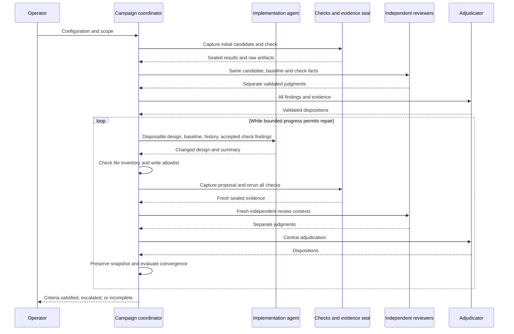
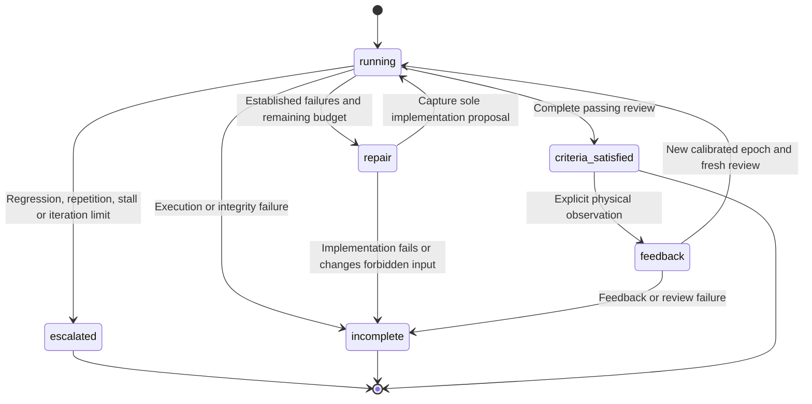

# Campaigns and convergence

A campaign reviews an initial candidate, then lets one implementation agent edit
an isolated copy when adjudication establishes defects. Every proposal becomes a
new captured candidate and receives fresh independent reviews before centralized
adjudication. The source checkout is never the implementation workspace.

Use [standalone review](operator-guide.md) when automatic design edits are not
wanted. Use a campaign only within an authorized repair scope. The
[bench-feedback guide](bench-feedback.md) describes how an accepted campaign
receives later physical observations.

## Configure and start

From the checkout, with the [native prerequisites](installation.md) and selected
subscription authenticated:

```sh
./bin/agent-ee campaign fixtures/closed-loop/campaign.json --out build/my-campaign
./bin/agent-ee verify-campaign build/my-campaign
```

The example uses the version-2 native RC control and an explicit Claude profile.
It spends subscription inference; it is not a dry run. The control is intended
to meet its declared criteria, so it may need no implementation call. New model
responses can still leave the review incomplete. Choose a fresh output path for
every attempt. There is no `resume-campaign`, force-overwrite or retry-until-pass
command.

The configuration schema is `agent-ee.campaign/1`:

| Field | Contract |
| --- | --- |
| `scope` | Path to an `agent-ee.scope/2` JSON file, resolved relative to the campaign configuration; an absolute path is also accepted |
| `review_profile` | Complete `agent-ee.profile/1` object; not a profile filename |
| `implementation` | One harness/model/effort/timeout definition using the profile adjudicator fields |
| `max_iterations` | Integer 1–100, excluding booleans; counts reviewed candidates, including the initial candidate |
| `max_seconds` | Finite number 1–86400; monotonic campaign work budget |
| `max_schema_resubmissions` | Integer 0 or 1, excluding booleans; defaults to 1 per role per iteration and is stored explicitly in captured `config.json`; 0 preserves a single call |
| `implementation_steps` | Optional list of `agent-ee.stage-step/1` declarations, run by the coordinator after each writer session; in a staged campaign only the earliest failing stage's steps run; see [stage receipts](stage-receipts.md) |
| `placement_adapter` | Optional `agent-ee.placement-adapter/1` declaration for staged scopes with a placement stage; see [placement adapter](placement-adapter.md) |

See the [complete executable configuration](../fixtures/closed-loop/campaign.json)
and [profile field rules](reviewer-profiles.md). The implementation call always
uses `investigate` tool mode. All calls use explicit subscription routes. An
unavailable provider, malformed response or failed implementation does not select
another model or account.

Place `mutable_inputs` in the **scope**, not the campaign configuration. It is a
nonempty list of exact captured file paths; its default is the declared board
and schematic. Every listed path must already exist and must be outside the
immutable baseline file set. The implementation must preserve the complete file
inventory: adding files, deleting files, introducing symlinks or changing any
other input is refused. A repair that legitimately needs a new model, library,
file or criterion requires a deliberately revised scope and a new campaign.

## Bounded output resubmission

A successful reviewer, adjudicator or writer call whose structured output fails
validation may make one separately recorded resubmission. The new call uses the
same captured inputs, profile, schema and prompt, with the exact validation error
appended. The original output remains refused. Witness and citation validators
apply unchanged; the coordinator never repairs or drops a finding. When the
first output has identifiable findings, a resubmission must preserve their IDs.
The adjudicator always receives the same supplied finding set.

Each call has a new preflight receipt against the original pinned environment.
Runtime or policy drift stops the resubmission before dispatch. Authentication,
quota, process failure, timeout, cancellation and incomplete harness streams
are terminal; they never select another provider or account. A second invalid
output leaves the role malformed and the review incomplete. Native checks never
use this mechanism. The existing campaign deadline bounds both calls. If file inputs change between
archival and the next launch, the original refusal stays terminal and its
execution projection records `resubmission_blocked`; no new model call runs.

For the sole writer, the second call can reissue its summary, but its delivered
design must remain byte-identical to the first call's output. Inventory and
immutable-input violations stop immediately without resubmission. Normal repair
iterations still require a fresh candidate, fresh checks and independent review.

`review-attempts/ROLE/N/` retains `response.json`, `execution.json`, `schema.json`,
`prompt.txt` and a copy of that call's `review-work/ROLE/`, including its preflight
receipt, logs and experiments. `N` starts at zero. The role execution projection
records `max_schema_resubmissions`, `resubmissions_used`, `input_identity` and an
ordered `attempts` list with archive paths, execution states, errors and hashes.
Input, finding-set and writer-design changes use the adapter diagnostic
`execution=refused` and cannot be resubmitted. The last call's active workspace
remains at `review-work/ROLE/`; earlier calls'
original bytes remain in their archives. Historical verification checks every
attempt's receipt and archive hashes. Writer archives are inside their
`implementations/N/` directory and are checked by `verify-campaign`;
`state.json` also hashes each writer execution projection in
`implementation_records`.

Bench-feedback reviews and explicit replacement review attempts inherit the
source run's recorded bound. Ordinary standalone CLI reviews keep a zero
resubmission bound. Campaign review
runs record the configured bound in `result.json`; their reviewer execution
records contain the count used. Adjudicator and writer counts are retained in
`adjudicator-execution.json` and `implementation-execution.json` respectively.

## Execution sequence



Initial reviewers execute concurrently, with at most two calls in flight. Each
candidate still gets separate contexts and scratch directories; concurrency does
not prove that models have different blind spots. Reviewers do not receive
campaign history,
implementation prose or other initial judgments. The implementation receives the
baseline, convergence history and accepted **check** findings. It cannot turn its
own summary into evidence of a passing candidate.

## States and stop rules



`feedback` is a diagram step, not a stored campaign state. A pending registered
bench event makes `verify-campaign` return the derived state
`empirical_superseded`; it does not overwrite `state.json` merely by verifying.

The convergence reducer in [convergence.py](../src/agent_ee/convergence.py)
compares iterations within the same calibration epoch, in this order:

1. An incomplete review stops as `incomplete` with `execution_incomplete`.
2. A previously passing check that now fails yields `regression`.
3. Repeating any earlier captured file inventory/hash identity yields
   `repeated_design`. This design identity excludes scope/profile metadata.
4. Any previously nonnegative metric bound becoming negative or disappearing
   yields `metric_regression`. Positive margins may shrink while staying valid.
5. A strict reduction of the failed-check set permits progress, subject to the
   protected passes above. Otherwise, progress requires the same metric-bound
   keys, no new failed check, at least one improved previously negative margin,
   and no worsening previously negative margin. Failure yields
   `no_monotonic_progress`.
6. A complete review satisfying criteria terminates successfully. If no check
   fails but review claims remain unresolved, halt with `unresolved_review_claims`.
7. A remaining defect at the iteration bound yields `iteration_limit`.

The negative-margin non-worsening comparison in step 5 applies when the failed
check set did **not** strictly shrink. The implementation does not optimize a
weighted global physical score. Each margin has its own units and requirement.
A local improvement cannot waive a protected pass or a coupled acceptance bound.

Escalation writes `tradeoff.json` with schema `agent-ee.tradeoff/1`, `reason`,
`failed_criteria`, `protected_criteria`, history and `required_action`. It is a
conservative stop diagnostic, not a proof that no feasible design exists. Inspect
the recorded margins and models; record the engineering decision before starting
a new design space. Execution failure has no physical infeasibility meaning.

## Retained files and verification

```text
CAMPAIGN/
  .campaign-root
  config.json                 # Captured campaign configuration
  profile.json                # Validated review allocation
  state.json                  # State, baseline, allowlist, history and diagnostic
  runs/1/                     # Ordinary review run for the first candidate
  runs/2/                     # Fresh review of a later proposal or feedback epoch
  history/1.json              # Exact original result snapshot for run 1
  history/2.json
  implementations/1/
    inputs/                   # Read-only prior candidate for the implementation
    baseline.json
    review-work/implementation/design/  # Only design proposal workspace
    implementation-execution.json
    receipts/1-<step>/        # Coordinator-run step receipt, when steps are declared
    stage-receipts.json       # Receipt index, anchored in state.json (new campaigns)
    proposal.scope.json
  tradeoff.json               # Present after an escalation
```

Paths are representative; directories appear only when their stage runs.
`implementations/N` uses the number of historical candidates before that repair.
The implementation's writable design copy is checked against the prior captured
inventory after its call. The summary response is schema-validated but does not
replace the actual file diff.

`verify-campaign` verifies configuration/profile consistency, each run's snapshot,
policy/runtime and evidence, baseline equality, the original result snapshot
hashes, the initial mutable-file allowlist, calibration transitions and the
recomputed convergence projection. In campaigns that anchor stage receipts, it
also validates every receipt index and receipt. It refuses the campaign when a
receipt claiming to apply has outputs that differ from the next run's captured proposal. It requires the same implementation/runtime
as the recorded runs, even though it skips their original live-source comparison.
An exit code of 0 means integrity checks succeeded; require the printed state
`criteria_satisfied` for campaign acceptance. An honestly incomplete campaign
can pass integrity verification.

The original judgment in `history/N.json` remains unchanged when bench feedback
later marks that run incomplete. The allowed difference between current and
historical results is limited to the empirical-feedback field, artifact hashes
and outcome. Other post-hoc result changes invalidate campaign history. Ordinary
manual adjudication can therefore make a retained campaign unverifiable; it is
not a supported way to rewrite the campaign's past decisions.

## Writer ownership, budgets and recovery

The root campaign lease encloses supported descendant run mutations. Adjacent
`.NAME.writer.lock` files hold nonblocking OS `flock` leases; files remain after
release. Their existence does not prove a writer is active. The same owning
thread can re-enter a lease; another process or thread is refused. Locks release
on process exit. Do not delete lock files to bypass contention, because another
process can still hold the old inode. See [trust boundaries](security.md).

The work budget is not a hard process-lifetime limit: capture, hashing and file
I/O are not all preemptible. A model call is bounded by its profile timeout and
remaining campaign time. Repeated physical feedback is an explicit new invocation
with its own wall-clock budget, but it does not reset the total automatic repair
iteration allowance. A requested feedback audit can run even after that allowance
is exhausted; a completed audit with remaining defects escalates with
`iteration_limit`, while failed execution remains incomplete. Neither triggers
another automatic repair.

After a failure, inspect `state.json`, the latest run and its execution records.
There is no general campaign continuation command for `incomplete` or
`escalated`. `campaign-feedback` admits an accepted or empirically superseded
last candidate; it is not a generic recovery mechanism. A partial output directory
or already-created next run can prevent another attempt. Preserve those records,
resolve the cause, and start a fresh explicitly configured campaign if needed.
Never edit history, limits or state labels to manufacture continuation.

The opt-in [staged campaign contract](staged-campaign.md) adds declared generation
stages and captured expected-content witnesses to this same campaign. It preserves
unstaged behavior and requires separate owner acceptance of the convergence change.
