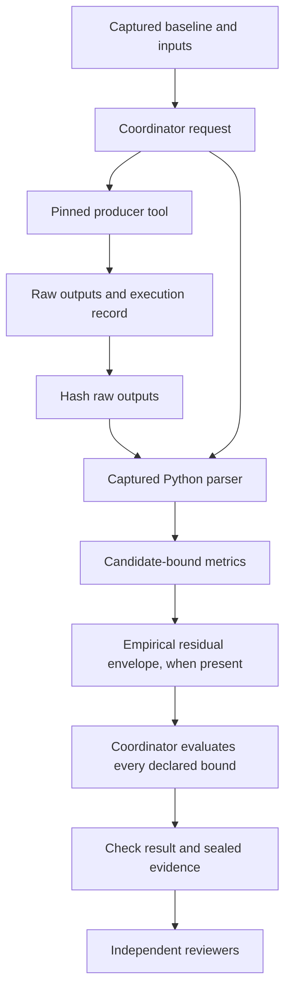

# Measurement tools and coupled margins

`measurements` runs an explicitly declared producer tool and a captured Python
parser, then lets the coordinator apply acceptance limits. `coupled_margins`
combines metrics from earlier checks at the same operating point. Neither check
is a bundled thermal, parasitic, DFM, DFA, DFT or supply-chain solver. Supply and
lifecycle telemetry must be captured before execution because tool sandboxes
have no network.

These check kinds are accepted by legacy scopes too, but the immutable baseline,
evidence seal and strict adjudication contract require
[`agent-ee.scope/2`](scope-reference.md#version-2-baseline).
The [native-check reference](check-reference.md) describes the built-in KiCad and
passive SPICE paths.

## Producer, parser and acceptance boundary



The producer and parser run separately. The candidate and baseline are read-only
in both sandboxes. The producer's `/work/request.json` is read-only; its other
scratch files are writable. The parser sees its request and `/work/tool` mounted
read-only, with writable scratch elsewhere under its own `/work`. The coordinator
also rechecks request and raw-output hashes after parsing. A parser cannot rewrite
those records to conceal the actual producer input or output.

The declared tool and parser are still trusted engineering programs. Hashes prove
which bytes ran and preserve their outputs; they do not prove the physical model
or that a parser extracted the correct number. Validate each tool/model/parser
against independent expected outputs before using its metrics for design approval.
System libraries are not a hermetically captured runtime image.

## Check configuration

The following is a **structural fragment**, not a standalone runnable scope. The
captured adapter and model paths, installed executable hash, operating condition
and bounds must describe your validated toolchain.

```json
{
  "id": "thermal",
  "kind": "measurements",
  "params": {
    "adapter": "analysis/parse_thermal.py",
    "tool": {
      "argv": ["/usr/bin/python3", "/candidate/analysis/thermal_model.py"],
      "sha256": "REPLACE_WITH_INSTALLED_EXECUTABLE_SHA256",
      "domain": "thermal",
      "inputs": ["analysis/thermal_model.py"]
    },
    "parameters": {"ambient_degC": 85},
    "calibration_inputs": ["analysis/thermal_constants.json"],
    "timeout_s": 600,
    "limits": {
      "peak": {"unit": "degC", "condition": "full-load", "max": 125}
    }
  }
}
```

| Parameter | Meaning and validation |
| --- | --- |
| `adapter` | Required safe captured relative path; executed with system Python |
| `tool.argv` | Required nonempty array of nonempty strings; argument vector, not a shell command or interpolation template |
| `tool.argv[0]` | Absolute executable path whose resolved location is under `/usr`; available inside the sandbox |
| `tool.sha256` | Digest of the installed executable; checked before and after tool execution, and during run verification |
| `tool.domain` | One of `electrical`, `thermal`, `parasitic`, `manufacturing`, `supply_chain` |
| `tool.inputs` | Captured program/dependency paths; included in the scope/2 immutable baseline and empirical model applicability; omitted means no additional declared program inputs |
| `parameters` | JSON data forwarded in the request, default `{}`; interpreted by the producer/parser, not a generic parameter schema |
| `timeout_s` | Per producer/parser call ceiling, default 600 seconds, capped by remaining run time; use a positive finite value |
| `limits` | Required nonempty object keyed by metric name; each entry declares exact unit, condition, and at least one finite numeric `min` or `max` |
| `calibration_inputs` | Captured model applicability paths; a nonempty list is required before ingesting bench observations for this check |

For the installed Python example, obtain the executable digest with
`sha256sum /usr/bin/python3`. The digest belongs to the executable, not the
adapter. Captured file identities already bind the adapter/program bytes.
An executable outside the allowed path is refused; copying a binary into the
candidate does not make it an allowed `argv[0]`. No general environment-variable
or solver-license interface is exposed by this check.

The producer starts in its own `/work`, with the same request available there.
Arguments must explicitly name any required input/output paths; the coordinator
does not append filenames to `tool.argv`. Captured programs live at
`/candidate/<path>`. Write raw outputs into `/work`. The parser is invoked as:

```text
/usr/bin/python3 /candidate/<adapter> /work/request.json /work/measurements.json
```

This shows the emitted sandbox command, not a host command to paste literally.
The producer and parser each get their own timeout; the enclosing review deadline
still limits total work. Invalid timeout types are not comprehensively validated
at scope-load time, so they must not be used as meaningful acceptance settings.

## Request and report contracts

The coordinator writes `agent-ee.measurement-request/1` with:

| Field | Value |
| --- | --- |
| `candidate_id` | Captured candidate identity |
| `files` | Complete captured relative-path → SHA-256 inventory |
| `baseline` | Complete structured baseline for scope/2; `null` for legacy scope/1 |
| `parameters` | Declared check parameters payload |
| `empirical` | Validated retained calibration bundle, or `null` |

The parser writes `agent-ee.measurements/1`. This structural response example
copies identity from the actual request rather than inventing it:

```python
import json
import sys
from pathlib import Path

request = json.loads(Path(sys.argv[1]).read_text())
# This example assumes a validated producer emits one numeric peak_degC value.
raw = json.loads(Path("/work/tool/thermal.json").read_text())
report = {
    "schema": "agent-ee.measurements/1",
    "candidate_id": request["candidate_id"],
    "files": request["files"],
    "domain": "thermal",
    "artifacts": ["tool/thermal.json"],
    "metrics": {
        "peak": {"value": raw["peak_degC"], "unit": "degC", "condition": "full-load"}
    },
}
Path(sys.argv[2]).write_text(json.dumps(report))
```

The snippet is an adapter template requiring that producer contract and the
sandbox arguments above. It is not a validated thermal model. Optional report
`tool` and `version` descriptions are informational; the coordinator's producer
record establishes tool identity. The report domain must equal the configured
domain. `candidate_id` and `files` must exactly equal the request.

`artifacts` is a nonempty list of safe paths relative to the parser workspace.
Each must be among the recorded producer files, under `tool/...`;
`tool/request.json` cannot be used as the cited producer output. A parser-created
replacement log outside `tool/` is refused. Producer symlinks are refused.
All regular producer files are hashed and retained, not just those the parser
chooses to cite.

`metrics` is a nonempty object. Every metric needs a finite numeric `value`
(booleans are refused), nonempty `unit`, and nonempty `condition`. No automatic
unit conversion or condition equivalence is attempted. Every configured limit
must find its metric. Additional unbounded metrics can be retained as information.
An interval can provide finite `lower` and `upper`; it must satisfy
`lower <= value <= upper`. The checks evaluate minimum bounds against `lower`
and maximum bounds against `upper`, falling back to `value` for absent endpoints.
Bench calibration constructs its own intervals from nominal values; see
[empirical interpretation](bench-feedback.md#residual-envelope).

## Margin and result semantics

For minimum bound `a` and maximum bound `b`:

```text
min margin = lower - a
max margin = b - upper
```

Bounds are inclusive. Zero margin passes; a negative margin is a defect. A
valid producer/parser execution with any failed bound is `ok/defect`.
Missing metrics, nonfinite values, reversed bounds, mismatched units/conditions,
wrong identities or malformed reports do not become a design pass. A failed
producer or parser has unknown coverage and its execution diagnostics remain.

The check details retain `producer`, `metrics`, `margins` and, when applicable,
`empirical_cases`. Producer metadata includes the exact argv, executable hash,
domain, execution record and raw-output hash inventory. The run stores:

```text
work/CHECK_ID/request.json
work/CHECK_ID/tool/request.json
work/CHECK_ID/tool/execution.json
work/CHECK_ID/tool/stdout.log
work/CHECK_ID/tool/stderr.log
work/CHECK_ID/tool/<producer outputs>
work/CHECK_ID/execution.json          # Parser execution
work/CHECK_ID/measurements.json       # Parser report
work/CHECK_ID/bench-replay.json       # Only when calibrated cases apply
checks/CHECK_ID.json
```

Console files also exist according to the executor. Files are written as stages
complete, so failed runs need not contain every listed output.

## Cross-domain coupling

A coupling check must follow its source checks in the ordered scope. This
fragment assumes executed `thermal` and `layout` measurement checks already
produce `peak` and `loop_L` at exactly `full-load`:

```json
{
  "id": "thermal-layout",
  "kind": "coupled_margins",
  "params": {
    "condition": "full-load",
    "members": [
      {"name": "temperature", "check": "thermal", "metric": "peak"},
      {"name": "inductance", "check": "layout", "metric": "loop_L"}
    ],
    "limits": {
      "temperature": {"unit": "degC", "condition": "full-load", "max": 125},
      "inductance": {"unit": "nH", "condition": "full-load", "max": 8}
    }
  }
}
```

At least two members and at least two distinct producer domains are required.
Member names must be unique and exactly match the limit keys. Each source must
belong to the current candidate and have execution `ok`; a source with a measured
defect may still supply its valid metric. A missing, failed or future source is
refused. `rc_transient` exposes the `electrical` producer domain in scope/2 and
can be a source. Ordinary ERC/DRC/geometry results do not provide this scalar
producer/metric contract automatically.

`work/CHECK_ID/coupling.json` retains complete source check facts, the joined
metrics, domains and condition. Limits are conjunctive. For example, 110 °C and
9 nH under the limits above fails despite ample thermal margin. The coupling
check does not solve a feedback equation or infer a parasitic network: the
producer tools must compute physically coupled behavior from qualified models.
The coordinator then exposes and evaluates those results consistently.

## Adapter qualification and failure investigation

Before adding a producer, establish its input completeness, units, operating
conditions, known independent answers and unsupported behavior. Include captured
programs, model data and telemetry snapshots in the scope. Test a known pass,
known physical-limit failure, missing output, solver failure and malformed parser
result. [Measurement tests](../tests/test_measurements.py) demonstrate protocol
and isolation boundaries with synthetic fixtures; they do not qualify your tool.

On refusal, inspect the producer execution first, then the parser execution,
raw outputs and report. Correct the configuration or adapter and create a new
scope/run. A captured adapter change alters the baseline and cannot be introduced
by the campaign implementation agent as a way to make a candidate pass.
