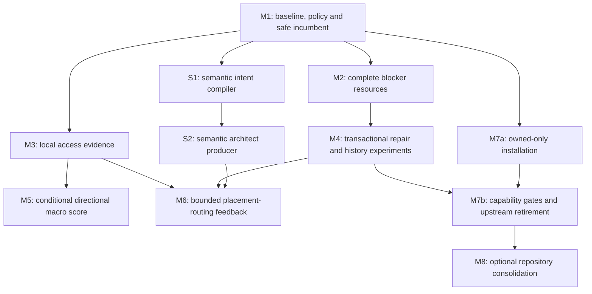

# Routability design and implementation plan

2026-10-21. Proposed implementation for agent-ee and kicad-route. This run inspected source, research and retained results, and performed bounded diagnostics. It changed no production algorithms. **Proposed** marks new paths, interfaces and fields. Measurements below are observations; improvement targets are provisional unless an existing release contract is cited.

Later execution update, 2026-10-21: KICADROUTE-90 has released the campaign eligibility part of M1; KICADROUTE-91's identity/policy/native-terminal gates remain unfinished. K at `3ae2c036d1f5ba8d0b717adc0db7a5f42c53fe5b`, `reports/routability-m1-20261021/{README.md,historical-audit.json}`, reconciles the ten alleged lost nets as a capped-report extraction error, as qualified in §2.5 below. Source tables and original PR instructions otherwise describe the investigated revisions. The [GPU experiment report](2026-10-21-gpu-pcb/README.md) adds measured CPU/GPU comparisons and implementation gates without delaying correctness work.

## 1. Executive recommendation

Make the **owned kicad-route backend the destination for routing, repair and escape functionality**, as directed by the owner during this investigation. Freerouting is a temporary comparison backend. New capabilities must not depend on a Freerouting upgrade, a KRT upstream branch or an external routing service. KiCad remains the native connectivity, zone-fill and DRC authority.

The **semantic architect** is the pre-placement agent in this architecture. It reads captured schematic, datasheet and owner intent, proposes functional grouping, critical electrical relationships and permitted physical choices, then a deterministic compiler emits the existing executable contracts. The constructive placer and owned router solve geometry under those contracts; a diagnostic agent proposes scoped revisions from evidence. Model confidence never overrides a failed native check. See §4.8 and S1/S2 for the compiler and orchestration work.

Repository separation is temporary. Keep the current CLI/receipt boundary useful while algorithms mature; a later history-preserving consolidation into agent-ee is allowed and planned in M8. No network service or permanent split is required.

Implement the following dependency order:

1. M1: qualify the baseline, bind actual layer policy, and correct incumbent eligibility. Reuse existing grading, provenance, campaign and corpus infrastructure.
2. M2: fix resource coverage in the existing relaxed blocker probe. A synthetic diagnostic reproduces its omission of span-based tracks.
3. M3: add local copper-access evidence before block compaction/freeze, then experiment with legal orientation and reseat selection.
4. M4: make bounded repair cohorts transactional and ablate existing history versus rip-up. Keep exploratory state separate from the native-validated incumbent.
5. M5/M6: conditionally add soft directional macro traffic scoring and bounded placement/routing feedback, after the individual features demonstrate value.
6. M7: remove mandatory upstream-router installation/health dependencies, close demonstrated capability gaps in the owned backend, and retire the Freerouting execution lane after acceptance gates pass.

S1 (semantic intent compiler) can proceed alongside M2 and M3 after M1; S2 adds the agent producer after S1. M2 and M3 can proceed in parallel after M1. M7's owned-only installation mode can also proceed independently after M1's identity contract. Full retirement follows M4 and the capability corpus. No change to required widths, clearances, via/drill rules, expected connectivity, fixed poses or electrical constraints is an algorithm improvement under this plan.

Three findings change the research's proposed roadmap. The owned router already has history and selective rip-up, and both ran in the plateau. The historical 203/235 result routes signals on all four copper layers and introduces a dangling via, so it is not a policy-conforming success. Its reported loss of ten input-complete nets was later traced to capped-report extraction; it is not a demonstrated copper regression. Finally, a 0.26 mm courtyard gap does not imply a 0.26 mm copper gap: an actual failed eFuse pin has a measured 0.755 mm gap to the nearby ground pad. Add evidence and fix existing mechanisms before adding another solver.

## 2. Current architecture and baseline

### 2.1 Source identities and investigation scope

| Alias | Repository | Inspected source revision |
| --- | --- | --- |
| A | `/home/halbritt/git/agent-ee` | `8f6e05e89579a8823d2fa34180f62c1273d2c10e` |
| K | `/home/halbritt/git/kicad-route` | `557ae5758c06b050508dd8016f5c7b6abc2a83f8` |
| F | `/home/halbritt/git/fome-mc` | `19522e37de01103a93fe171a09fe624d8aba6bad` |

Paths below are relative to these aliases. The checkouts were clean at investigation start. User-supplied AGENTS instructions govern; no additional AGENTS.md was found for A/K. F’s AGENTS.md was read and preserves native KiCad authority, snapshot checks and sourced geometry/rule constraints. A uses topic documents under `docs/` and dated research under `docs/research/`. This document follows that convention. Concurrent A commit `417efb4d4918fec2679c62a160454eb431c473b2` changed only the Google PDF, not the inspected code; its replacement is accounted for in the source-reading note below. The focused semantic audit also checked A `2601dcc95c1274b8039eb94478134ac93342fdd1`; §4.8 names the contracts verified there. These identities describe the audit, not a claim that moving main is frozen.

Research citations:

| ID | Original input | Locators |
| --- | --- | --- |
| M | [PCB routability placement and routing.md](<2026-10-21-routability-brief/PCB routability placement and routing.md>) | §§1–5, ranked recommendations, gaps |
| P | [Prior Art for Routability-Driven PCB Placement and Congestion-Aware Detailed Routing.pdf](<2026-10-21-routability-brief/Prior Art for Routability-Driven PCB Placement and Congestion-Aware Detailed Routing.pdf>) | 14 PDF pages |
| G | [PCB Placement and Routing Research - Google Docs.pdf](<2026-10-21-routability-brief/PCB Placement and Routing Research - Google Docs.pdf>) | section names; page-version note below |

All three originals were read in full. The owner later supplied [Unified agentic PCB architecture](2026-10-21-routability-brief/unified_agentic_pcb_architecture.md), cited as U; it was also read in full and preserved unchanged from `/tmp/unified_agentic_pcb_architecture.md`. A fifth owner-supplied input, [Next-generation concepts Rev 2.0](2026-10-21-routability-brief/next_gen_agentic_pcb_concepts_rev_2_0.md), cited as N, was read in full and is reconciled in §3.1. It is preserved unchanged from `/tmp/next_gen_agentic_pcb_concepts_rev_2_0.md`. PDF extraction used `pdftotext -layout`; the original G was 26 pages and lost mathematics in extraction. Rendered pages 2, 7, 8, 10, 11, 14, 16 and 19 were inspected. Some original expressions were clipped by page layout, including a halo tail and a cost expression; no unreadable expression was reconstructed. Markdown siblings were navigation aids, not substitutes for reading the PDFs. The refreshed G at `417efb4` has SHA-256 `7117f84cfac2e507a17d9f7efe47fb8a468f41e61e8f5249482ea2043559d1ef`: pages 1–25 have identical extracted text; page 26 changes whitespace only. Relevant pages were rendered again; formulas and clipping are unchanged, so the 26-page locators remain valid.

K `src/kicad_route/router/UPSTREAM.json` records base KRT v0.23.1 `295f9ee197517e8323726853361eb137cc08ba9e`, fork `0494a05e30063b849c9cf1b9ac02098073d82216` and selective later adoption. That provenance does not describe arbitrary current upstream code. Executed generation `.router-generations/84b30dc286f44df6b465ae8d40aa1363` and current owned source both hash to `89a2efbf53057a0694b3cef365ec3acdc01b61f5f57d86bfbe8a62dc8f11db6d`; extension SHA is `a68e93acff252282e8836b0ac33e1347684f66db7af5633c90afd326fa9d60a6`. Installation commit and wrapper HEAD differ. K `engine.identity`, `engine.source_sha256`, `statemanifest.build_id` and `execution_build_id` already expose the relevant distinction. Record hashes, not just a wrapper revision.

Native tools are KiCad/pcbnew 10.0.7 and Python 3.12.3. Installed Freerouting v2.5.0 is build `b647a2f824cfbc54bc4dcaee71b03b7cd945eb76`, JAR SHA `f6f51bb02245e8e717f9359bd260cc9c5c0b1bc0acc8b7cb2cd5b8ffeb5de3c7`, Java 25.0.4.1. Relevant source was checked at that build.

### 2.2 agent-ee architecture

| Responsibility | A paths and symbols | Verified behavior / missing capability |
| --- | --- | --- |
| Geometry and transforms | `placement_probe.py::extract`, `placer.py::transform`, `_move_geometry`, `_qualified`; `blocks.py::frame_member`, `_local`, `pad_geometry_sha256` under `src/agent_ee/` | Integer nm, saved pad poses and qualified quarter turns. `placer.transform` preserves the captured side; `placement_adapter._flip_pad/_flip_follows/_native_custom_flips` qualify side flips. Use these instead of component-centre rectangles. |
| Constraints and legality | `placer.py::_hole_conflict`, `_fits`, `_near`, `_keepout_blocked`, `_initial_reservations`; `placement.py::judge`; `electrical_locality.py` | Courtyards, fixed poses/overhangs, holes, owned keepouts, outline, sourced pad-locality and group constraints exist. Native DRC gates the saved/reloaded board. |
| Candidates/scoring | `placer.py::_candidate_axes`, `_wire_cost`, `_wire_bounds`, `_ranked`, `_Search.scan` | Deterministic axes from outline/reservations/locality windows, four quarter-turns; Manhattan same-net pad-distance score with declared ground exclusions. |
| Backjumping | `placer.py::_Search.push`, `pop`, `blockers`, `scan`, `place_unit`, `_locality_clusters` | Incremental reversible search and conflict backjumping already exist. Timeout/finite search exhaustion are unknown, not infeasibility proofs. |
| Blocks/freeze | `blocks.py::derive`, `net_roles`, `pack_block`, `_recover`, `_compact`, `candidate`, `admit`, `match` | Anchor-based isolated packing, recovery for stranded plane-only members, area compaction, rigid `agent-ee.block-candidate/2` with geometry/net/policy binding. Local routing access is not certified before freeze. |
| Macro arrangement | `block_arrangement.py::admit_entry`, `_macro`, `_shift`, `_Arrangement`, `_order`, `_net_counts`, `arrange`, `grade_rules`, `provenance_artifact` | Places admitted rigid macros using four quarter-turn orientations, member slabs/shadows/holes and cached pose geometry, then packs residuals. It admits one internal candidate per block; choosing among alternate internal layouts is new work. |
| Congestion/advice | `placement_congestion.py::pad_shapes`, `clearance`, `Board`, `rotation_issues`, `congestion_cells`, `analyze` | Pad clearance helpers, MST-box RUDY, area capacity, Poisson estimate, free-space/move/rotation advice exist. Probability is uncalibrated; supply lacks a complete rule/layer/via model. |
| Feedback/integration | `placement_adapter.py`, `placer_runner.py`, `routing_adapter.py`, `kicad_route_attempt.py`, `placement_plans.py` | Existing writer contexts, saved-board gates, layer/pour checks and planning scaffolding. Actual route-aware block ranking/targeted feedback remains incomplete; do not introduce another coordinator. |

Supporting docs: A `docs/placer.md`, `blocks.md`, `placement.md`, `placement-congestion.md`, `placement-adapter.md`, `routing-adapter.md`. The congestion check's caller-declared `max_failure_probability` may create an advisory defect that blocks review, but it is not a calibrated physical bound or acceptance predicate. Omit that threshold in new experiments; preserve old record semantics. Its simple width/clearance inputs and pad-box free-area model cannot certify custom rules, holes or all legal layer transitions.

### 2.3 Owned routing architecture

Engine Python paths below are K `src/kicad_route/router/py_router/`; Rust paths are `src/kicad_route/router/rust_router/src/`.

| Responsibility | Symbols / files | Behavior and limitations |
| --- | --- | --- |
| Wrapper | `src/kicad_route/cli.py::krt_route`, `KRT_FLAGS`, `KRT_ENV` | Owned source, strict sizes, escalation off, no power neckdown or DRC-setting fixes; disables cap moves and several relaxations. Keep these guards. |
| Connectivity | `kicad_parser.py::local_to_global`; `connectivity.py::endpoint_reaches_pad`, `via_copper_layers`, `endpoint_reaches_via`; `improvement_gate.py::net_connectivity_map` | Copper/layer-aware endpoints, via spans, multi-pin components and MST/taps exist. Some legacy approximations remain. Internal pad deficits are not native remaining connections. |
| Grid/obstacles | `obstacle_map.py::build_base_obstacle_map`; `obstacle_cache.py::NetObstacleData`, `precompute_net_obstacles`, `refresh_net_obstacles`; Rust `obstacle_map.rs::GridObstacleMap` | Pads, edges/cutouts, keepouts, tracks, holes and via rungs; clearance-inflated dynamic reference counts separate from static obstacles. Segment capsules use spans. Through vias see obstacles on all physical layers. |
| A* | Rust `router.rs::GridSearch`, `GridRouter`; `routing_config.py::GridRouteConfig` | Weighted octile A*, eight directions, turn/via/layer/proximity/attraction costs. Defaults: 0.1 mm grid, weight 2.3, 200,000 iterations. No shortest-path guarantee. Explicit `--layers` preserves full-stack obstacle visibility; omission activates all copper. |
| Ownership/state | `routing_state.py::RoutingState`; `rip_up_reroute.py::rip_up_net` | Net→geometry/cache, results, paths, queues, ghosts, ancestry and casualty custody exist. Add bounded inverse resource queries, not a new routing database. |
| Blockers/repair | `blocking_analysis.py::analyze_frontier_blocking`, `rank_blockers`, `mincut_probe_order`; `single_ended_loop.py::route_single_ended_nets`; `reroute_loop.py::run_reroute_loop`; `phase3_routing.py` | Frontier attribution, default N=1…3 victim ladder, reanalysis, tried sets, reroute queue and ancestry guards. Default selection `count`; optional relaxed `mincut` is not formal min-cut. |
| History | `history_congestion.py::HistoryField`, `reset_history`; `routing_context.py`; `congestion_field.py` | ON: increment .1 mm-equivalent, cap .5, rip weight1, frontier weight.25, escalation0, max500,000 cells. Density/demand congestion fields exist but default OFF. Reset each batch, including nested calls/campaign subprocesses. |
| Protection/restore | `src/kicad_route/provenance.py`, `protected_nets.py`, `rip_up_reroute.py::restore_net`, `leg_rip.py` | `protect existing` freezes input but not new in-run copper. `protect human` can free earlier agent copper. Restore can refuse occupied corridors and leave a victim open. Branch rip is OFF and needs lifecycle tests. |
| Best result | `route.py` improvement gate; `src/kicad_route/campaign.py::rank_key`, `Campaign.best`, `record` | Internal aggregate gate may trade lost/gained nets and skip on exceptions; wrapper is stricter. Campaign already retains chains and grades against origin, but can rank a fewer-open DRC-invalid candidate above a clean incomplete one. |
| Native grading | `cli.py::validate`, `kicad_drc`; `provenance.py::net_completion`; `pour.py`, `kicad/pour.py`; `blocked.py::write_report` | Original rules restored, zones refilled/saved, all-severity DRC/parity, hashes, preservation, sizes, scope, connectivity and pour integrity. `blocked/2` is explicitly a straight/L-corridor heuristic. |

r0's first batch recorded 154 contest, 85 rip and 166 frontier events over 392,392 cells, with 0.64 s history upkeep. Three nested batch resets created further fields. Both history and victim movement were active. Local rejected repairs currently retain history; separate batch calls lose it. Neither behavior establishes an optimal lifetime.

### 2.4 Freerouting and upstream independence

K `cli.py::freerouting_route` uses native DSN export and SES import through `kicad/specctra.py`, strips SES placement, restores locks, translates selected scopes/supported class rules, then uses the same native grade. Arbitrary custom rules and other bridge limitations remain. Its counts are diagnostic.

At the installed revision, `FoundConnectionInserter.insertFanoutMicroNeckdown` can narrow fanout traces even with automatic neckdown disabled. The adapter therefore disables fanout. `BatchFanout` accepts `surroundingsDensity`; pinned documentation says `surroundings_density`, which does not select the intended ordering. Master's `DirectPinRouting`/`direct-first` pipeline is absent. Installed code already has pass-dependent rip-up cost, stagnation shuffle and `LastMileBlockerRipup`; describing it as no-repair is false. No Freerouting fork or feature work is selected.

Owned routing already needs no external KRT checkout or prebuilt selector. `installation.install` copies owned source into an immutable generation, installs dependencies, runs `build_router.py` with locked Cargo build, validates startup and atomically selects the manifest. Remaining Freerouting coupling is operational: `cli._update_locked` updates it, doctor requires Java/JAR, smoke/canary include it, and sandbox/manifest support it. M7 removes those requirements for an owned-only installation before deleting the comparison lane.

### 2.5 Board constraints and results

The research target is the expanded **90×65 mm, 309-footprint, 235 multi-pad-net, four-layer microSD telemetry pod**. It is not the older 80×50 mm pod in A `docs/pod-routing-policy-determination.md` or the retired 194-net eMMC board. F `telemetry-pod/expansion/design-rules/constraints.json` records Default .20 mm track/clearance and .60/.30 mm via/drill, separate board floors/fine-pitch rules and RF width. Use actual `.kicad_pro`/`.kicad_dru`; these examples are not universal constants. D-PCB-15's thinner eFuse class was withdrawn.

Fixed features include the right-angle 35-position AMPSEAL J1, mounting holes, IMU constraints, RF reference corridor, U1 antenna overhang/keepout and J3 card access. D-PCB-13 v3 now fixes J3 at (8.9,32.0) B,90°, mouth off the left edge; iteration-7 used the earlier card lane. A changed placement cannot count as a router-only improvement.

D-PCB-7 v2 records **SIG/GND/PWR+SIG/SIG**: In1 no signal tracks, In2 signals around +3V3, plus the RF inner-layer no-track/no-via corridor. It lives under `decisions_pending_next_seed`. Native inspection of the iteration-7 silk board found **zero rule areas**; its plane stage added zones, not those exclusions. M1 must create a distinct corrected-policy diagnostic input, retaining any stricter policy of a newer candidate. Layer type alone is not electrical intent.

Let `R = F/telemetry-pod/expansion/routing-diagnostic/iteration-7/`. Committed receipts and live boards/logs under `/home/halbritt/.cache/agent499-microsd/iter8d/route/runs/candidate/` were inspected.

| Result | Input/settings | Native outcome and limitation |
| --- | --- | --- |
| `R/candidate/iter8d-campaign-r0/` | Input PCB SHA `67782a5d8ff7ce3c21dbe90b6f50c2735e4827231f3f474c9db4522de43ca73f`; 900 s budget;316.338s backend, about342s chain; protect existing; rescue/finalize off | 55 remaining connections, 32 incomplete nets: reported 203/235. One new `via_dangling`; `net_completion` FAIL for ten nets. |
| later hard-first rounds | Same campaign; changed scopes/order; 900 s/run,3300s campaign | 59/64 remaining connections and 45/47 incomplete nets; 3/9 new findings. Order sensitivity, not impossibility evidence. |
| `R/candidate/iter8d-fr-leftovers/` | Input is r0 validated PCB SHA `471ffb9b5a1ebf7ae7100d59582c1a0bcbfb8666a053f9029eb8603e88bf430e`; 1500 s job; 1562.413 s process | 51 remaining connections, 30 incomplete nets: 205/235. Zero new findings **against r0**, 24 total; inherits dangling via. Not matched A/B or origin-valid evidence. |

r0 project SHA `7c7933bf09fad1617887d95dce24ae2b994737bf4cc46c20662e447561515b74`; rules SHA `ff62208301c38bca2c963a0682e0a2ee843d8a546bace3719340cfcca1b08d0d`. Its 4,497.724 mm new track is F.Cu 1,970.922 / B.Cu 1,640.772 / In1.Cu 481.680 / In2.Cu 404.350 mm, with 412 vias. Excluding GND/+3V3 still leaves 425.579 mm on In1 and 393.615 on In2. `work/krt.log:15` gives all layers cost 1; command has no `--layers`. These are not two-signal-layer results.

Raw r0 DRC has 18 library-footprint issues, 5 footprint mismatches and 1 dangling via. Wrapper input-complete count 155 and ten lost nets need reconciliation against the same refilled input. Historical prose calls some false/precarious; this plan does not dismiss them. Copper can preserve old tracks while breaking filled-zone contact. A failing preservation check remains a failure until a grader defect is demonstrated.

Subsequent native audit, K `3ae2c03`, `reports/routability-m1-20261021/historical-audit.json`: on the exact saved/refilled input SHA `67782a5d...`, native pad-UUID components show 182 incomplete nets and 53 complete nets. All ten wrapper-reported lost nets were already incomplete; neither historical result loses any of the 53 complete nets. KiCad 10.0.7's 499-item unconnected-report cap caused the wrapper's absence-based completion inference to overstate origin completion. Treat the old `net_completion` FAIL above as an observed grader output, not established net loss; fix that extractor separately. The audit also identifies six footprint-owned keepouts (U1/J3), despite zero board-owned rule areas. These findings do not qualify all-layer routing, remove the new dangling via or supply missing policy/schematic identity.

`baseline_unconnected_total=499`, engine regrade of 182 owned nets/150 successful, and 235 multi-pad nets are different quantities. Freerouting backend counts also differ from KiCad. Independent example: K `reports/fixture/freerouting_round_trip.json` is native COMPLETE/PASS with zero opens while Freerouting reports one incomplete connection. Reuse native metrics; do not add another extractor based on engine summaries.

Older eMMC, iteration1/3/5 and patched-via runs differ in netlists, rules, placements, planes or budgets. Keep them as history, not recovered-net measurements. No expensive campaign was rerun here.

### 2.6 Worked failures and diagnosis boundaries

**Actual intra-block failure:** `/SENSOR_POWER_FRONT_ILIM`, U23.7 at (16.955313,24.995)mm. F.Cu pad box x16.815313…17.095313,y24.57…25.42; C87.2 GND box x16.460313…17.360313,y26.175…27.125. Native effective-polygon separation is **0.755 mm**, above the 0.6 mm example for a 0.2 mm trace with 0.2 mm clearance each side. Adjacent U23 pins have 0.5 mm pitch / 0.28 mm width, leaving only 0.22 mm. A 1 mm straight outward ray hits C87.2, but short outward-then-sideways paths clear the inspected other-net F.Cu pad polygons at minimum 0.330 mm centreline spacing versus 0.300 mm required. This is a pad-model witness, not a native-validated route: tracks, vias, holes and full rules still need checking. It refutes deriving impossibility from courtyard gap and motivates bend-aware access candidates.

**Actual inter-block repair:** r0 `work/krt.log:1039–1114`, `/GNSS_PPS`: forward 262 / backward 5,000 iterations; 64 frontier cells, 11 attributed to `/TIRE_CAN_CS` and `/IMU_INT1`, 53 unattributed. Removing `/TIRE_CAN_CS` still failed. Reanalysis changed victims to `/DIAG_U28_AIN2`, then `/DIAG_I2C_SCL` and `/DIAG_I2C_SDA`, reaching three. Restores of net IDs 87 and 51 were refused because corridors had become occupied. Blocker movement already exists; atomic failed-trial recovery does not. Search failure does not prove geometry impossible.

**Connector:** older `blocked-by-input.json` reports blocked straight/L corridors at J1 and several ICs. Current fixed connector/holes are a required regression fixture, but no exhaustive current J1 access proof or isolated connector ablation was found. Do not attribute all plateau opens to it.

**Confirmed synthetic implementation defect:** a native-map diagnostic for a 0.2 mm track (1,2)→(3,2), 0.1 mm grid, 0.2 mm clearance and 0.6/0.3 mm via produced 0 explicit cells, 27 track spans and 185 expanded cells. `blocking_analysis.mincut_probe_order` returned `([],True)` without search because it reads only `blocked_cells`. Mixed objects can instead be removed fully but only partially priced/attributed. This is a demonstrated representation bug, not a measured pod recovery.

Failure records distinguish proven geometry conflict, exhausted access candidates, removable-copper contention, static/unattributed blockers, search budget, grid artifacts, connectivity disagreement, bridge/DRC mismatch and unknown. A failed search or high demand score alone never proves physical impossibility.

## 3. Research decision matrix

Evidence labels: P=established primary mechanism; V=verified code/artifact/diagnostic; H=adaptation needing experiment; U=unsupported. Reports agreeing is not independent validation.

| Concept; research locator | Failure and evidence | Fit / existing implementation | Benefit, cost, risk | Recommendation; smallest experiment |
| --- | --- | --- | --- | --- |
| Local copper access; M §§1,2,4; P pp3–6,9–10; G §§1,2,4 | Trapped terminals. P geometric throat; V U23 bent-access witness. | `blocks.pack_block/_compact`; existing pad/transforms, missing full access contract. | High diagnostic value; medium effort; false rejection risk. | Implement diagnostics then soft selection. Original vs legal passive flip/reseat under identical router. |
| Demand/capacity; M §§1–2; P pp2–6; G §2 | Corridor contention. P demand/supply; H PCB capacity. | Existing MST RUDY/area model; need per-class/layer intervals. | Possible macro gain; medium geometry cost; double counting risk. | Experiment after access. Rank a few legal arrangements; compare native connections. |
| Directional spacing; M §2; P pp4–6; G §2 | Global gap wastes mechanical space. H side assignment. | Reuse axes/slabs; courtyard remains separate assembly constraint. | Potential space gain; overreservation/packing failure risk. | Soft candidate offsets. Count shared corridor once; no universal hard ceil(n/L) rule. |
| Crossing/orientation; M §1; P pp3–4; G §1 | Similar HPWL can hide crossing. P Cypress example. | Quarter turns/MST rotation advice exist. | Low arithmetic cost; legal detours/layers confound. | Soft tie-break ablation on same-bbox 0°/180° fixture; never hard veto. |
| RUDY/pin density; M §1; P pp2–4; G §1 | Aggregate load/concentrated pins. P RUDY; V existing advisory. | Reuse current implementation; Poisson uncalibrated. | Low reuse cost; misses exact access. | Access-only vs RUDY-only vs combined; no new subsystem. |
| Selective repair/history; M §3; P pp7–9,12; G §3 | Contested early ownership. P PathFinder; V active history/rip ladder. | Extend existing A*, ownership, queue. | Potential completion gain; high rollback/connectivity risk. | Fix resource coverage/transactions, then rip×history ablation. No convergence claim. |
| Relaxed proposal; same | Finds removable owners. H PCB adaptation; V optional probe bug. | Clone existing map; fixed obstacles stay hard. | Better victim proposals; not true min-cut. | Span/via fixture identifies every crossed owner; proposal never exported as copper. |
| Escape/fanout; M §4; P pp9–10; G §4 | Scarce exits/via sites. P package access; H pod benefit. | Owned escapes/taps exist; FR fanout risks width. | May help or consume channels; new solver costly. | Reuse direct-first local routing/access candidates; defer rigid fanout/flow subsystem. |
| Plane use; M §§3–4; P pp6,8–10; G §§3–4 | Capacity vs reference/power integrity. V policy mismatch. | Layer/pour guards exist. | Completion can rise by violating electrical intent. | Preserve actual policy; filled connectivity required. Reject plane jumpers as algorithm lever. |
| Place-route feedback; M §1; P pp3–4; G §1 | Frozen local obstruction.H. | Existing writer contexts/blocked report. | Useful bounded change; full rerouting costly. | Small identity-bound contract after individual gains; one scoped reseat test. |
| Evaluation/corpus; M §5; P pp11–13; G §5 | Unmatched counts/budgets, unsafe ranking. V current defect. | Grader/compare/corpus/provenance already exist. | Highest decision value; low/medium effort. | First:reconstruct55/32,51/30; unsafe-complete cannot win. |
| Semantic architect; U §1 | Electrical grouping and critical paths can be lost before geometry. H agent benefit; V existing source/constraint compilers. | Reuse `spec_record`, `requirement_map`, `pin_contracts`, `topology_rules`, locality and allocation. New producer/compiler bridge. | Potentially high semantic value; medium effort; fabricated authority/unsupported checks are principal risks. | Select typed compiler first, then subscription agent. Compile current pod intent to equivalent contracts; intentionally wrong return binding must fail. |
| Fluid macro perimeter; U §2B | A rigid internal layout may obstruct exits. H continuous deformation benefit. | Current candidate/2 binds exact members; rotations/repacking already available. | New state and legality burden, unmeasured benefit. | Defer deformable macros; try finite alternate internal candidates only after M3/M6. |
| Bus/river and stub costs; U §3C, E | Bundle topology and local stubs compete for channels. V existing owned implementations. | `bus_corridor`, `global_plan`, `pack_river`, `obstacle_costs` already exist, mostly disabled. | Reuse possible; SD electrical constraints and width accounting matter. | No new subsystem. Test existing disabled guides only if SD bundle failures remain; native and semantic bundle checks required. |
| Pin/gate swaps and visual critic; U §4C, D | Semantic alternatives or visual congestion hints. H benefit. | Existing review/constraint infrastructure; no proof of pin equivalence. | Swaps affect schematic/firmware; visual suggestions can misread connectivity. | Defer swaps to an explicitly authorized electrical change. Visual critique stays advisory and must identify native objects/evidence. |
| FLUTE/global-route/RL/broad corpus | More accurate models. H for this project. | Adds dependencies/solver/evaluation cost. | Unproved gain over small extensions. | Defer until selected models fail with native evidence. |

Primary checks that change the decision:

- [PathFinder §§2–3.1](https://janders.eecg.utoronto.ca/1387/readings/pathfinder.pdf) supports moving earlier routes and accumulating contention prices. It supplies no convergence guarantee for this bounded PCB adaptation.
- [RUDY](https://past.date-conference.com/proceedings-archive/2007/DATE07/PDFFILES/08.7_1.PDF) supports cheap demand estimation and distinguishing supply. It is not an access certificate.
- [Cypress §4.2/Fig3](https://www.csl.cornell.edu/~zhiruz/pdfs/cypress-ispd2025.pdf) supports complementary orientation/crossing scores; it does not make every planar crossing infeasible.
- [Freerouting settings at the installed build](https://github.com/freerouting/freerouting/blob/b647a2f824cfbc54bc4dcaee71b03b7cd945eb76/docs/settings.md), cross-checked against source at that revision, rules out master-only direct-first advice and exposes fanout width risk.

P p5 correctly distinguishes copper from courtyard; its later hard-cut advice still needs proof that demand must cross that cut and cannot use another layer/path. M/G overstate this. RUDY and crossings answer different questions. Reject promised 32-net/20–25-net/7–12-net recoveries,tiny LOC estimates,unmeasured sub-millisecond costs,universal layer discounts and convergence guarantees. Corpus counts/normalizers were inconsistent and are unnecessary for first experiments. No selected design depends on unreadable equations or those constants.

U adds useful separation between semantic intent, constructive geometry and diagnostic feedback. Its proposed automatic +0.4 mm block growth after 15 iterations, permanent early stubs, blanket via fanout, 3–5× penalties and plane-jumper constants have no validating measurement here. U's composite ordering also places completion before DRC; §4.1 reverses that priority. Its “fluid” macro idea is deferred, not silently substituted for the current rigid candidate contract. The selected architect preserves critical-loop/Kelvin intent even where no current evaluator can enforce it.

Owned features relevant to U already exist: `bus_corridor.plan_bus_corridors` makes an inflated representative spine used as soft guidance (`--bus` off); `global_plan._build_river_groups`, `river_attraction_path` and `apply_plan_order` are behind `KICAD_GLOBAL_PLAN`/`KICAD_RIVER`; `pack_river.pack` is behind `KICAD_PACK_INLINE`. `obstacle_costs.add_stub_proximity_costs`/`apply_stub_proximity` already price stub proximity (2 mm radius, 0.2 mm-equivalent default); layer-aware mode is off. Existing `bga_fanout.generate_bga_fanout`, `escape.find_escape_channel`/`assign_pair_escapes`, direct-route candidates and `global_plan.apply_plan_escape_fanout` must be evaluated before replacing them. Most optional global-plan/fanout modes are off. These are implementation facts, not evidence of success on this pod.

### 3.1 Additional Rev 2.0 concepts

N's novelty claims and runtime promises are unsupported and unnecessary to this plan. Its eight ideas have these dispositions; they do not change M1–M4's order.

| N section/concept | Addressed failure; evidence and current fit | Decision, cost/risk and smallest validation |
| --- | --- | --- |
| §1 Pin/gate/net swapping | Crossings from pin assignment; H improvement. Native expected connectivity/pin contracts are fixed. Physical passive rotation already exists and preserves pad-net identity. | Defer to a separately authorized semantic revision. MCU/ADC/gate equivalence needs voltage, boot, timing, firmware and system evidence. Hungarian cost minimization does not guarantee zero crossings. Future test must atomically update schematic/PCB/firmware mapping and pass parity/functional checks before routing counts as success. High integration risk. |
| §2 Datasheet-to-constraint compilation | Missing electrical relationships; V existing fact/pin/topology/locality compilers, H agent extraction benefit. | Adopt through S1/S2 physical-intent; no second TCC schema. Bind actual switching-state loop and force/sense topology. A generic CIN→VIN→SW→L1 sequence is not a universal hot loop; Kelvin is not automatically a length-matched differential pair. Wrong-loop fixture must fail; unsupported physics stays visible. |
| §3 Liquid core/satellite macros | Internal whitespace and wrong-side passives; H gain. Current rigid candidates and bounded repacking already exist. | Defer new hierarchy/LP compactor. Smallest experiment is one explicitly movable satellite under exact locality/side/envelope constraints after M3/M6 fail. ESD, filters and series terminations are not movable solely by category. High state/invalidation cost. |
| §4 CDT/rubber-band routing | Early geometric commitment; established topology idea, unverified adaptation. Owned A* already has mutable routes/river guides. | Defer solver rewrite. Triangulation-edge length is not free throat capacity; independent capacity inequalities do not guarantee realizable legal copper. Prototype must beat repaired A* on native-verified corridor cases before adoption. Reject single-pass/zero-twist guarantees and grouping CAN/SPI/UART as electrically equivalent. |
| §5 Mirror-via folding | Surface escape contention; V target already 162 F /147 B footprints and native flips. | Reuse side-aware access; no new folding subsystem. A new side change requires permitted assembly/height/electrical envelope. Test flipped pads and all-layer via obstacles; no fixed 0.30 mm offset or automatic flip on estimated overflow. |
| §6 Plane-return/impedance critic | Plane necks/reference transitions; V existing `plane_fragility`, `pour_guard`, return-via machinery. | Reuse existing costs and verify them through M4 transaction tests. New universal critic/insertion deferred; no arbitrary 0.25 mm web. Native fill/contact fixture and a GND-to-power-reference negative fixture first. DRC/pour integrity is not broadband impedance signoff. |
| §7 Visual/spatial critic | Macro problems missed by local heuristics; H VLM utility, V existing rendering/transform infrastructure. | Optional S2/M6 proposal input, no separate DSL interpreter. Typed action binds IDs/preconditions and compiles to current permitted transformations. Stale IDs, fixed rotations, unapproved side flips and unsourced highway widths must refuse or remain advisory. No assumed <10-second loop. |
| §8 DFM/thermal/silk/probes | Manufacturing/thermal/access risks; V existing thermal-spread, silk relocation and DFT access checks. | Reuse those mechanisms. Defer heat-field/tombstone optimizer and new testpoint insertion. Needs actual losses/materials/process evidence; equal entry widths cannot certify reflow balance or justify thinning required current paths. Existing blocked-probe fixture and new-part-preservation refusal are smallest checks. |

Additional audited code: A `board_build` and `placement_adapter._footprint` implement native side flips; `block_arrangement` already has `thermal-spread` and sourced minimum-distance rules. `happy_adapters.thermal_estimate` is an explicitly heuristic LDO/package estimate, not a board heat solver. `silk_artwork.relocate` already provides bounded native-checked silkscreen relocation; `dfa_dft.testpoint_access/testpoint_coverage` assesses existing declared pads and produces a bring-up plan. New testpoint components change the design and can add loading/stubs; they are not a post-route cosmetic edit.

K `plane_fragility.py` already builds exact-fill-informed neck costs, refreshes them for committed/ripped copper and prices vias through existing congestion transport. It is enabled by default (`KICAD_PLANE_FRAGILITY_COST=2.0`, dynamic mode on), inert without zones; geometry coverage/fallback mode is reported and must be retained. These are existing control values, not newly endorsed physical limits. `pour_guard.py` and native `pour.py` grade fill integrity. `add_gnd_vias.add_gnd_vias_to_existing_board` resolves signal ground domains; `route_planes.is_thermal_pad/compute_thermal_via_array` already offers exposed-pad via arrays with heuristic pad identification. These do not prove thermal or return-path performance. Include their cached fill/derived costs in M4 snapshot invalidation and rollback.

Two primary-source checks materially constrain N: [TI's reference-transition guidance](https://www.ti.com/content/dam/videos/external-videos/de-de/9/3816841626001/6307562268112.mp4/subassets/pcb-trace-as-wave-guide-presentation-quiz.pdf) distinguishes stitching same-net ground references from the AC path needed between ground and power references. A GND via cannot join +3V3 without a short; no automatic new capacitor/network is selected. [Murata's tombstoning guidance](https://www.murata.com/en-global/support/faqs/capacitor/ceramiccapacitor/mnt/0012) identifies land, solder, temperature and placement effects, so symmetric track width alone is not a sufficient criterion.

## 4. Selected design

### 4.1 Evidence, effective configuration and incumbent selection

Owner: K, with A validating the declared policy at its adapter boundary. Extend `cli.validate`, `campaign.rank_key`, existing evidence/attempt records and `scripts/compare_router.py`; do not build a second DRC pipeline.

A **proposed** `routability-experiment/1` sidecar binds:

- Exact input PCB/project/custom-rule hashes, source and validated/refilled output hashes, netlist/placement identity, original chain root and predecessor; input files retained together with their matching names.
- Owned source/extension/package hashes, wrapper commit, KiCad identity, backend identity, explicit scope, protected-origin IDs, rule floor and layer policy.
- Effective grid origin/step, layer order, allowed trace/via spans, per-layer costs, heuristic/iteration limits, repair/history knobs, net order/seed, wall/stall/grace/grade budgets. Record effective values after defaults, not just user overrides. Unknown/missing is not a guessed default.
- Raw result/DRC/preservation/pour references and hashes, native counts, all DRC categories, length/vias/layers, process/total time, RSS and repair counters.

Use existing attempt/result schemas for their existing fields; the sidecar is an explicitly versioned extension. Its comparison key is a hash of immutable input, rules, electrical policy, scope, toolchain and budget fields, plus the declared experiment axis. An algorithm A/B may differ only on its declared axis. A placement experiment deliberately changes placement identity but shares netlist/mechanical/rule identity and router settings. Cross-class comparisons are refused, not silently pooled.

The native grader remains final. A result is eligible to displace the safe incumbent only if all required preservation, layer-policy, netclass geometry, parity and native no-introduced-finding checks pass. Missing grade/failed refill is ineligible. Existing findings remain visible and unchanged rules must expose them; they are not erased by delta grading. Default release policy disallows any introduced native finding, including dangling warnings. Report critical categories separately so a short is never hidden among library warnings.

Among eligible results compare lexicographically:

```
(remaining_native_connections,
 distinct_incomplete_nets,
 unresolved_nonconnectivity_findings_by_declared_priority,
 total_vias,
 total_track_length_nm,
 end_to_end_wall_ns,
 stable_candidate_digest)
```

The first two quantities are never combined with route quality. Preserve the same quality tie-break for every arm; vias before length is a proposed experiment policy, not a physical law. If no eligible result exists, retain the original input as the unchanged baseline and report `no_eligible_candidate`; rank invalid attempts only in a diagnostic table. Do not let a failed complete board become the returned best. A pre-existing violating input can be a preserved baseline, but not a clean-pass board.

`campaign.rank_key` currently returns `(graded, exit_code!=0, any_preservation_failure, connections, new_findings, runtime)`. Exit2 and exit3 both satisfy `!=0`; therefore a complete, clearance-invalid attempt with no preservation failure can beat a valid incomplete attempt. M1 first adds the opposing fixture and changes eligibility before counts. Keep `Campaign.best/record` and against-origin grading. In an external continuation, invoke existing `validate END --against ROOT_RUN`, where ROOT_RUN binds the original input, before any origin-valid claim.

For the ten reported lost input nets, compare the same saved, refilled input's native terminal components with wrapper facts. Retain disagreement by pad UUID and net. Fix a demonstrated extraction/association error separately; do not waive `net_completion` because prose calls it false. Unknown connectivity is ineligible for promotion.

Runtime/memory: sidecar derivation is linear in retained findings/items; avoid repeated native DRC when the exact saved board, rules and KiCad identity already have a sealed grade. A grade after geometry or fill change is mandatory. Independent validation reconstructs counts directly from raw native JSON and pad identities, rather than trusting the sidecar producer.

### 4.2 Local access before a block becomes rigid

Owner: A for placement decisions and its native capture; K owns route search. The access model is deliberately bounded and geometry-based, not a second detailed router. Add **proposed** `src/agent_ee/placement_access.py` with pure `analyze_access(geometry, poses, routing_policy, limits)` and an incremental `AccessIndex`. Extend `placement_probe` with an opt-in, separately versioned **proposed** `agent-ee.routing-geometry/1` capture. Reuse `placer.transform`, `electrical_locality.PlacementIndex` push/pop patterns, `placement_congestion.pad_shapes/clearance` where their support is sufficient, and `placement_predicates.ratsnest` for deterministic MST data.

Do not reinterpret `_packing_pad_geometry` reservations as raw copper: they are already enlarged and are currently captured conditionally when a drilled pad exists. The new capture must identify raw copper and drill shapes separately, tolerances/inner/outer bounds, source UUID, net, layers, pad copper offsets, board and footprint rule areas, outline/cutouts and resolved applicable rules. Include approved via geometries and their spanned layers. Circles, slots, rotated pads and side flips must match pcbnew. Unsupported custom padstack/rule evaluation yields explicit unknown coverage. Use conservative routing-layer policy supplied by the existing adapter, not a guessed count of signal layers.

For a trial track centreline on layer l, enlarge each different-net copper obstacle by half the candidate width plus applicable pairwise clearance. Include board-edge constraints, track-forbidding rule areas and drill clearance. For a via, test its copper annulus/clearance on every physical spanned layer, hole-to-hole/drill constraints and via-forbidding areas. A forbidden trace layer can still obstruct a through-via. NPTH has no electrical copper but remains a drill/edge obstacle; PTH pads can provide legal same-net layer access only where plated/flashed connectivity permits. Mechanical body/courtyard is not copper unless an actual routing keepout says so.

Local analysis works on conductive terminal components, not blindly one obligation per pad. Already joined same-net pads are one component; duplicated pad numbers retain distinct UUIDs. An internal net requires evidence between its disconnected components. A boundary net requires accessible exits from its internal components toward the block boundary; it does not require one independent escape per pin. Ground/power pads remain obligations until a native filled zone or validated conductor actually joins them. On an unplaned isolated block, plane membership is a potential via-access route, not a completed net.

Candidate access consists of a finite deterministic set of:

1. Legal direct short links to another same-net terminal component.
2. Pad-edge normal/diagonal exits and one-bend exits to a local shell or block boundary.
3. Short stubs to legal via sites that reach another allowed layer or a declared plane connection.

Candidate offsets come from actual pad boundaries, required clearance, grid alignment, obstacle interval endpoints and allowed via dimensions; do not import 0.65 mm or a pin-count threshold. Retain a small configurable maximum of candidates per component and a geometric region/work budget. Start with a provisional maximum of eight distinct witnesses, use existing deterministic order, and report truncation. This is a search budget, not a physical limit. Tiny same-net direct links are considered before vias to avoid needless fanout.

Results have three meanings:

- `witness`: a candidate is clear in the stated model, with path, layers, shape/rule coverage and minimum margins. Several witnesses are alternatives, not mutually compatible reservations.
- `proven_no_access`: permitted only for a complete necessary-condition certificate, such as an exact closed cut separating all required exits on every accessible layer with no legal transition inside it. Conservative blocked raster failure cannot certify this: an outer obstacle bound may falsely close a real gap. M3 need not implement this general proof; report unknown instead.
- `unknown`: no witness found, budget exhausted, unsupported geometry/rule, or incomplete coverage. It is not infeasibility. Retain the attempted candidates and blockers.

Existing exact copper/keepout violations can still reject through their current predicates. New estimated demand, candidate exhaustion or straight-ray failure cannot enter the hard backjump set. Any witness used to claim native legal copper must be materialized on an isolated copy with unchanged rules, saved, refilled and checked by KiCad. Local witnesses alone do not establish simultaneous routability or complete internal nets.

**Proposed** `agent-ee.block-access/1` sidecar binds the strict existing candidate/2 digest rather than adding unknown fields to that schema. It contains block ID, local frame, pose-independent pad/courtyard/rule hashes, internal/boundary net roles, terminal components and access witnesses, unknowns, fixed internal obstructions, approved layers/vias and measured/model capacity. `blocks.admit` accepts an optional verified sidecar; old candidate/2 remains readable. Before freeze, analyze the initial packing and each compacted finalist. Preserve all existing hard and electrical-locality obligations. In experimental selection mode compare the existing locality objective first, then unknown/no-witness count, compatible direct-access count, soft crossing cost and area; do not select smaller area by sacrificing an established access witness when an otherwise equal legal candidate retains it. Report witness conflicts instead of claiming a joint route.

The macro placer needs transformed terminal locations/layers, local obstruction geometry and boundary access alternatives, not merely four pin counts. Its existing four quarter-turn macro orientations must transform this metadata through `_Arrangement`'s pose cache. A witness relying on free space outside a block must be rechecked after arrangement. Internal geometry unchanged by rigid movement can retain local evidence; board-edge, neighbor, via/plane and RF conditions cannot.

Incremental algorithm:

```text
capture raw geometry/rules once; bind policy identity
for each existing legal pose in deterministic scan:
    checkpoint existing locality and AccessIndex
    move geometry with existing transform
    recompute access for moved component and nearby affected components
    recompute incident-net soft topology terms
    yield (existing locality score, access/topology score, existing ties)
    undo exact deltas; assert canonical index equality in tests
for each complete block candidate / compaction finalist:
    recompute independently from full geometry (no incremental cache)
    retain sidecar, coverage and unknowns
admit rigid block only under unchanged existing legality contract
```

A soft score cannot help if the required pose is absent from the finite candidate set. Add a small, bounded set of axis offsets derived from failed access blockers' clearance boundaries, then use the same scan and budget. No free continuous optimizer. Cache key includes geometry, side/orientation, rule/layer policy and search-limit version. Push/pop restores touched occupancy and incident-net contributions exactly. Cost is proportional to affected shapes/candidates with a spatial index, plus a full block-finalist check; cap it by the existing search wall/step budget. At timeout use the legacy complete candidate if available and label access unqualified, or return the existing typed unknown result. Feature disabled must preserve legacy output.

Independent tests compare transforms to saved pcbnew geometry, incremental to full recomputation, and accepted candidate stubs to native DRC. U23/C87, fixed J1/holes and J3 access are regressions, never reference-name exceptions.

### 4.3 Complete resource ownership for repair proposals

Owner: K. Extend `obstacle_cache` and `blocking_analysis.mincut_probe_order`. Promote/reuse `_cache_cells_and_vias`, presently an audit expansion helper, into a **proposed** bounded `iter_resource_footprint(cache, region, route_geometry)` interface. Preserve the existing add/remove implementation and its multiset semantics.

A logical resource is either a trace-centre cell `(physical_layer, gx, gy)` or a via placement `(gx, gy, via_geometry_id, layer_span)`. Attribution includes the **clearance halo**, not only copper centreline cells. NetObstacleData's explicit cells, track spans, via spans, small/rung maps and hole constraints all contribute. A bounded inverse lookup maps a resource to every removable net owner, plus immutable reasons. **Current caches mix fixed pads with routed copper:** `precompute_net_obstacles` includes pads, while `build_base_obstacle_map` skips pads of nets being routed. Removing an entire victim cache therefore also removes its pads unless replaced. The first implementation uses a survivor cache: on an isolated geometry copy, remove only eligible track/via objects; recompute that net's cache with all pads, holes, locked/input and otherwise protected copper still present; atomically replace old cache with survivor cache in the proposal map. The componentwise multiset difference, checked against tagged removed objects, is the removable footprint. If the difference cannot be resolved at the active geometry/rule configuration, refuse the relaxation. Do not infer removable versus fixed origin from untagged arrays. Later tagging can optimize this recomputation after parity tests. Maintain net IDs during a run and stable copper/pad UUIDs or geometry IDs in receipts. Same-net overlapping capsules can increment a refcount twice; mutation must remove the identical multiset, while attribution counts an owner once. Removing one owner cannot uncover another owner's halo.

Ownership classes are static board/pads/holes/keepouts, protected original copper, out-of-scope copper, protected coupled structures, and eligible routed copper. Only the last can be relaxed. A pad remains fixed even if its net's routed tracks are eligible. Coupled differential pairs and branch-only rip stay excluded from the initial repair cohort unless their existing paired operation and tests explicitly support them. Whole-net removal includes all shared branches/vias; never delete a shared trunk as though it belonged to one two-pin edge.

```text
candidates = existing frontier ranks filtered by scope/protection
clone = fresh clone of current obstacle map
for owner in bounded candidates:
    survivor = recompute owner cache after deleting only eligible tracks/vias
    footprint = old cache minus survivor, with exact multiset accounting
    if unsupported: mark unknown; do not relax that owner
    replace old cache with survivor atomically in clone; pads remain blocked
    price complete removed resources, including via exclusions
path = existing bounded weighted A*(clone)
if no path: return unknown proposal, existing count-order fallback
owners = union of eligible owners crossed by densified path and via transitions
verify each removed/priced resource and each crossed owner is accounted
return ordered owner proposal, provenance, coverage, search termination
```

Keep fixed obstacles hard; no relaxations of dimensions or rules. Unsupported via-resource pricing must return an incomplete proposal and use existing ranking, not claim no blockers. Price repeated ownership by the current scalar proposal cost initially; it is a tuning parameter, not a claim to minimize victim count. Rename user-facing explanation to “relaxed blocker proposal” while retaining `mincut` as a compatibility alias. Weighted A*, finite boxes and omitted alternatives mean even a failed complete-resource probe cannot prove impossibility.

This extends an optional path; the default count ranking remains unchanged until ablation. Bound expansion to the search/repair region, because unpacking all spans into Python sets can erase their memory benefit. A spatial span query or streaming iterator is preferable; cap temporary resources and fall back explicitly on overflow. The exact 27-span/185-cell fixture, overlapping owners, via on forbidden inner layer, immutable wall, a tempting path through the victim pad, and multi-pin shared trunk independently test resource membership and input-map immutability.

### 4.4 Transactional bounded repair and history

Owner: K. Add **proposed** `py_router/repair_trial.py` around existing `RoutingState`, route/rip helpers and obstacle rebuilds. Initial scope is an opt-in single-ended post-pass cohort, not a rewrite of every mutation path. Existing normal routing remains the control. **Proposed** configuration: `--repair-mode legacy|cohort` (default legacy), `--repair-passes`, `--repair-max-trials`, `--repair-history-scope batch|attempt` (default batch). Reuse `max_rip_up_count` and max-iterations; record all values in effective configuration. Expose options through existing shared `cli.add_route_args/route_argv` plumbing, not campaign-specific copies.

First grade the normal-pass result as a checkpoint. If it is eligible, initialize repair from it; otherwise retain it only as diagnostic evidence and initialize the first cohort from the safe captured original. Record this fallback explicitly, since it may discard substantial unsafe progress and affect runtime. Do not treat a normal-pass loss of an original connection as a new baseline obligation that can be ignored. A cohort begins with one failed root and at most the existing default three victim owners. Grow monotonically within that cap when new actual frontier evidence identifies another eligible owner. Each changed set starts from the same accepted baseline. Rank victims by complete probe crossings when available, otherwise existing frontier rank; ties by stable net ID. Prefer a smaller set, fewer previous attempts and fewer protected/coupled obligations. Do not infer flexibility solely from track length. Fixed or out-of-scope owners are never victims.

**Transaction boundary:** freeze one coherent accepted state. Fork the Python composite once so internal aliases remain consistent, and rebuild native maps/caches from copied authoritative geometry. Native map cloning alone is insufficient. Identity-keyed custody ledgers must be reconstructed by stable geometry/owner IDs; do not carry `id(object)` assumptions into a reconstructed state. A serialization/reparse fork is acceptable if deep-copy aliasing cannot be demonstrated, but measure its cost. All geometry, write lists, results, path ownership, queues, connected components, proximity/ghosts and obstacle caches belong to the trial. Derived zone fill is invalidated.

```text
incumbent = original or latest eligible native-validated snapshot
exploration = coherent state derived from incumbent
for pass in bounded passes:
    for root in deterministic open-component order:
        for victim_set in bounded, evidence-derived proposals(root):
            if cycle_or_attempt_seen(identity, root, victim_set): continue
            trial = fork_and_rebuild(exploration)
            remove whole eligible victim nets in trial
            route root with HARD legality, then every victim component
            if failed, cancelled, timed out, or obligations lost:
                discard trial; merge only qualified observed contest events
                continue
            if internal invariants fail: discard and record defect
            candidate = save, refill, native-grade trial against original input
            if eligible and comparator(candidate, incumbent) is strictly better:
                atomically replace exploration and incumbent reference
            else: discard trial; retain incumbent
    stop on completion, deadline, cycle or no eligible improvement
return incumbent and all diagnostic attempts
```

**Concrete grading boundary:** the owned backend runs in its numeric environment, while native KiCad grading belongs to the wrapper environment; `cli.validate` is not an in-process backend API. Add a **proposed** immutable `repair_validation_context/1` written by `cli.krt_route` before launch: original snapshot directory and hashes, rules/project/policy, protected-object manifest, expected pad/net identities, original component snapshot, tool identity, trial output root and remaining deadline. Pass only its path/hash into the owned configuration. Add **proposed** `src/kicad_route/kicad/repair_grade.py`, invoked through the same verified `/usr/bin/python3`/module-path setup used by current native helpers. The backend writes a complete trial board to a unique directory and sends a job file with that path, board hash, context hash and trial ID. The worker loads the bound original and trial, restores/checks identical rules, refills/saves the trial, calls factored shared native/preservation/pour grading helpers from the existing validation flow, and returns a hash-bound grade plus native component partitions. Refactor the shared grading functions out of `cli.validate` only as needed; do not call the CLI recursively or create fake campaign attempts.

Worker timeout, crash, malformed result, stale hash or incomplete checks reject the trial. The parent checks returned output hash and context/trial IDs, then reconstructs accepted engine/cache state from exactly that saved result, including filled-plane fragility costs; never promote a grade for a different in-memory geometry. Worker writes stay within the trial directory. The normal wrapper still performs its final origin-bound grade after backend exit. Budget includes worker refill/DRC and reserves final grading time; run only one worker at a time initially.

**Native partial-connectivity oracle:** existing `provenance.net_completion` protects complete nets, not every already-connected subset of an incomplete net. Add **proposed** `src/kicad_route/kicad/native_components.py::pad_components` on the exact refilled board. Reuse the native `BuildConnectivity`/connected-item traversal pattern inspected in A `benchmark.pcb_groups` and `routing_native` without importing a benchmark module into production. Emit symmetric, disjoint pad-UUID partitions per expected net, traversing tracks/vias/flashed pads and actual filled zones. For every baseline group G, require one candidate group containing all UUIDs in G; missing IDs, asymmetric traversal, unexpected foreign-net membership or unsupported native association is unknown/ineligible. Store these partitions in the immutable context and each trial grade. Native fixtures for zone-only joins, PTH/via layer access, duplicate pad numbers and shared branches independently validate the helper.

For the first version, native-grade each internally successful cohort before accepting it. If refill dominates, reduce cohort attempts within the fixed budget; do not call an ungraded state the incumbent. A later phase-batched grader is a separate experiment, with a native-validated checkpoint still controlling publication. Commit means swapping the coherent snapshot and manifest atomically, never replaying only part of a mutation journal into the live state. Cancellation before the swap retains the old snapshot; cancellation after it returns the fully graded new one. Files use a fresh trial directory and atomic final selection. A failed trial must leave baseline copper, refcounts, connectivity, queues and caches equal, not merely collision-free.

Acceptance requires preserving every component connection present before the trial and every originally complete net, including victims and unscheduled nets; improving the root cannot pay for breaking another net. Verify multi-pin nets across all terminal components after removal and after reroute. Same-net branch sharing is legal, foreign-net shorts are not. Geometry invariants include `working = immutable base + sum(current owner footprints)` with matched refcounts, current generation on all derived caches, and no changed protected objects/rules. Native fill/connectivity checks catch zone-contact losses missed by the internal graph.

**History reuse.** Keep `HistoryField`; do not create a parallel PathFinder grid. Costs enter g through the existing nonnegative proximity/history composition. Leave the heuristic unchanged initially; adding cost to h would invent a stronger optimality assumption on top of the existing weighted search. For a move use current history cost units and layer key. A via contention event identifies its full legal span/rung footprint; price it through a bounded projection into the same layer-cell field, and experimentally replace only the history portion of the current via-transition cost with the maximum affected-cell history. Rust `router.rs` already consumes destination-layer proximity/history on a via transition; preserve non-history proximity and avoid charging both destination and full-span history for the same event. This is a proposed opt-in extension requiring a test that it is paid once, not once per duplicated stamp. It does not change via legality.

Existing defaults remain the initial control, not literature-derived constants:

```
raw_history[r] <- raw_history[r] + event_weight
H[r] = min(Hcap, Hstep * raw_history[r])  # effective consumed cost
g(move) <- existing legal move cost + H contribution
proposal_cost <- existing move cost + H + positive removable-owner penalty
```

Existing raw accumulation remains uncapped in the control; `HistoryField.rows` caps consumed cost, and eviction can depend on raw weights. Do not silently change storage/eviction while testing history lifetime. The live graph never permits overuse. Contention is measured by a failed hard-search frontier intersecting an eligible owner's complete exclusion footprint, or by a relaxed proposal that actually crosses that footprint. A speculative crossing is labeled as such; it is not a DRC violation or occupied final route. Keep the existing raw-frontier/full-rip history arm as the control. In new cohort mode, buffer trial events. On rejection, retain only genuine observed contests against the baseline, deduplicated by input epoch, search ID, root/owner and resource signature; discard stamps from speculative trial-only copper and failed paths. On acceptance, merge its observed events once. Hash full canonical sets for deduplication, not only weak aggregate count/bounds signatures.

Lifetime: batch scope preserves current behavior. Opt-in attempt scope shares one field across nested batch/repair passes with the same placement, rule, netlist, grid and layer identity. Dynamic routing changes within that epoch are precisely what history describes; they do not reset it. Moving a footprint, changing fixed copper/keepouts, net assignments, allowed layers, via geometry, rule values or grid origin/step creates a new epoch and clears it. Separate campaigns start empty. Persisted cross-campaign history is deferred; no stale sidecar may silently bias a new board.

Cycle detection uses canonical copper geometry, terminal-component/open-set identity, ordered victim set and canonical effective capped-cost signature. Do not include a monotonically increasing history version as an equality key; that would hide saturated cycles. Repeated geometry plus saturated identical cost and identical obligations is a stop. Also stop after two whole repair passes without an eligible improvement, after per-root/set attempt cap, or at the existing total deadline. Two passes is a provisional compute guard, not a convergence threshold. Reserve time for native grading and output. Best-result preservation guarantees only that a worse result is not published; it does not guarantee convergence or completion.

Memory: one baseline plus one trial, bounded history and bounded inverse resource window. Rebuild maps may be expensive; measure wall time, individual-process RSS and concurrent process-tree peak. Runtime correctness is more important than a journal optimization. If the existing ≤1.10 release gates cannot be met, keep cohort mode experimental and optimize the measured fork/rebuild boundary; do not silently relax release requirements.

### 4.5 Escape, power/ground and layer integration

No new rigid fanout subsystem is selected now. The actual board has many local passive connections and a retired eMMC BGA; blanket fanout-first can spend vias and block direct paths. Reuse existing owned pad escapes, direct routes, multipoint taps and plane mechanisms. Evaluate a direct-short-connection-first order on the same fixed placement, with the same budget, before proposing a new solver. The U23 example specifically requires bent access, not a universal outward straight stub.

The trigger for later **proposed** access reservations is repeated native-open terminals whose legal access candidates exist in isolation but are consumed by other routes, after M2/M4. At that point the smallest experiment uses M3 witnesses: enumerate short direct/bent/via candidates, build pairwise geometry conflicts, greedily assign the most constrained terminal component first with deterministic limited backtracking, and reserve only mutually legal candidates. Candidate limits derive from local geometry and budgets, not “all packages with eight pins.” Reservation is a soft cost for other nets until committed; committed stubs are owned movable copper. Repair may revoke/reassign them only by the same transaction, preserving their terminal obligations. Never permanently lock them merely because they were routed early. A dedicated flow/ordered-escape solver remains deferred until this experiment fails.

Power/ground access consumes surface stub area, through-via annuli and antipads. Exclude planar demand only after actual filled-zone connectivity proves the required pad components are joined. A via insertion or zone outline alone cannot mark a net complete. Grade thermal spokes, isolated islands, lost fill contact/reach and declared area loss through existing pour checks. Failed fill or unmodeled custom thermal rules remain unknown. Keep In1 exclusions/RF corridor and the current In2 policy; this plan introduces no extra plane jumper permission. DRC alone does not qualify return-current behavior or SD bundle timing/length constraints. F's D-PCB-14 requires the six SD signals as a bundle on one layer pair, within 10 mm matching and no stubs; retain that separately from general completion.

### 4.6 Conditional directional demand and macro scoring

Owner: A, after M3. Extend existing congestion data structures in a separately named mode; do not replace the old advisory result or import a global router. Proposed `DirectionalDemandIndex` stores per-net terminal components, deterministic MST branches, per-layer interval supply, per-footprint occupancy contributions and reversible deltas.

Stage A includes internal nets and local exits. Stage B consumes transformed boundary components/ports and external terminals; fully internal nets are not counted again as inter-block traffic, but unresolved internal routing still consumes modeled capacity inside the macro. The block-access sidecar retains local-demand intervals and optional compatible reservation summaries, tagged by internal net/component and local frame; transform them with the block and subtract/account them once. If no such internal demand model exists, mark that corridor supply incomplete rather than treating it as free. A multi-pin net uses a deterministic MST over disconnected conductive components, never all pin pairs or one collapsed centroid. Merge collinear overlapping same-net branch intervals for a cut before counting demand; alternate trees and branching still make the result heuristic. Plane-net demand includes unconnected surface-to-plane access, not a blanket GND/+3V3 exclusion.

For horizontal flow, compute available vertical track-centre intervals on each layer/cut; vertical flow uses horizontal intervals. Subtract the union of actual expanded obstacles once, including holes and rule areas. For equal-width traces between two copper walls, `N*w + (N+1)*c <= g`, hence `max(0,floor((g-c)/(w+c)))` lanes. This is a necessary geometric bound **only for that strip model**. In a general interval of legal centre positions of length d, at most `1+floor(d/(w+c))` parallel equal-width centres fit when the interval is nonempty. Mixed classes need class-specific intervals and conservative compatible spacing; do not divide an area by one average pitch and call it exact.

Assign each estimated MST branch to one eligible layer for scoring, rather than counting it on every layer or dividing by a layer count. Process branches by fewest feasible layer choices, then stable net/component IDs. Among eligible layers, choose the one with the smallest increase in normalized overflow across that branch's cuts, tie by fewer modeled transitions then physical layer order. Use zero-supply cuts as unavailable in this assignment, but return unknown rather than reject the placement if all assignments fail. A transition consumes the corresponding modeled via-site resource once, with its full span; shared site conflicts remain visible. This deterministic greedy assignment is a heuristic and can miss a better joint allocation. Report assigned demand separately from unassigned/unknown demand and compare to an independent full recomputation.

Per-layer supply stays a vector. A layer is usable by a branch only if both endpoint components have legal access or a modeled legal via connection to it. Independent per-layer lanes are not simply additive where the same through-via sites constrain them. An optimistic upper bound may be reported as such; heuristic discounts such as 0.65 or a “third emergency layer” are not defaults. Only an exact mandatory separating cut with an optimistic supply upper bound and unavoidable demand lower bound could support rejection; that proof is outside M5. All normal demand/overflow and crossing scores remain soft.

Select a short list of candidates using existing locality and mechanical ranking, then evaluate:

```
overflow = sum_cuts,layers max(0, estimated_demand - modeled_supply)
score = (existing hard/locality requirements,
         access-risk rank, overflow, same-layer crossing proxy,
         existing inter-block-wire/thermal terms and stable ties)
```

Initial experiments keep weights absent by using this explicit lexicographic order on a finalist shortlist; compare against the old term order. Once useful effects are measured, a policy may select term order through the existing arrangement objective mechanism. Never sum opponents' halos for the same corridor twice. Suggested directional spacing supplies candidate axis offsets, not universal mandatory halos. Orientations transform pad identities, obstacle shapes, exit direction and legal layer access; supply/demand is recomputed for affected geometry. Push/pop updates only incident nets and touched cuts/tiles; full recomputation on complete candidates is the oracle. Report runtime and model correlation before enabling in every inner-loop insertion.

### 4.7 Small cross-tool feedback contract

Extend A `placement_adapter.writer_context` (currently reports routing feedback unavailable) and its existing captured-receipt verification. K continues producing `blocked/2`; add a **proposed** `kicad-route/routability-feedback/1` sidecar referring to it rather than changing its heuristic meaning.

Required fields:

```
schema; attempt/result/grade digests; original chain identity
board_sha256; placement_sha256; netlist_sha256; project/dru/policy digests
frame = {units: nm, axes: KiCad_board_xy_y_down, origin_nm, grid_step_nm}
physical_layer_names/order; allowed_trace_layers; allowed_via_geometries
objects = stable footprint/pad/copper UUIDs with net identity and origin/protection
failures = [{net, terminal_component_ids, locations_nm, layers,
             reason, confidence, evidence_refs, search_limit,
             blockers:[{object_id, owner_net, removable, resources, method}],
             access_or_capacity:{method, demand, supply_by_layer, coverage}}]
```

`confidence` is `native_observed`, `exact_model`, `heuristic` or `unknown`, with a reason, never an unexplained probability. Coordinates and object IDs must resolve against the declared board; backend-local numeric net IDs cannot cross the boundary without a mapping. If DSN/SES loses stable copper IDs, use input UUID mapping and a hashed geometry identity scoped to that board; ambiguous mappings remain unknown. Aggregate blockers do not establish an exact cut.

A validates identities before exposing feedback. Permitted edits are existing allowed rotations/reseats of explicitly movable members, bounded repacking of the implicated block or existing macro translations/rotations that preserve fixed anchors, locality, mechanical/thermal/RF constraints and side assignments. No schematic, pin swap, width/clearance, plane policy or locked-object edits. Any placement change restarts from the captured unrouted source: `placer_runner._unrouted_board` already refuses tracks/vias/zones. Discard prior routing and access caches tied to world geometry, regenerate planes, regrade placement, then route with the unchanged experiment settings. Never move parts under old copper.

Initial outer-loop budget: original plus at most two distinct proposals, one block per proposal; no repeated placement digest; total routing budget three matched attempts. Stop at first eligible completion, no eligible improvement after both, or deadline. The best whole-board validated candidate survives. A hint that cannot produce a legal change is retained as unacted evidence, not a license to broaden scope.


### 4.8 Semantic architect and deterministic intent compilation

Owner: A. The failure mechanism is semantic information being distributed among prose, datasheet facts and manually authored placement rules, so a legal geometric optimizer can group the wrong return path or optimize a distance that does not represent the electrical obligation. The architect addresses the authoring gap; it is not a source of new physical facts or permission to change fixed constraints.

Reuse this existing chain (A paths under `src/agent_ee/`):

| Existing contract | Verified integration point and boundary |
| --- | --- |
| Source and requirement closure | `spec_record.capture/verify`; `requirement_map.account_requirements/compile_map`; one explicit disposition per required obligation. |
| Datasheet and physical pins | `datasheet_facts.validate_fact_records/page_support/check_datasheet_facts`; `pin_contracts.validate_contract/_bindings/evaluate`; exact MPN, conditions, PDF hash/page/quote and native physical pin binding. A quote's presence alone does not prove its interpretation. |
| Electrical roles/topology | `design_rules.validate_bindings/evaluate`; `topology_rules.validate_rules/bind_requirements/evaluate`; explicit roles and native XML graph predicates, not names guessed by a model. |
| Functional grouping | `block_inventory` supplies reference block role/boundary evidence; placement `blocks._allocation/derive/net_roles` remains the actual member partition and net boundary authority. These two inventories serve different purposes. |
| Physical electrical obligations | `electrical_locality.validate/resolve/grade` supports supply/return, optional switch and buck-output-loop relationships. `locality_provenance.classify` qualifies sourced maxima. `placement_adapter.bind_locality` binds one immutable coordinator-graded file; embedded policy must match exactly. |
| Rules and execution | `net_constraints.parse_document/emit`, `design_rule_provenance.import_constraints/bind_project`, `placement_provenance.classify`; existing distinct enforcement rules remain. `campaign.step_plan/run_implementation_steps`, `stage_receipts.run_step`, `profiles.validate_profile`, `reviewers.reviewer_call` provide the subscription call/receipt/deadline boundary. |

Add **proposed** `agent-ee.physical-intent/1` and pure `src/agent_ee/physical_intent.py::{validate_plan,compile_plan,verify_receipt}`. Add a thin **proposed** `physical_architect.py` producer only after the compiler. The intent document is an authoring format. Compiled existing artifacts are the sole executable truth; do not let the model and placer maintain competing versions of locality or connectivity.

Inputs bind schematic/native XML, PCB/probe, spec record, captured datasheet facts/PDFs, approved parts/pin contracts, mechanical envelope, electrical rules/layer policy and owner decisions by hash. Assertions carry stable IDs, source IDs, exact terminals/net IDs, conditions, units, required/advisory request and addressed requirement IDs. Initial supported assertions are block membership/anchor, bound net roles, existing decoupling/buck-locality relationships, existing topology predicates and allowed move sets. Numeric lengths canonicalize to nm through existing validators. An assertion's requested enforcement does not elevate its provenance. Allowed moves are intersected with fixed poses, sides, rotations, envelopes and electrical constraints already authorized.

Capture critical-loop membership and Kelvin intent explicitly: force/sense terminals, permissible join-pad UUIDs, forbidden shared force/sense edges and unresolved conditions. **There is no generic Kelvin shared-current-path or routed loop-area checker in the inspected code.** Same-net membership or a short pad distance cannot satisfy those obligations. Supported topology checks may verify stated membership; unsupported physical obligations retain an explicit limitation and cannot yield overall semantic completion when required. A future owned routed-graph predicate is a dependency for enforcement, not a guessed feature of the initial compiler.

```text
verify source hashes, native identities and current contract versions
resolve each assertion to exact native terminals, parts, nets and requirements
reject contradictions, stale references and forbidden scope expansion
qualify provenance with each existing contract's rules
compile supported assertions to allocation/topology/locality/rule artifacts
run their validators and native topology/binding checks
retain unsupported/unknown obligations with explicit dispositions
compile the existing requirement map; never turn unsupported into pass
emit receipt mapping assertion IDs -> output JSON pointers + source hashes
publish the whole immutable artifact directory atomically only if admissible
```

A proposal with a false role binding or conflicting block membership is refused without partially publishing constraints. Missing facts remain unknown. Unsupported required semantics prevent a claim that the design satisfies all requirements, while explicitly supported subwork can proceed under the existing scope contract. Repeated source+intent+compiler digests reuse the compiled package. Source, intent or compiler changes invalidate its receipt and all dependent placement/access/routing evidence.

The model writes only proposed intent JSON in its stage directory. Use configured subscription execution; auth/quota failure stops that operation, with no OpenRouter fallback. A manually authored, explicitly selected valid intent file is a supported input mode, not an automatic substitute after a failed agent call. Configuration is **proposed** `physical_intent.mode = manual|architect|disabled`; disabled preserves current manually captured contracts. One architect proposal and at most one correction for deterministic validation findings is the initial bounded experiment; no open-ended agent debate.

Complexity is source parsing plus bounded graph checks already present. Compilation should be cached and run once per semantic baseline, outside placement inner loops. Agent wall/token budgets use the existing campaign profile and are recorded separately from geometric solver runtime. Independent validation checks emitted topology directly against native XML, and locality/rule bindings through current validators, not through a second model's agreement. S1's target fixture must compile the pod's existing 17-block/12-locality-obligation intent without inventing additional constraint authority. S2 compares a captured agent proposal against that contract and records every unresolved assertion.

### 4.9 Eventual unification and upstream retirement boundary

The target architecture is one application with three internal responsibilities: semantic intent compilation, deterministic placement/routing, and native verification with evidence-driven replanning. A repository merge must preserve these boundaries without requiring them to be independently deployed. Keep the owned Python/Rust router package and CLI callable during consolidation, retain its provenance/license notices and deterministic build identity, and make A's existing routing adapter the compatibility caller. Do not create an RPC service to preserve today's repository split.

M7's owned-only installation removes mandatory Java/JAR/update/smoke dependencies while keeping a deliberately installed comparison backend temporarily available. Retirement requires a capability matrix for native connectivity, standard pads/holes/vias, protection, partial scopes, plane refill, differential-pair/bundle obligations actually required by retained boards, deterministic results, cancellation and failed-trial recovery. Missing required capability is a visible blocker or scoped unsupported result; switching an upstream off is not evidence that the owned replacement works.

M8 may then import K history into an A subtree, preserving an independent package/build target initially. Proposed path `packages/kicad-route/` is a migration choice, not an existing directory. Keep CLI/result compatibility for F and A callers, make one atomic source/build identity cover the combined release, and migrate CI/tests before removing duplicate scripts. Do not combine source movement with algorithm changes. No upstream retirement or repository merge is executed by this planning task.

## 5. Dependency-ordered implementation milestones

Effort ranges are engineering days for one engineer familiar with Python, Rust and KiCad, including fixtures and review. They are planning estimates, not LOC estimates or delivery promises. Geometry/rule binding and native runtime are the largest uncertainties. Each milestone lands separately. Features remain opt-in until §6 gates pass.



S1/S2 are a parallel semantic workstream, not a dependency on every early router fix. M6 must accept already captured manual intent as well as architect-produced intent. M5 is conditional and does not block M4 or M6. M8's timing is independent of placement scoring once release identity and compatibility tests are stable.

### M1 — Establish comparable evidence and safe candidate promotion (2–4 days)

**Problem/result:** current campaign ranking can promote a DRC-invalid complete board, and historical comparisons conflate boards, native counts and layer policies. After M1, only eligible candidates displace the baseline; comparison records identify the exact electrical problem and effective settings.

**Repositories/files:** K `src/kicad_route/campaign.py::{rank_key,Campaign.best,Campaign.record}`, `cli.py::{validate,krt_route}`, `evidence.py`, `statemanifest.py`, `scripts/compare_router.py`, `tests/test_campaign.py`, `tests/test_evidence_manifest.py`, `tests/test_campaign_corpus.py`, `docs/campaign.md`. A `src/agent_ee/routing_adapter.py`, `kicad_route_attempt.py`, `tests/test_kicad_route_stage_receipt.py`; only add policy/identity validation where current receipts lack it. Proposed K `tests/test_routability_experiment.py` and versioned sidecar producer, located beside the existing evidence producer rather than a parallel grading implementation.

**Concrete edit order:**

1. Add a fast comparator regression: complete/new-clearance-error versus incomplete/no-new-errors. Also cover a short, lost original net, failed fill/missing grade and zero eligible candidates. Change `rank_key` and selection together so invalid attempts remain inspectable but cannot become `best`. Update the existing ranking test, whose current expectation puts one invalid attempt ahead of a valid attempt with more opens.
2. Record explicit eligibility and reasons from existing native/preservation/pour results. Keep origin-bound validation and result exit semantics; version any changed campaign output. A missing required fact means unknown/ineligible. Do not infer legality only from an integer exit code.
3. Emit effective identity/configuration using §4.1. Build two retained target inputs: historical replay (explicitly all-layer) and corrected-policy input under the actual current F decisions. Do not modify archived evidence or silently relabel it policy-compliant. Verify rule areas and trace-layer flags on the corrected copy before routing.
4. Reconstruct historical native 55 connections/32 nets and 51/30 from raw grades. Resolve the ten lost-net reports against the same refilled input, or record each unresolved pad-component discrepancy as a blocker to promotion. Do not force agreement by renaming a metric.

**Tests/commands:** in K, `KICAD_ROUTE_TEST_OUT=/tmp/krt-m1-tests PYTHONPATH=src /usr/bin/python3 -m pytest -q tests/test_campaign.py -k 'rank or net_pattern'`; extend with proposed eligibility tests. Run `tests/test_evidence_manifest.py` and `tests/test_campaign_corpus.py` under their existing fixture environment. A: `PYTHONPATH=src:tests /usr/bin/python3 -m unittest tests.test_kicad_route_stage_receipt -v`. Native origin-chain tests: K `tests/test_routing.py::test_chained_attempts_graded_against_origin` and the existing blocked campaign fixture. Native tests may take minutes; do not conflate them with the fast comparator check.

**Gate/runtime:** all eligibility permutations pass; no invalid candidate promoted; historical counts reproduced or explicit unresolved evidence retained; a policy-bound corrected input exists with full identity. Fast comparator tests complete within 5 seconds on the baseline host (provisional), evidence derivation adds less than 1 second on retained pod JSON (provisional). At most one corrected-policy baseline route initially, 900-second backend ceiling, plus separately measured native grading; repeated matched trials belong to §6. No recovered-net target.

**Compatibility/rollback:** preserve old raw results and diagnostic ranking; version added fields if required. Safe eligibility is a correctness fix and should not be hidden behind an unsafe default. Roll back optional sidecar emission independently; if selection fails, return the unchanged baseline with a typed error, not the old unsafe ranking. No board constraints change.

### M2 — Repair resource coverage in the existing blocker probe (3–5 days)

**Problem/result:** span-only track caches disappear from the relaxed probe. After M2, eligible track/via resources have complete coverage or an explicit unsupported result; the hard obstacle map is unchanged by a proposal.

**Repository/files:** K `router/py_router/obstacle_cache.py::{NetObstacleData,_cache_cells_and_vias}`, `blocking_analysis.py::{mincut_probe_order,rank_blockers,analyze_frontier_blocking}`, `rust_router/src/obstacle_map.rs` only if a bounded query is missing. Prefix engine paths with `src/kicad_route/`. Existing `router/tests/test_obstacle_addremove_parity.py`, `test_obstacle_lifecycle.py`; **proposed** `router/tests/test_blocker_resources.py`. Depend on M1's result eligibility and resource identity, not M3.

**Concrete edits:** turn the reproduced span-only case into a deterministic fixture before modifying behavior. Add a bounded footprint iterator/query; keep multiset removal distinct from owner attribution. Use it for relaxation, pricing and path-crossing attribution, including clearance halos and via transitions. Implement survivor-cache replacement so routed-net pads stay hard; whole-cache removal without replacement is forbidden. Explicitly filter protected/base/unscheduled owners. Add the victim-pad-crossing negative fixture. Add coverage/fallback reason fields to the probe diagnostic. Preserve `mincut` spelling as an alias and existing count mode as default. Do not change A* cost weights or rip strategy in this PR.

**Tests/commands:** `make kernel` after registering the proposed test script in `scripts/kernel-tests.py`; run `"$KERNEL_PYTHON" src/kicad_route/router/tests/test_obstacle_addremove_parity.py` after setting that task variable to the interpreter path resolved by the existing Makefile, not an arbitrary system Python. Add fixtures for overlapping owners, diagonal/off-grid tracks, span-only/explicit equivalence, one forbidden via layer, fixed wall and shared multi-pin branch. Assert the original map digest/refcounts are identical after success, timeout and refusal.

**Gate/runtime:** the 27-span fixture invokes search and identifies the blocker when the only relaxed path crosses it; no false attribution through an immutable wall; every removed footprint is priced or refusal occurs. Existing add/remove parity stays exact. A repeated local probe adds no more than 10% median time/RSS over the equivalent explicit-cell reference (provisional microbenchmark); target whole-route defaults remain unchanged. Cap initial diagnostics at ten probes and 60 seconds each, with no target reroute required to establish the defect fix. Use matched optional-probe experiments later; absence of target gain can justify leaving the mode off.

**Compatibility/rollback/uncertainty:** resource iterators are internal; result diagnostic additions need schema coverage. Disable optional relaxed proposals to fall back to count ranking if performance/coverage gates fail. Via rungs and mixed-clearance caches account for the 3–5 day range; discovering more native representations may extend it.

### M3 — Qualify local access before block freeze (5–9 days; split capture and selection PRs)

**Problem/result:** area compaction can freeze a poor exit geometry without evidence. M3a emits source-bound access witnesses/unknowns; M3b uses them as a soft selection criterion and adds only geometry-derived candidate offsets.

**Repository/files:** A `src/agent_ee/placement_probe.py::{extract,_packing_pad_geometry}`, proposed `placement_access.py::{analyze_access,AccessIndex}`, `placement_congestion.py::{pad_shapes,clearance}`, `placer.py::{_candidate_axes,_Search.scan,_Search.push,_Search.pop}`, `blocks.py::{pack_block,_compact,candidate,admit}`, `block_arrangement.py::_Arrangement`; tests `test_locality_copper.py`, `test_placer_search.py`, `test_blocks.py`, `test_block_arrangement.py`, `test_placement_congestion_native.py`; proposed `tests/test_placement_access.py`, `tests/fixtures/placement/access/`. Existing strict candidate/2 stays intact; metadata is the optional block-access/1 sidecar.

**Concrete edits:** first capture raw geometry/rules and implement witness search on complete candidate boards outside the inner loop. Qualify actual native shape transforms and conservative unknown handling. Then attach the sidecar at compaction/freeze, test four macro orientations, and only then add incremental deltas and soft ordering. Preserve the existing deterministic candidate order as final tie-break. Use the same sourced locality objective and fixed constraints. Do not implement a general impossibility prover in this milestone.

**Tests/commands:** `AGENT_EE_REQUIRE_TOOLCHAIN=1 PYTHONPATH=src:tests /usr/bin/python3 -m unittest tests.test_placement_access tests.test_locality_copper tests.test_placer_search tests.test_blocks tests.test_block_arrangement tests.test_placement_congestion_native -v` (new module is proposed). Native fixtures use `/usr/bin/python3` with installed pcbnew. Set `AGENT_EE_REQUIRE_TOOLCHAIN=1` for all A native acceptance commands: `tests/toolchain.py::require_toolchain` otherwise allows missing prerequisites to skip tests. A skip is not acceptance. Materialize witnesses on isolated copies for native DRC; geometry tests compare saved/reloaded pads, mirrored sides, slots/NPTH, custom unsupported shapes, legal/forbidden vias and same-number pad UUIDs. Replay exact U23/C87 geometry; add synthetic narrow escape and an orientation-dependent two-net case with known legal alternatives. A failed finite search must return unknown.

**Gate/runtime:** disabled feature preserves legacy candidate identity; incremental/full recomputation match through push/pop/backjump; no established hard/locality constraint regresses; every native-qualified witness passes unchanged native rules. Target before/after placement uses one fixed router configuration, never a new router at the same time. Initial pod access analysis ceiling is 15% of the measured 106.355-second historical placement runtime (15.95 seconds, provisional and valid only on the comparable host); measure a fresh matched baseline if hardware/code differs. Inner-loop selection must fit existing search budgets. Promote selection only after the §6 placement ablation improves native completion without required-obligation regression.

**Compatibility/rollback:** default diagnostic mode first; policy opt-in for ranking. Missing sidecar retains current candidate admission with access status unknown. Feature-off restores prior ordering and capture path. Unsupported arbitrary custom rules limit claims; this is the principal effort uncertainty.

### S1/S2 — Compile semantic intent, then add the architect producer (S1: 4–7 days; S2: 2–4 days)

**Problem/result:** source-backed electrical intent is manually fragmented. S1 deterministically emits the current contracts and retains unsupported obligations. S2 has an agent propose that same typed input, using existing subscription execution and captured evidence.

**Repository/files/dependencies:** A proposed `src/agent_ee/physical_intent.py`, `physical_architect.py`, `tests/test_physical_intent.py`, `tests/test_physical_architect.py`, `docs/physical-intent.md`. Extend `campaign.step_plan/run_implementation_steps`, `stage_receipts.run_step`, `profiles.validate_profile`, `placement_adapter.bind_locality` only for the new role/receipt binding. Reuse, rather than duplicate, all §4.8 validators. S1 follows M1 identity work; S2 follows S1. Neither depends on M4. M3 can consume manual existing contracts while S1 develops.

**Edits/tests:** implement source-bound schema, terminal resolution, provenance qualification, existing-artifact compiler and atomic receipt publication before any model integration. Tests cover deterministic output, stale XML/PDF/pad UUID, duplicate pad numbers, conflicting membership/fixed moves, spoofed owner source, numeric mismatch, failed topology, no partial publication, missing facts and unsupported required Kelvin obligations. Compile captured pod intent back to equivalent 17-block/12-locality-obligation contracts. S2 adds one proposal plus one bounded correction, with scripted transport tests for invalid output, auth/quota stop and no fallback. No live model call is required in CI.

**Commands:** `AGENT_EE_REQUIRE_TOOLCHAIN=1 PYTHONPATH=src:tests /usr/bin/python3 -m unittest tests.test_physical_intent tests.test_requirement_map tests.test_topology_rules tests.test_electrical_locality tests.test_locality_provenance tests.test_placement_adapter -v`; S2 adds proposed `tests.test_physical_architect`, existing `tests.test_profiles` and `tests.test_stage_receipts`.

**Gate/runtime:** complete assertion-to-contract/source mapping; zero fabricated binding/authority; every required unsupported assertion stays visible; locality output matches the single coordinator file. Pure compilation completes within 10 seconds for the captured pod on the baseline host (provisional, excluding PDF extraction and model calls); cache repeated hashes. Agent stage must finish within its recorded existing campaign deadline and two-call ceiling. Value experiment: architect identifies a deliberately misbound return/path without changing net membership or silently weakening the requirement; compare against a human-captured supported contract, not self-reported model confidence.

**Compatibility/rollback/uncertainty:** manual/disabled mode preserves existing workflows. Remove producer independently of compiler. New general Kelvin/current-loop predicates are outside this slice; lack of those checks is explicit. No automatic pin/gate swap or schematic edit is authorized by enabling the architect.

### M4 — Add transactional repair cohorts and test history lifetime (10–18 days; split transaction, native worker and history PRs)

**Problem/result:** failed repair can leave victims open or caches inconsistent, and history resets may lose useful evidence. M4 makes one optional repair cohort atomic, then tests whether complete proposals and retained contention history improve completion.

**Repository/files:** K proposed `src/kicad_route/router/py_router/repair_trial.py`; `routing_state.py::RoutingState`, `single_ended_loop.py::route_single_ended_nets`, `rip_up_reroute.py::{rip_up_net,restore_net}`, `reroute_loop.py`, `route.py::batch_route`, `history_congestion.py::{HistoryField,reset_history}`, `routing_context.py`, `routing_config.py`, wrapper `cli.py::{add_route_args,route_argv,krt_route,validate}`, `campaign.py`; proposed `kicad/repair_grade.py`, `kicad/native_components.py` and validation-context schema; proposed `router/tests/test_repair_trial.py`, `test_history_epoch.py`, wrapper `tests/test_repair_native.py`. Depend on M1/M2; no mandatory new congestion estimator.

**Edits/tests:** snapshot/fork and reconstruct authoritative state; whole-net scoped victim cohorts; route root and every victim with hard legality; native-grade before promotion; discard/atomic-swap; deduplicated qualified history events; attempt epoch and cycle/budget controls. Split into transaction/rollback PR before history policy PR. Inject failure after every mutation stage, before/after save/fill/grade and before commit. Multi-pin shared-branch and initially joined partial-net fixtures must preserve all terminal equivalences. Include a deliberately blocked restore corridor, cancellation and overlapping clearance owners. Run `make kernel`, new focused owned tests and native wrapper fixture; use `scripts/compare_router.py --mode algorithm-change` for release gates.

**Gate/runtime:** exact baseline state after every rejected trial; no input-complete net or prior terminal connection lost; no new native errors; competing-routes fixture succeeds by moving an actual blocking owner (prove changed geometry), not just retrying the open root. Default maximum three victims and existing total deadline are enforced. Native grading may dominate; initial maximum six cohorts per attempt is provisional, bounded further by a grade-time reserve measured in M1. Promote only if §6 matched target/corpus gates pass, including ≤1.10 median runtime and memory. If improvement needs a larger budget, report the tradeoff as experimental; do not change the release gate implicitly.

**Compatibility/rollback:** `legacy` remains default until qualified. All cohort/history settings recorded; batch history is compatibility default. Disable cohort mode or revert the isolated mode without modifying baseline boards. No branch-only rip, diff-pair split, persisted cross-campaign history or unsafe relaxed copper. State reconstruction and fill latency are the major uncertainties.

### M5 — Conditional directional macro scoring (4–7 days, only after M3 evidence)

**Problem/result:** inter-block demand can be poorly served despite valid internal blocks. Add the §4.6 per-layer soft score to a finalist shortlist, not a new global router.

**Repository/files:** A `placement_congestion.py::{Board,congestion_cells,analyze}`, `placement_predicates.ratsnest`, `block_arrangement.py::{_Arrangement,_net_counts,arrange}`, `placer.py::_candidate_axes`; proposed `DirectionalDemandIndex` and `tests/test_directional_demand.py`; existing `test_block_arrangement.py`, `test_placement_congestion.py`. Depends on M3 geometry/metadata; S1 gives semantic labels when available.

**Edits/tests:** component-based multi-pin tree, interval union supply per class/layer, orientation transforms, reversible touched-cut updates, incident-net invalidation and explicit unknowns. Test shared trunk counted once, opposing corridor shared once, holes/via coupling, plane access, rotated macro exits and incremental/full equality. Command: `PYTHONPATH=src:tests /usr/bin/python3 -m unittest tests.test_directional_demand tests.test_block_arrangement tests.test_placement_congestion -v` (new module proposed).

**Gate/runtime:** no heuristic becomes hard rejection; shortlist analysis ≤15% of matched macro-arrangement time (provisional); unchanged fixed/locality constraints; native routing gain under identical settings on at least two legal target arrangements and no corpus regression. If it predicts no better than existing RUDY/locality after the bounded experiment, keep diagnostics and abandon ranking. Feature flag off restores old order; old advisory schema stays readable. Mixed rules and candidate scarcity are uncertainties.

### M6 — Bounded semantic/placement/routing feedback (4–7 days)

**Problem/result:** credible access/blocker evidence does not reach placement. Implement §4.7 over current adapters, with at most two scoped retries and full invalidation.

**Repositories/files:** K `blocked.py::write_report`, `evidence.py`, proposed feedback sidecar serializer and `tests/test_routability_feedback.py`; A `placement_adapter.writer_context`, `placement_plans.py`, `placer_runner._unrouted_board`, `routing_adapter.py`, `campaign.py`; existing `tests/test_placement_adapter.py`, `test_placement_plans.py`, `test_placement_campaign.py`, `test_kicad_route_stage_receipt.py`, proposed `tests/test_routability_feedback.py`. Depends on M1/M3/M4; accepts manual semantic input, adds S2-produced proposals when available. M5 optional.

**Edits/tests:** verify every identity and UUID, classify confidence/evidence, expose scoped allowed changes, invalidate old copper and world caches, restart placement/plane/routing from captured sources, retain best eligible whole-board result. Stale board/rules/layers and ambiguous ID tests refuse; a synthetic repeated-failure loop stops; actual U23 or J1 feedback must either produce a legal distinct candidate or explicitly record no permitted change. Commands: respective proposed feedback tests plus A adapter/campaign tests with `AGENT_EE_REQUIRE_TOOLCHAIN=1 PYTHONPATH=src:tests /usr/bin/python3 -m unittest tests.test_routability_feedback tests.test_placement_adapter tests.test_placement_campaign -v` and K `tests/test_blocked_schema.py`.

**Gate/runtime:** exactly original plus at most two distinct placement attempts; never route under stale copper; each attempt has the identical fixed router budget and no authority expansion; fewer native opens on a reproduced movable-block case with no hard regression, or feature remains diagnostic. Total route budget ≤3× the declared single-attempt budget; all native grading time separately bounded/recorded. Disable feedback to recover the fixed-placement workflow. Geometry identity and source invalidation are the main integration risk.

### M7a/M7b — Owned-only operation and upstream retirement (2–4 + 3–6 days, excluding discovered gaps)

**Problem/result:** owned routing still drags Freerouting installation/doctor dependencies. M7a permits full owned operation without Java/JAR/network updates; M7b removes the execution lane after required capabilities pass.

**Repository/files:** K `src/kicad_route/installation.py::install`, `cli.py::{_update_locked,doctor,smoke,freerouting_route}`, `statemanifest.py`, `sandbox.py`, `scripts/install.sh`, `tests/test_installation_generations.py`, `tests/test_home_containment.py`, `tests/test_routing.py`, `docs/routing-engine-migration.md`, README; verify current function boundaries before editing as main evolves. A `routing_adapter.py` backend selection and installation docs only when removing the lane. Existing DSN/SES tests stay while import/export remains supported; do not delete historical evidence.

**Edits/tests:** explicit installed capability set, owned-only doctor/smoke/update, deterministic native build and atomic generation selection, no implicit download of upstream router. Test empty-Java/JAR environment, failed generation build retaining previous generation, cancellation and existing CLI compatibility. Run K `tests/test_installation_generations.py`, containment tests, `make kernel`, then owned smoke/corpus with the installed manifest. M7b compares required features against the retained corpus and removes FR defaults/code only after a stated deprecation/compatibility decision.

**Gate/runtime:** owned-only installation/doctor/smoke work offline with pinned dependencies already cached; all native correctness and performance gates pass; required capability gaps are explicitly closed or remain unsupported with no false success. No mandatory reference to external KRT or Freerouting in owned execution. Build time is measured separately; routing keeps ≤1.10 gates. Retain old immutable installation for rollback until one full release cycle passes. No promise that optional advanced fanout/ribbon features fit this estimate.

### M8 — Optional consolidation into agent-ee (4–7 days, no algorithm change)

**Problem/result:** separate repositories can duplicate release and orchestration work. Import the owned router with history, keep internal package boundaries and external CLI/receipt compatibility, then simplify redundant packaging.

**Files/dependencies:** proposed A `packages/kicad-route/`; A `routing_adapter.py`, packaging/CI and docs; K compatibility release/archive instructions. Depends on M7a and stable M1/M6 contracts; full upstream retirement may finish before or alongside migration. No electrical/algorithm edits in the move.

**Edits/tests/gate:** enumerate F/A CLI consumers; preserve package imports, command names, result schemas, state-home behavior, generation hashes/provenance and licenses; run all existing K tests/corpus plus A routing/stage receipt tests from the combined checkout. Use `--mode migration-equivalence` for identical geometry/checks and ≤1.10 runtime/RSS. Compare source-content identities despite path relocation; build identity migration must be explicit. The same captured input must produce equivalent native outcome and compatible receipts. Disable new packaging and point compatibility callers back to the last K release on failure. Do not delete K history or break downstream scripts to achieve a tidier tree.

## 6. Validation, acceptance, rollout and rollback

### 6.1 Metrics and authority

Report the native saved/refilled board, with its exact matching project/rules and KiCad version. KiCad connectivity and DRC are the final board authority; additional electrical obligations can still fail on a DRC-clean board. Backend counts, access witnesses and congestion scores are diagnostic evidence.

| Metric | Definition and reporting rule |
| --- | --- |
| Remaining connections | Native `unconnected_items` count, using the existing wrapper's same scope interpretation. Report total and in-scope separately. It is not a number of nets or necessarily the router's MST edge count. Retain each native item and endpoint association. |
| Incomplete nets | Distinct expected multi-pad net identities with disconnected native terminal components; report ambiguous/unmapped items explicitly. Reconcile with wrapper `unrouted_nets`; do not divide connections by a presumed pins-per-net value. Denominator is bound to the current netlist, not always 235. |
| Preserved connections | Every originally complete net remains complete; for repair trials, every previously connected terminal pair remains in the same component. Compare pad UUID equivalence partitions, not only global open count. Keep plane-dependent relationships after refill. |
| DRC | Total/pre-existing/resolved/introduced counts by native category and severity: shorts, clearance, width/drill/via, edge/hole, dangling/isolated, courtyard, parity, library/footprint and other. Use existing native identity/state comparison; moving a violation must not make it disappear through a coarse count. Unmeasured ambiguous deltas remain unknown. |
| Trace length | Sum geometric centreline length of retained tracks/arcs by net and layer, plus total. Report full output, original retained and new delta separately; no HPWL substitution. |
| Vias and layers | Count actual via objects by geometry/span and net; include preserved/new/removed. Report track length by physical layer and policy violations, plus required bundle/differential-pair constraints separately. |
| Runtime/memory | Backend wall, full CLI wall including import/export/fill/DRC, campaign elapsed/CPU, largest process RSS and sampled concurrent process-tree peak. Record sampling limits, machine, affinity and competing load. |
| Repair effort | Root searches, expanded nodes/iteration limits, candidate/victim sets, whole nets/branches removed, accepted/rejected/rolled-back trials, history events/resources/resets, repeated cycles, time spent proposing/rebuilding/grading. Do not call every attempt a recovered net. |
| Semantic/placement | Required obligations passed/failed/unsupported, fixed/locality/mechanical results, changed poses/sides, access coverage/witness conflicts, candidate/backjump counts and total placement budget. No aggregate score hides an unsupported required check. |

Acceptance order is strict: preserve required geometry/electrical constraints and introduce no shorts/clearance or other prohibited findings; preserve expected connectivity; then minimize native remaining connections and incomplete nets; then compare quality and runtime. A faster incomplete result may be useful evidence but cannot displace a valid more-complete result solely through a weighted score. Native DRC is necessary but does not certify impedance, return path, thermal operation or manufacturing yield.

### 6.2 Three separate experiment classes

**Routing on frozen placements.** Capture one historical-policy input for reproduction and one current-policy input for decisions, never pool them. Each experiment arm uses identical PCB/project/rules, fill baseline, scope/protection, layer/via policy, net order/seed, toolchain and wall budget. Start with local fixtures; then the current target; then the existing small K corpus. Use an unchanged control and one declared feature axis. A frozen historical all-layer improvement is a mechanism observation only, not acceptance under the current layer policy.

**Placement under fixed routing.** Hold semantic/native netlist, mechanical and electrical contracts constant. Router binary/config/order/budget are identical; only admitted pose generation/selection changes. Compare legacy, access-only, existing congestion-only, and access plus conditional directional score. Keep fixed objects and allowed sides exact. Save each placement before routing, including failed packing and timeout receipts. Run the fixed router on every admitted finalist, not only the best-looking score; avoid selecting a score by testing many candidates and reporting only one favorable outcome.

**End-to-end integration.** Only after the individual arms qualify, compare fixed workflow against S2/M6 with the same total budget. A three-attempt feedback arm is compared to a three-attempt fixed-placement/order-control campaign, not one cheap baseline attempt. Report semantic changes, distinct placement digests, each routing result and the selected incumbent. Agent/model stage time and subscription usage are separate, retained metrics. Any semantic contract change starts a new experiment class; it is not a router improvement on identical requirements.

### 6.3 Ablations, limits and falsification

| Hypothesis | Minimal isolated experiment | Promotion evidence / falsification |
| --- | --- | --- |
| Complete blocker coverage improves repair proposals | Span/via fixtures, then identical failed target roots: existing count, old optional probe, complete-resource probe; no new history/cohort policy. | Every crossed owner accounted and unchanged hard map. If proposals remain no more useful on reproduced failures or cost exceeds budget, retain coverage correctness but keep optional mode off. |
| Atomic repair can move winners safely | Competing-route fixture with known alternate path; legacy versus cohort, history off in both; same order/grid/budget. | Blocking owner's geometry changes, all obligations preserved, native fewer opens. Any rollback leak, missing branch or loss of prior connection blocks promotion regardless of completion gain. |
| History adds value beyond rip-up | Factorial repair off/on × history off/on on same frozen inputs; then separate batch versus attempt lifetime in the repair-on arm. No simultaneous weight tuning. | Fewer median native opens or less repeat repair at equal completion/budget; no quality/correctness regression. If history does not change chosen resources or adds futile oscillation/cost, keep existing lifetime and abandon extension. |
| Local access helps placement | Legacy versus diagnostic-only versus access selection; replay U23/J1 plus legal rotations/reseats; router frozen. | Native reduction in remaining connections with all locality/mechanics intact; witness scores correlate with outcome. If only score improves, or witness coverage is too incomplete to distinguish candidates, leave diagnostics and stop ranking work. |
| Directional macro score adds value | Access-qualified blocks; existing RUDY/locality versus added directional score; two legal arrangements minimum. | Native gain beyond access-only at matched effort. No predictive gain or excessive packing failures falsifies promotion; don't rescue it by hard rejection or wider gaps. |
| Semantic architect improves intent capture | Captured known contract plus seeded wrong-return/missing-obligation cases; compare manual source-bound input to bounded agent proposal. | Supported assertions compile correctly, all missing/unsupported requirements visible, no authority expansion. Repeated fabricated facts or silent omissions blocks automated admission; compiler remains useful manually. |
| Feedback beats repeated routing | Three matched attempts each: fixed-placement order control versus original plus two scoped changes. | Best eligible native completion improves without new requirements; repeated digests, only extra-time gains or illegal moves falsify benefit. |

Use the actual target and existing tests first. Focused fixture set: constrained bent pin escape; competing route with alternate corridor; same-bbox orientation-dependent two-net access; through via blocked on a nonrouting layer; NPTH/slot and copper offset; multi-pin shared-branch rip; occupied restore/cancellation rollback; filled-zone island/contact loss; current-policy forbidden-layer result; invalid-complete incumbent; semantic wrong-return/Kelvin-unsupported. Small synthetic fixtures must state their constructed ground truth and native verification. Real fixtures retain original pose/rule provenance and approved project files.

Only add an external corpus after a selected mechanism passes these fixtures and target tests. A modest 3–5 native KiCad boards is enough initially: verify license/source revision, native parse/fill/DRC baseline and declared rules, preserve originals, cover different pin pitch and via/keepout geometry. Do not import a claimed 1,000-board benchmark wholesale or treat an unverified DSN conversion as ground truth. Existing K corpus remains the release gate.

**Budget protocol:** initial defect diagnostics are ≤60 seconds each; no broad routing sweep until M1 identity is complete. Target routing uses the historical 900-second backend ceiling as an initial matched ceiling, not an entitlement to exceed campaign deadlines. Historical backend 316.338 seconds is one observation, not a runtime distribution. Measure the current corrected-policy baseline before setting grading reserve and total process deadline. Reserve at least the measured upper native-grade time plus cancellation/save grace; if insufficient time remains, do not start another trial. Retain timeout/crash results in all-attempt correctness reporting.

For a comparison, use one excluded warmup and at least three measured repetitions per arm/board, alternating arm order as `scripts/compare_router.py` already does. Report all samples, median and min/max; where stochastic ordering is exercised, use a fixed published seed list and matched seeds, reporting per-seed deltas and worst regression. Do not invent a seed option for a deterministic engine: record actual stable order or existing order controls. Increase to five measured repeats only if three disagree on the conclusion. The initial target A/B limit is eight runs total including warmups (≤7,200 seconds backend ceiling), with no parameter sweep. Retain raw settings/output/logs/DRC and effective environment; compare only recorded options actually consumed by the engine.

Existing K release requirements in `docs/routing-engine-migration.md` and `scripts/compare_router.py` remain: all-attempt correctness, completion non-regression, one warmup/three measured attempts, and ≤1.10 median ratios for full CLI wall, individual-process max RSS and sampled concurrent process-tree peak. Use `algorithm-change` for intended copper changes and `migration-equivalence` for packaging-only changes. Performance gates do not waive correctness. An experimental feature can remain opt-in if it shows value but cannot meet the existing release threshold; changing that threshold requires a separately stated decision.

Example existing comparison command, with explicit paths bound by M1:

```sh
/usr/bin/python3 scripts/compare_router.py \
  --reference-cli "$REF_CLI" --reference-state "$REF_STATE" \
  --candidate-cli "$CAND_CLI" --candidate-state "$CAND_STATE" \
  --reference-backend builtin --candidate-backend builtin \
  --project "$FROZEN_PROJECT" --output "$NEW_COMPARISON_DIR" \
  --mode algorithm-change --repeats 3 --timeout 900
```

The uppercase names are task-specific path variables to set from retained manifests. Append the same policy/scope/budget arguments with the existing `--arg=...` interface. Current compare script shares `--arg` between arms; for same-binary feature toggles M1 should add **proposed** `--reference-arg`/`--candidate-arg` arrays with an explicit allowed-difference check, rather than hiding different defaults or inventing another harness. The current `--timeout` and backend budget serve different purposes: the final command must account for native grading/grace in its full-process deadline. A 900-second whole-process timeout cannot be assumed to allow a 900-second backend plus grading.

### 6.4 Rollout and rollback

Land correctness/evidence fixes separately from optional optimization. First run diagnostic-only access and resource coverage on archived inputs. Then opt-in cohorts and access ranking on fixtures and target, keeping defaults until matched gates pass. Promote one behavior at a time, retain immutable previous generation and receipts, and publish all failures as well as the selected result. Feature-off paths must keep old schema consumers working; new strict schema versions and sidecars require explicit validation.

Rollback selects the previous immutable source/configuration and captured board, not a mutated live exploration state. Never reclassify pre-existing violations, loosen dimensions or delete expected connections to make a rollout green. M6 invalidates old copper when placement changes; S1 invalidates dependent evidence when intent changes. Repository consolidation has its own equivalence gate and can be rolled back independently of the algorithm settings.

## 7. Deferred work, uncertainties and revisit triggers

| Deferred/rejected proposal | Reason now | Revisit trigger |
| --- | --- | --- |
| New PathFinder/history subsystem | Existing field/rip-up already active; duplicate state increases drift. | None for duplication; extend existing mechanism if M4 identifies a specific missing representation. |
| Hard demand/crossing/halo rejection | Estimates are not necessary conditions; alternate layers/routes and multi-pin sharing invalidate simple counts. | A complete model proves mandatory demand lower bound and optimistic supply upper bound on all legal escapes. |
| General flow fanout, permanent escape locks | Local direct/bent routing may suffice; stubs consume copper/vias. | Repeated native failures specifically show compatible isolated access being stolen after M2/M4; run §4.5 reservation experiment first. |
| Alternate block layouts / liquid macros | Finite repacking already offers a smaller intervention; rigid candidate identity is a useful invariant. | M3/M6 repeatedly find no permitted reseat but a verified core/satellite variation solves the same board under unchanged constraints. |
| Global router, FLUTE, CDT/homotopy or learned optimizer | Larger geometry/model/dependency burden before simple defects are fixed. | Owned A* remains bottleneck after repair/access qualification, with measured corridor cases and an independently validated prototype. |
| Plane signal jumpers, thinner tracks/vias, waived connectivity | Electrical/manufacturing requirement changes, not algorithm improvements. | Separate owner-approved electrical decision with its own return-path/impedance/fabrication validation and new baseline. |
| Persistent cross-campaign history / default decay | Identity invalidation and bias are unmeasured; nested-attempt retention is smaller. | M4 proves useful history is repeatedly discarded across otherwise identical attempts; design portable resource identity first. |
| Branch-only and paired repair | Shared trunks/coupled obligations multiply rollback risk. | Whole-net cohorts lose measured value on native-qualified multipin/pair fixtures and ownership tests cover branch/pair invariants. |
| Generic Kelvin/loop-area/current-path enforcement | Initial semantic compiler can preserve intent but existing locality cannot prove it. | A required target obligation specifies exact terminals, joins, prohibited shared edges and measurable electrical criterion; add a routed-graph checker before asserting compliance. |
| Broad imported corpus | Licensing/conversion/rule verification cost exceeds initial information gain. | Target plus local fixtures pass and a demonstrated generalization gap needs a specific external geometry class. |
| Full upstream retirement / merger immediately | Required owned capability and compatibility gates are not yet established. | M7/M8 gates; no requirement to keep the repos separate once those pass. |

Remaining concrete gaps: correction of completion extraction after the native reconciliation above; a current-policy matched baseline; complete pairwise custom-rule resolution for new placement access capture; cost of coherent native/Python trial cloning and repeated grade; and an executable physical checker for any required Kelvin/current-loop assertion. None prevents continuing M1/M2 or the pure semantic compiler. They prevent claiming completion gains or electrical compliance in advance.

### 7.1 Verification performed for this plan

This planning run read source and retained artifacts and made only bounded diagnostics. A focused 27-test unittest selection passed in 9.198 seconds (10.18 seconds process wall; max RSS 35,376 KiB):

```sh
PYTHONPATH=src:tests /usr/bin/python3 -m unittest \
  tests.test_placement_congestion tests.test_placer_search.SearchTest \
  tests.test_blocks.CanonicalIdentityTests -q
```

K owned `test_obstacle_addremove_parity.py` passed for uniform and layer-DRU modes, axis/diagonal/off-grid tracks and vias, under the installed generation interpreter with a 60-second cap. Two fast wrapper tests passed in 0.24 seconds: `test_net_pattern_matches_exactly_one_name` and `test_rank_prefers_complete_valid_then_fewer_unconnected`. The latter characterizes existing behavior; it does not validate the proposed safe ordering. The synthetic span-only probe reproduction completed in about 0.7 seconds. No full routing campaign, production solver change or performance-improvement measurement was performed. Future commands above are implementation validation instructions, not claimed completed tests.

### 7.2 Decision provenance and limits

Pincite retrieval-state validation passed using release commit `d3e0c0d4ccd1920b2e045c156f1cf0db4fc5f04f`, corpus `corpus-2026-07-12-a11702cc9217`, doctrine `doctrine-f6bbb5196a3f8bf9`, retriever `retriever-ec995ecdd083b2c8`. Evidence-reassembled packet `pkt-f1dac65d84e4819b`, SHA-256 `f1dac65d84e4819bab7b8d1cf680610d4c7eb24cf897b7b0177da5518fcf8aa4`, supplied baseline guidance only: precise concept nomination abstained (`precise-nomination-gated`). It is not an EDA authority or evidence of algorithm benefit. Applied baseline principles were repository-contract precedence, evidence before intervention, measured improvement, the no-change alternative and separate semantic/structural checkpoints. The engineering recommendations rest on the source/artifact evidence above.

The decision receipt is **recommended**, owned by the repository owner under this task's planning-only authority. Observation: existing history/repair, incomplete probe resources and unsafe incumbent ordering. Recommendation: extend those mechanisms and compile semantic intent to current contracts. Alternatives: leave optimization off pending experiments; defer replacement solvers; reject rule/expected-connectivity relaxation. Verification is the per-milestone native and performance gates; implementation and electrical acceptance are not claimed. Reopen on changed source/board/rules, falsified benefit or required owned capability gaps.

The retrieval's remaining obligations are retained here rather than represented as satisfied. Material omissions narrow the recommendation to the experiments or conditional migrations already specified; they do not license production adoption.

| Obligation group | Unmet requirements (packet wording) | Classification and disposition |
| --- | --- | --- |
| `architecture-fitness-functions` | accepted decision; accepted decision and protected property; baseline, threshold, noise, and cadence; owner and response to failure; preservation boundary | Material to claiming/accepting improvement, not established here. M1/§6 measure the corrected baseline and thresholds; later features remain experiments until gates pass. |
| `architecture-scoped-characteristics` | stimulus, operating environment, response, and measurable threshold | Material to claiming/accepting improvement, not established here. M1/§6 measure the corrected baseline and thresholds; later features remain experiments until gates pass. |
| `data-consistency-model-selection` | application scenario and forbidden observations; datastore consistency and isolation guarantees; datastore guarantee; forbidden observation or invariant; latency and availability consequences under partition or failure | Nonmaterial: no distributed datastore, replication or partition architecture is selected; these retrieved concepts were not applied. |
| `data-partition-key-workload-fit` | access-locality requirements; key-frequency and size distribution over representative intervals; query and update locality requirements; representative key distribution; routing, fan-out, and rebalancing behavior | Nonmaterial: no distributed datastore, replication or partition architecture is selected; these retrieved concepts were not applied. |
| `data-replication-guarantee-selection` | acknowledgment and replication topology; durability and availability objectives; durability, latency, availability, and recovery objectives; failure and failover behavior; replication and failover topology | Nonmaterial: no distributed datastore, replication or partition architecture is selected; these retrieved concepts were not applied. |
| `task:architecture-assessment` | evidence-accepted-design-decisions; evidence-operational-constraints; evidence-version-history | Nonmaterial to the bounded defect/experiment recommendation: user authority, current source and retained runtime are directly cited. No claim of accepted production redesign or comprehensive historical/operational assessment. |
| `universal-earned-abstraction` | coherent shared meaning or real boundary pressure; hidden decision and net cost comparison; proc-determine-abstraction-earned | Material to adopting a broader structural change. M7/M8 remain conditional; exact preservation, cost and checkpoint gates must pass before migration/retirement. No present acceptance claim. |
| `universal-measure-claimed-improvement` | pre-change baseline and target; representative comparison or replayed motivating scenario; semantic preservation and confound analysis | Material to claiming/accepting improvement, not established here. M1/§6 measure the corrected baseline and thresholds; later features remain experiments until gates pass. |
| `universal-no-change-option` | expected future change from accepted plans; latent security, safety, data, durability, and compatibility check; proc-decide-leave-code-alone | Material to adopting a broader structural change. M7/M8 remain conditional; exact preservation, cost and checkpoint gates must pass before migration/retirement. No present acceptance claim. |
| `universal-preserve-behavior-by-default` | proc-establish-preservation-boundaries | Material to adopting a broader structural change. M7/M8 remain conditional; exact preservation, cost and checkpoint gates must pass before migration/retirement. No present acceptance claim. |
| `universal-separate-semantic-structural-change` | checkpoint verification | Material to adopting a broader structural change. M7/M8 remain conditional; exact preservation, cost and checkpoint gates must pass before migration/retirement. No present acceptance claim. |

### Original first implementation task — released as KICADROUTE-90

Execution update: implementation `683b270ca1a5d19c7422098a29893d55230d0af4` has landed, with integration evidence at K `3ae2c03`, `reports/routability-m1-20261021/`. Do not repeat this change. Continue M1's KICADROUTE-91 identity/policy/native-terminal qualification before dependent optimization. The original acceptance contract follows for reference; the independent GPU lane's first task is G0 in its linked report.

In K `src/kicad_route/campaign.py`, make native/preservation eligibility precede completion in `rank_key` and `Campaign.best`, retaining invalid attempts only as diagnostics. First extend `tests/test_campaign.py` with a complete candidate containing a new clearance violation and a valid incomplete candidate; the current implementation must demonstrate the wrong ordering. Then implement the fix and cover no eligible candidate, missing grade, failed refill, introduced short and lost original net.

Acceptance: every hard-valid candidate outranks every ineligible candidate regardless of open count; no ineligible candidate is published as `best`; with no eligible candidate the captured original remains unchanged and the result explicitly says no eligible candidate; valid candidates still prefer fewer native remaining connections with deterministic ties; existing origin-chain and protected-copper tests pass. Do not change route geometry, required dimensions, layer policy, netlist or solver costs in this first PR.
