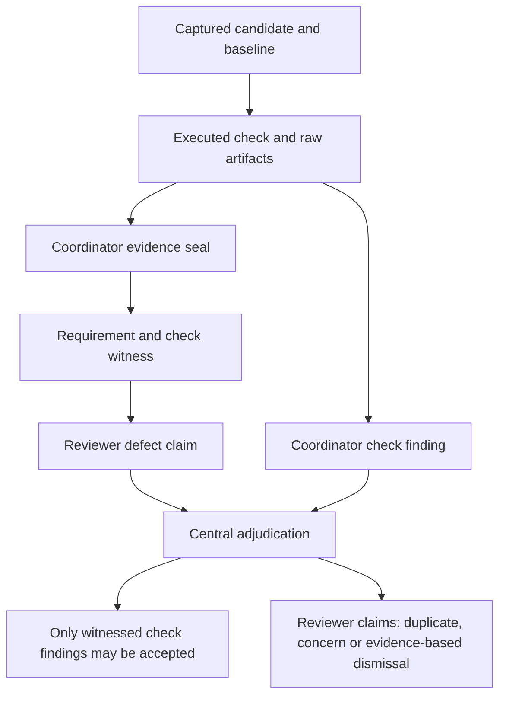

# Result and evidence format

For version-2 requirements, measurement/coupling interfaces, campaigns and bench
feedback, see the [closed-loop contract and command reference](closed-loop.md).

Version strings identify record formats; they are not signatures or proof of
correct electrical conclusions. There is no automatic migration or import of
old acceptance. JSON records are written with sorted keys, indentation, finite
numbers and atomic temporary-file replacement. Identity JSON uses sorted keys
and compact separators before SHA-256 hashing.

## Run directory

```text
RUN/
  candidate.json                 selected input manifest and scope
  baseline.json                  immutable scope/2 or scope/3 baseline, when applicable
  inputs/                        exact captured source/library/requirement bytes
  work/CHECK_ID/                  isolated native scratch and raw evidence
  work/verification/evidence.json scope/2 or scope/3 check and raw-artifact seal
  checks/CHECK_ID.json            interpreted check result
  packet.json                    bounded evidence supplied to initial reviewers
  reviews/ROLE.json              validated initial judgment
  review-executions/ROLE.json     role-level adapter outcome
  review-work/ROLE/               raw harness stdout/stderr/execution
  review-work/adjudicator/        raw adjudicator execution
  adjudicator-execution.json      interpreted adjudicator outcome
  events/                        adjudication, correction and empirical history
  events/bench-BUNDLE_SHA256.json registered physical feedback event, when present
  result.json                    current projection and integrity inventory
  REPORT.md                      human-readable projection
  error.log                      traceback when the CLI crash boundary catches an error
```

Some paths do not exist if capture or execution stops early. Each native work
directory normally has `execution.json`, `stdout.log`, `stderr.log` and combined
`console.log`. Native programs can also produce configuration/cache files in
their scratch. The reviewer home is removed after its invocation; credential
contents are never copied into the retained run.

## Candidate and run identities

`candidate.json` has schema `agent-ee.candidate/1`:

| Field | Meaning |
| --- | --- |
| `scope` | Full parsed scope document |
| `files` | Candidate-relative path to SHA-256 of each captured file |
| `sources` | Candidate-relative path to resolved original source path |
| `source_revisions` | Input destination to source Git HEAD, or null |
| `scope_path`, `scope_sha256` | Original scope path and exact file digest |
| `profile_path`, `profile_sha256` | Present for an external profile file; its resolved source path and exact digest |
| `candidate_id` | SHA-256 identity of the parsed `scope` and `files` mapping |

Candidate identity includes input path mappings and scope settings. A changed
source path in the scope can create a distinct candidate even if bytes match.
Scope whitespace can change the exact scope-file digest without changing the
parsed-scope identity; normal source verification still notices that edit.
Git revision metadata is not the candidate hash. Changed bytes matter even when
HEAD stays unchanged. A fresh run also gets a UUID `run_id`; separate executions
of the same candidate have distinct run identities.

`packet_sha256` identifies the constructed packet before adding its own digest
field. `packet_file_sha256` in the result hashes the actual retained packet file.
Review records must match candidate, run and packet IDs exactly.

## Evidence packet

`packet.json` has schema `agent-ee.packet/1`. It retains `candidate_id`, `run_id`,
scope text, declared `criteria`, `declared_limitations`, interpreted `checks`,
`artifacts`, `packet_limits` and `packet_sha256`. Each supplied text artifact has
`path`, `sha256`, `bytes_total`, `bytes_included`, `extent` (`whole` or `prefix`)
and `content`. The digest identifies the complete source file; `content` can be
only its prefix. Binary omissions have notices rather than readable content.
Packet identity cannot establish that omitted data was inspected. Scope/2 packets
also include `baseline` and `baseline_access`; see the version-2 record details
below and [packet ordering](scope-reference.md#packet-ordering-and-omissions).

## Result projection

`result.json` uses `agent-ee.result/1` and contains:

| Field group | Fields |
| --- | --- |
| Identity and scope | `run_id`, `candidate_id` when captured, `name`, `scope`, `previous_run` |
| Lifecycle | `state`, `outcome`, `started_utc`, `finished_utc` when finalized |
| Work inventory | `expected_check_ids`, `expected_review_roles`, `checks`, `reviews`, `review_executions` |
| Findings | `findings`, `adjudicated`, `limitations` |
| Freshness | `policy_files`, `runtime_files`, `artifact_hashes`, `manifest_sha256`, `packet_file_sha256` when available |
| Physical supersession | `empirical_feedback` when registered; forces the current outcome to incomplete |
| Diagnostics | `error` when present; `prior_errors` when a manual update completes a previously failed projection |

State is `running`, `complete`, `incomplete` or `interrupted`. State `complete`
does not imply acceptable design or complete engineering coverage. Outcome is:

| Outcome | Interpretation |
| --- | --- |
| `incomplete` | Registered bench feedback supersedes old acceptance, or run not finalized with all required execution/reviews/adjudication, or some required check/review has unknown/failed coverage |
| `defects_or_unresolved` | Required execution completed, but a declared check failed or a finding is accepted, unresolved or deferred |
| `criteria_satisfied` | Required execution/reviews/adjudication completed, all checks are pass/info, and no blocking dispositions remain |

At least two initial reviews are required. Every declared check and reviewer
role must appear. Non-defect noted observations can remain in a satisfying
review. An actual executable check failure blocks satisfaction regardless of an
LLM's favorable prose or later attempted disposition.

## Check record

Fields are `id`, `kind`, `candidate_id`, `execution`, `outcome`, `summary`,
`evidence`, `details`, `limitations`. Evidence is normally a list of run-relative
artifact path strings; collection also understands evidence citation objects.
Details are check-specific facts, including native counts, source board digest,
geometry, generated element identities and measured bounds as applicable.

| Execution | Meaning |
| --- | --- |
| `ok` | The handler obtained the evidence it requires and interpreted the check |
| `failed` | Invoked tool/provider or solver failed |
| `unavailable` | Required executable/credential or launch facility unavailable |
| `timeout` | Invocation exceeded its time allowance |
| `malformed` | Required report/review/trace/identity or coverage was invalid |
| `not_run` | Prerequisite/result absent or work was never invoked |
| `interrupted` | Operator/deadline interrupted work or prevented a check from starting |
| `unsupported` | Requested kind, model interpretation or analysis is not implemented |

For check records, any execution other than `ok` requires `outcome=unknown`.
Successful checks use `pass`, `defect` or informational `info`. Reviewer adapter
records use their own diagnostics and may not have check-style `outcome` fields.
An executable missing inside Bubblewrap can appear as a failed wrapped process
rather than a direct `unavailable` launch exception; consult its console.

Execution records retain original `argv`, full `sandbox_argv`, `timeout_s`,
`execution`, nullable `exit_code`, `duration_s` and `console_sha256`. stdout and
stderr are separate; combined console concatenates stdout then stderr and does
not preserve interleaved timing.

## Initial review

Schema `agent-ee.review/1` has exactly these top-level keys:

`schema`, `candidate_id`, `run_id`, `packet_sha256`, `role`, `coverage`,
`limitations`, `findings`.

Coverage and limitations are lists of nonempty strings; empty lists are
structurally allowed. Findings may be empty. Each finding requires:

| Field | Meaning |
| --- | --- |
| `id` | Reviewer-local ID: letters/digits then letters/digits/underscore/dot/hyphen, at most 128 characters, no `..` |
| `title` | Concrete claim |
| `location` | Component/pin/net/UUID/design or verification location |
| `condition` | Applicable operating condition or criterion |
| `mechanism` | How the alleged failure occurs |
| `severity` | `blocking`, `major`, `minor`, or `info` |
| `assessment` | `defect` or `concern` |
| `evidence` | List of `{ "path": "...", "locator": "..." }` |
| `reasoning` | Relationship between condition, source evidence and conclusion |

Required text fields must be nonempty. Optional normalization fields are
`downgraded_from`, `validation_note` and `witnesses`. In a legacy scope/1 run,
a defect with no evidence is visibly
downgraded to concern, retaining why it was downgraded. Bad identities, invalid
paths, duplicate local IDs and malformed structures invalidate the review.
Merely having citations does not prove the claim is true or that the reviewer
received the entire cited document.

Citations must name actual regular files under `inputs/`, `checks/` or
`work/CHECK_ID/` or `review-work/ROLE/experiments/` inside this run. Absolute paths, backslashes, traversal and
symlink traversal are refused. Citation objects contain exactly `path` and a
nonempty `locator`; use a native UUID/pin/net, page/section, measurement name or
specific report item rather than a vague file-level claim. Reviewer prose alone is not independent engineering evidence; experiment citations
should identify the actual command, input, measurement or fetched source.

Adapter records identify the backend, requested model, subscription route,
execution/diagnostics, harness binary digest and, on successful parsing,
model-usage/session/API-duration metadata supplied by the harness. A requested
model name is not independent attestation of the provider's internal routing.

## Collected findings and decisions

Collection keeps every valid initial claim. IDs become `ROLE/LOCAL_ID`; failed
native criteria become `check/CHECK_ID`. Check defects default to blocking and
remain distinct from physical-failure claims. Findings begin unresolved and
retain their original evidence, source, assessment and attribution.

Manual decision files have schema `agent-ee.decisions/1`, exact `candidate_id`
and `run_id`, and a `decisions` list. Each item requires `finding_id`,
`disposition`, `reason`, `evidence`. Optional keys are `duplicate_of`, `checks`
and `previous_run`. This is a structural example requiring real identities,
an existing finding and engineer-checked counter-evidence before application:

```json
{
  "schema": "agent-ee.decisions/1",
  "candidate_id": "COPY_CURRENT_CANDIDATE_ID",
  "run_id": "COPY_CURRENT_RUN_ID",
  "decisions": [
    {
      "finding_id": "circuit/EXISTING_LOCAL_ID",
      "disposition": "dismissed",
      "reason": "Replace with the specific counter-evidence and its engineering implication.",
      "evidence": [
        {
          "path": "work/netlist/connectivity.json",
          "locator": "Replace with the exact component, population and net relationship."
        }
      ]
    }
  ]
}
```

| Disposition | Requirements and effect |
| --- | --- |
| `accepted` | Established `assessment=defect`, explanation and nonempty decision evidence; scope/2 additionally requires a coordinator `check/ID` finding and its sealed failed-check citation; blocks satisfaction |
| `noted` | Evidence-supported minor/info concern with its own original evidence and decision citations; does not block satisfaction |
| `dismissed` | Explanation; a supported/alleged defect needs counter-evidence; native check defects cannot be dismissed |
| `deferred` | Explained unresolved uncertainty; blocks satisfaction; native check defects cannot be deferred |
| `duplicate` | Existing surviving canonical finding; self-links/cycles and hiding defects behind non-defect notes/dismissals are refused |
| `closed` | Library-level cross-candidate closure validation; same-candidate repair closure is invalid; CLI users should use `close-correction` |

Unsupported/downgraded allegations, major/blocking concerns and check defects
cannot be merely noted. Duplicate chains are validated, including their final
target's disposition; a vote cannot erase a singleton. Decisions append finding
events containing sequence, identities, reason and evidence. Current
`status`/`disposition`, `decision`, `disposition_reason` and `decision_evidence`
are projections; earlier events are retained.

## Correction events and integrity

Dedicated correction events use `agent-ee.correction/1` and retain finding ID,
reason, old/new candidate/run IDs, new run path, affected checks, target result
digest and changed input hashes. They are stored under the old run's `events/`
without rewriting its original defect into a pass. Absolute target paths aid
local inspection but may require manual location after moving evidence.

`artifact_hashes` covers all regular files under inputs, native work, check,
review and reviewer-execution directories, plus events and the adjudicator
execution record. The manifest and packet have separate hashes. `REPORT.md`,
the top-level `error.log` and `result.json` itself are not signed or externally
anchored acceptance evidence. Python policy hashes cover each `*.py` module in
`src/agent_ee`; runtime fingerprints cover resolved kicad-cli, ngspice, bwrap,
system Python, Claude/Codex/Agy binaries, the Codex tool host and the `_pcbnew` extension. They do not hash the entire
OS/shared-library image. See [security](security.md) for the guarantees this
provides and the host-modification limits.

## Version-2 witnesses and evidence seal

Version 2 changes the **scope** contract; candidate, packet, result, review and
decision records retain their existing `/1` schema names with the extensions
below. Legacy scope/1 runs do not require a baseline file, seal or witnesses; their
absence in such a run is not evidence tampering. There is no blanket inference that an old `/1` result has the stronger
scope/2 guarantees: inspect its captured scope and baseline.

| Record | Fields and ownership |
| --- | --- |
| `baseline.json`, `agent-ee.baseline/1` | Coordinator-owned `requirements`, `targets`, `reference_architectures`, `files`, `criteria`, `baseline_id` |
| `baseline.json`, `agent-ee.baseline/2` | Scope/3 adds requirement `intent` and coordinator-owned `coverage` (`agent-ee.coverage/1`), covered by `baseline_id` |
| `work/verification/evidence.json`, `agent-ee.evidence/1` | Coordinator-owned `candidate_id`, `baseline_id`, and `checks` map of check IDs to `{result, artifacts}` hashes |
| Packet extension | `baseline` contains the full structured baseline; `baseline_access` describes its sandbox location |
| Finding extension | `witnesses` array of `{requirement_id, check_id}` pairs |
| Result extension | `empirical_feedback` array of captured feedback event references; nonempty means current outcome is incomplete |

The seal is written before initial reviews. It covers every baseline check and
hashes each retained check JSON plus its cited raw artifacts. Check evidence must
come from its own workspace or evidence already sealed for an earlier check.
Verification reconstructs the seal and compares it to the saved record; a
standalone incomplete run that stopped before sealing need not have one.



Each witness must name an existing requirement mapped to that check, cite
`checks/CHECK_ID.json`, and refer to unchanged sealed evidence whose check
execution is `ok` and outcome is `defect`. At least one raw artifact is required.
Witness shapes are validated for concerns too. The model response schema requires
a `witnesses` field for every scope/2 finding; an empty array is appropriate for
a concern without a reproduced requirement violation.

A scope/2 defect without a valid witness is refused, rather than receiving the
legacy no-evidence downgrade. The whole malformed review remains invalid.
An accepted scope/2 decision must target `check/CHECK_ID` and cite its failed
check JSON; arbitrary reviewer prose cannot become a separate accepted defect
by borrowing that check's witness. Reviewer analysis may be retained as a
concern or linked as a duplicate of the executable finding. These restrictions
apply to manual and automatic adjudication alike.

The same check result can carry one or more requirement mappings. Witnesses
prove the configured failed criterion and its provenance; they do not prove all
natural-language causal explanations attached to it.

## Campaign record schemas

Campaigns add an outer history above ordinary review runs. The
[campaign guide](campaign-guide.md#retained-files-and-verification) explains
paths, lifecycle, verification and recovery.

| Schema or record | Required meaning |
| --- | --- |
| `agent-ee.campaign/1` | Operator configuration: scope, review profile, implementation definition and iteration/time limits |
| `agent-ee.campaign-state/1` | Coordinator state, `config_sha256`, `history`; after the first retained review also `baseline`, `mutable_inputs`, `diagnostic`; `epoch` defaults to zero and is stored when feedback advances it |
| History entry | `candidate_id`, `design_id`, `run_id`, `failed`, `passing`, `outcome`, `margins`, `run`, `result_sha256`, `result_snapshot`, `epoch`, `calibration_id` |
| `history/N.json` | Exact original `agent-ee.result/1` bytes copied when the coordinator records that iteration |
| `agent-ee.tradeoff/1` | `state=escalated`, reason, failed/protected criteria, history and required engineering action |
| Implementation response | Object containing only a string `summary`; actual permitted file changes establish the proposal |

`calibration_id` is the hash of the captured empirical bundle, or null without a
bundle. `design_id` hashes the entire captured file inventory, not only mutable
native design files. It intentionally distinguishes file changes from candidate
identity changes caused solely by scope paths or profiles.

Campaign state can be `running`, `repair`, `criteria_satisfied`, `escalated` or
`incomplete`. `empirical_superseded` is a verification projection when the last
retained run has later feedback; it is not an automatic overwrite of stored state.
Errors can leave state incomplete even though the last completed history entry
would otherwise permit repair. A state label alone is not process liveness.

## Measurement and empirical records

These records are machine-readable interfaces, not automatically published JSON
Schema files. Their field constraints are enforced by Python validators at the
stage that consumes them. Unknown fields are not universally rejected.

| Schema | Producer and consumer | Detailed contract |
| --- | --- | --- |
| `agent-ee.measurement-request/1` | Coordinator → producer and parser | [Request fields](measurement-adapters.md#request-and-report-contracts) |
| `agent-ee.measurements/1` | Captured parser → coordinator | [Metrics and raw-output binding](measurement-adapters.md#request-and-report-contracts) |
| `agent-ee.bench/1` | Operator/instrument ingestion → feedback coordinator | [Raw samples and report fields](bench-feedback.md#report-and-raw-sample-contracts) |
| `agent-ee.calibration/1` | Feedback coordinator → subsequent check harness | [Cumulative provenance and model applicability](bench-feedback.md#calibration-provenance-and-reviewer-independence) |
| `agent-ee.empirical-feedback/1` | Coordinator → source run event/result | [Registration and output paths](bench-feedback.md#capture-and-re-entry) |

Coupling and bench-replay JSON are retained check-specific evidence; they do not
carry a standalone schema version in the current implementation. Their fields
are described in the measurement and bench guides. Hash inventories and campaign
snapshots remain trusted local records, not signatures against a privileged
party capable of replacing all records and expected hashes.


## Scope/3 audited witnesses

Scope/3 retains the candidate, packet, result, review, decision and seal `/1`
record names. Its baseline/2 embeds the complete executable coverage report.
An accepted witness must additionally reference an acceptance-intent requirement
and one of its audited defect-capable mapped checks. Informational mappings never
establish an accepted defect. Capture and verification reconstruct coverage;
a retained flag cannot promote an unsupported check. See the
[scope contract](scope-reference.md#version-3-executable-acceptance-coverage).

## Pre-inference environment receipts

New reviews retain an `agent-ee.launch-expectation/1` object in
`result.json.launch_expectation`, captured before deterministic checks. It binds
run, candidate and baseline identities, profile and role definitions, the loaded
policy/runtime inventories, native prerequisites of the declared checks and
declared measurement and PDF extractor pins. `declared_installations` binds
installed kicad-happy roots to the declared file-inventory hash; active SPICE
requires the captured `/usr/bin/ngspice` binary, even when `PATH` resolves
`ngspice` elsewhere. Baseline reconstruction uses the same
captured inputs as capture and verification, including facts files. Every admitted
initial reviewer, adjudicator and implementation call compares those expectations
with fresh local observations before provider dispatch.

`review-work/<role>/preflight/receipt.json` uses `agent-ee.preflight/1`. It records
a unique invocation, boundary, role, expectation identity, observed inventories,
probe execution and `ok` or `refused` with diagnostics. The execution record's
`preflight` link carries its run-relative path and SHA-256. Probe stdout, stderr
and command records remain under `preflight/probe/`. Each role owns a separate
probe workspace; receipts and prior judgments are absent from initial prompts.
The probe runs `/usr/bin/true` through the native Bubblewrap executor with its
network disabled. It checks namespace/execution availability and consumes the
call's wall-clock budget. Cancellation applies to the probe's process group.
The separate pcbnew version probe also owns a process group, including descendants
that retain output pipes after the leader exits. Timeout cleanup records a
diagnostic refusal rather than leaving a receipt with no reason.

Missing prerequisites, observable drift, invalid expectations, duplicate receipts
and unsuccessful or malformed probes refuse inference. A refusal records
`execution: not_run` and leaves the review or campaign incomplete. It adds no
design finding and grants no adjudication or repair authority. Verification
requires the linked receipts for attempted calls under the new policy and checks
their retained identities and probe artifacts. Automatic review validates these
links before adjudication and completion; implementation validates its receipt
before emitting a proposal. Verification does not rerun a historical probe or synthesize receipts for old policies.

Campaigns pin their runtime/policy and implementation definition at creation.
Implementation receives explicit expectations for the original reviewed candidate,
retained in `implementations/<n>/launch-expectation.json`; writable repair scratch
is not a captured candidate. Campaign verification checks the separate
implementation execution/receipt link and probe artifacts. An older campaign
without original launch expectations must start a fresh campaign to invoke an
implementation under this policy.

Preflight observes an environment boundary. Upgrades after observation can still
race dispatch; existing snapshot and final environment checks remain necessary.
No model call, authentication/quota canary, numerical simulator canary or provider
fallback is performed. An `ok` receipt establishes neither subscription quota nor
engineering acceptance. Only declared tool identities are covered; arbitrary
transitive dependencies are not discovered.
