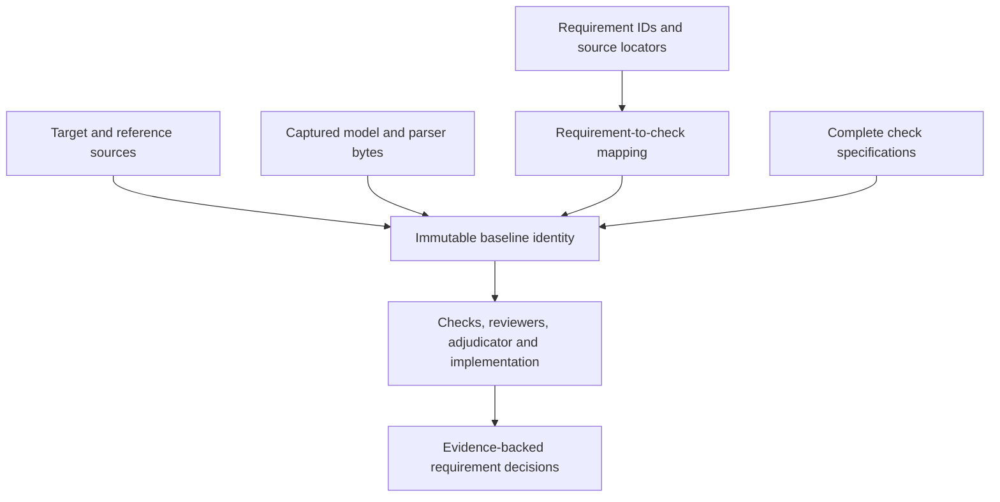

# Scope configuration reference

For version-2 requirements, measurement/coupling interfaces, campaigns and bench
feedback, see the [closed-loop contract and command reference](closed-loop.md).

A scope declares what to capture, what to check and what the reviewers can see.
It is not a discovery engine for every dependency in a design. Include the
native project, rules, library tables, actual libraries, applicable requirements
and models needed to support the declared engineering claims.

Start from [the control scope](../fixtures/rc/control.scope.json) for a complete
passive example. [The donor scope](../scopes/donor.json) demonstrates an external
project with captured stock and project libraries. The latter contains paths
specific to the original workstation; adapt them before using it elsewhere.

## Top-level fields

| Field | Type / default | Meaning |
| --- | --- | --- |
| `schema` | Required string | `agent-ee.scope/1` or requirements-bound `agent-ee.scope/2` |
| `name` | Required nonempty string | Name displayed in reports |
| `scope` | Required nonempty string | Review purpose, boundary and relevant operating conditions |
| `inputs` | Required list of input mappings | Source files/trees to copy into the candidate |
| `schematic` | Required relative path | Captured root `.kicad_sch` |
| `board` | Required relative path | Captured saved `.kicad_pcb` |
| `checks` | Required nonempty list | Ordered check specifications |
| `baseline` | Required for scope/2 | Requirement/check mappings and captured target/reference sources; see [closed-loop contract](closed-loop.md) |
| `mutable_inputs` | Optional list | Campaign-editable captured design paths; default board and schematic |
| `empirical` | Optional captured path | Coordinator-generated calibration bundle for bench feedback |
| `requirements` | List, default `[]` | Captured input-relative text files placed first in the packet |
| `limitations` | List of strings, default `[]` | Explicit omitted conditions or analyses retained in the report |
| `packet_inputs` | List; default root schematic and board | Captured input-relative source text selected for reviewers |
| `packet_artifacts` | List, default `[]` | Required generated evidence paths, relative to the run |
| `packet_max_bytes` | Integer, default 240000 | Total artifact-text budget, allowed range 1024–1000000 |
| `review_profile` | Explicit profile object; alternatively pass `--profile FILE` | Harness/model/effort/timeout for every reviewer and adjudicator |

Both native paths and all requirement paths must actually be captured. Every
review currently declares a board and a schematic, including a narrow circuit
review. Schematic-only operation is not implemented. Native parity expects the
schematic beside the board under the matching basename used by KiCad; the
scope's separate `schematic` setting does not override KiCad's parity file
selection. Preserve the actual project naming relationship.

The scope is validated by Python code, not a published standalone JSON Schema.
Some shape/type checks occur only when the relevant field is used; unknown
top-level keys are not comprehensively rejected. An accepted JSON file is not
proof that every intended setting was understood. Use exactly the documented
fields and inspect the captured scope and resulting checks.

## Input mappings

Each entry in `inputs` contains:

| Field | Required | Meaning |
| --- | --- | --- |
| `path` | Yes | Source file or directory; relative to the scope file, absolute, or `~`-expanded |
| `at` | Yes | Destination relative to the candidate's `inputs/` |
| `include` | No | Directory-selection patterns, default `["**"]` |
| `exclude` | No | Additional directory-selection exclusion patterns |

Directory selection uses Python `fnmatch` on each complete relative path. On
the demonstrated Linux environment it is case-sensitive; `*` can match a slash
in that string, so these are not shell traversal rules. Exclusion takes
precedence. Git metadata is excluded automatically. An empty directory selection
is refused. `include` and `exclude` do not filter a single-file input mapping.

An explicitly named source root is resolved to its real path; this permits a
deliberately selected checkout alias. Symlinks encountered inside a selected
tree are refused. Declare their intended targets as separate inputs at the
effective candidate destinations. Targets containing `..` or absolute candidate
paths are refused. Two mappings cannot supply the same destination, even with
identical bytes. A library mapping can populate an otherwise empty subdirectory
inside a project mapping, provided no selected files overlap.

Capture records bytes, not just Git HEAD. Uncommitted files, external references
and requirement edits matter. The Git revision is provenance; it does not
replace selected-file hashes. Broad selections can capture unrelated local
files and consume time/storage. Select explicitly and keep secrets outside the
input set.

## Native library layout

Inside every tool sandbox these candidate destinations have configured meanings:

| Candidate-relative destination | Sandbox value |
| --- | --- |
| `stock/symbols` | `KICAD10_SYMBOL_DIR=/candidate/stock/symbols` |
| `stock/footprints` | `KICAD10_FOOTPRINT_DIR=/candidate/stock/footprints` |
| `stock/template` | `KICAD10_TEMPLATE_DIR=/candidate/stock/template` |

ERC, DRC and netlist checks copy captured `stock/template/sym-lib-table` and
`fp-lib-table` into a fresh `/work/kicad-config/10.0`. Missing template tables are
reported as a limitation; actual native library errors remain in the reports.
Project tables should resolve their custom symbols/footprints inside the
candidate, for example through `${KIPRJMOD}`. Host home configuration and
undeclared live libraries are not exposed. A custom environment variable in a
library table does not automatically become available inside the cleared child
environment.

For the donor, external project libraries are captured under
`project/fome-kicad-libs` to match its native tables. The disposable case-alias
scope also maps one existing source file to a second, differently capitalized
candidate name. This explicit input difference changes candidate identity and
does not repair the original checkout.

## Check specification

Each check has `id`, `kind`, and optional `params` (object, default `{}`). CLI
check IDs are unique and match `[a-z][a-z0-9_-]{0,63}`. Checks execute in the
listed order; dependencies are not topologically sorted.

Supported kinds are `erc`, `drc`, `netlist`, `geometry`, `rc_transient`,
`measurements` and `coupled_margins`. The latter two use the
[measurement contract](measurement-adapters.md).
Unknown kinds are retained as unsupported unknown coverage. The transient check
must name a preceding check in `params.netlist_check`; use an actual `netlist`
check whose generated connectivity exists. Parameters, units and check-specific
failure behavior are in the [check reference](check-reference.md).

The current ERC/DRC policy treats any returned all-severity native issue as a
failed declared criterion, including reported excluded issues. There is no scope
parameter for "warnings only" acceptance, arbitrary DRC waiver, or silently
ignoring a failing native check. Report exclusions and resolve their engineering
meaning separately; changing that policy is an explicit implementation change.

## Reviewer specification

Use an explicit [reviewer profile](reviewer-profiles.md), either embedded as
`review_profile` or supplied with `--profile FILE`. The external file takes
precedence and is independently hashed. No model default or fixed adjudicator
remains. Initial contexts and experiment directories are separate. Tools are
enabled by default so reviewers can inspect complete captured files and investigate.
Role lenses request coverage; actual coverage still needs recorded evidence.

## Packet ordering and omissions

The packet includes scope criteria, check records and selected text in this order:

1. Requirement paths, prefixed with `inputs/`.
2. In scope/2, all baseline file paths, prefixed with `inputs/` (including captured
   normative sources, adapters, declared tool program inputs and calibration inputs).
3. `packet_inputs`, prefixed with `inputs/`.
4. Required `packet_artifacts`.
5. Remaining evidence paths produced by the declared checks.

Large baseline source/program files can consume the text budget before native
packet inputs. The structured baseline itself is included outside that budget.
Duplicate paths are included once. Each artifact text is capped at 100000 bytes,
within the shared artifact budget. The budget does not cap all JSON overhead,
check-record text or adjudicator context. Text is a prefix when clipped. Binary
artifacts are retained on disk but omitted from text context. Unavailable paths,
clipped extents and binary omissions are recorded in `packet_limits`.

`packet_artifacts` must name paths actually listed in this run's check evidence;
a missing or mismatched required artifact fails packet construction and leaves
the review incomplete. A path in `packet_inputs` is not automatically required
by the same validation, so inspect unavailable-source notices. Choosing a path
or capturing a document does not ensure its full contents reached the reviewers.
If a relevant source is clipped, narrow the scope or add a suitable extraction
with preserved source/page/native provenance and rerun.

## Version-2 baseline

`agent-ee.scope/2` uses the same capture/native/profile fields and adds a required
`baseline`. [The version-2 control](../fixtures/closed-loop/control.scope.json)
is a complete runnable example. This fragment shows the baseline shape only:

```json
{
  "requirements": [
    {"id": "R-response", "statement": "Output meets the declared response band",
     "source": {"path": "requirements/system.md", "locator": "R-response"},
     "checks": ["response"]}
  ],
  "targets": ["requirements/targets.md"],
  "reference_architectures": ["requirements/reference.md"]
}
```

The baseline object accepts exactly `requirements`, `targets` and
`reference_architectures`. All three lists must be nonempty. Each requirement
has exactly `id`, `statement`, `source` and `checks`; IDs use the safe finding-ID
syntax and must be unique. Statements and source locators are nonempty strings.
Each source has exactly `path` and `locator`. Paths must be safe, captured input
paths. Locators document the relevant section; the validator does not parse prose
to prove that a section or statement is correct.

Each requirement names one or more unique declared check IDs. Every declared
check must appear in at least one requirement mapping. Multiple requirements may
map to the same check. Coverage of IDs is structural traceability, not proof that
a check semantically covers every part of a requirement. The operator must make
that engineering mapping defensible.

The coordinator creates `baseline.json` with the requirement mappings, target and
reference paths, complete check specifications, and hashes of all baseline files.
The immutable file set includes the normative sources, legacy `requirements`
paths, measurement adapters, declared producer `tool.inputs`, and all
`calibration_inputs`. Candidate verification reconstructs and compares it.
Changing an included file or check specification changes `baseline_id`.



The full structured baseline is included in the packet outside the artifact-text
budget and mounted at `/evidence/baseline.json`. Its complete sources remain
read-only under `/candidate`. Packet excerpt limits still apply to embedded
source text; access to a file does not establish that a reviewer inspected it.

A version-2 reviewer defect needs valid requirement/check witnesses and a citation
to a sealed failed check. Only coordinator check findings may receive an accepted
defect disposition; see [finding contracts](result-reference.md#version-2-witnesses-and-evidence-seal).

## Migrating a legacy scope

1. Preserve the scope/1 file and historical runs. Copy it to a new scope file.
2. Change its schema to `agent-ee.scope/2`; capture the actual requirements,
   target specifications and reference architecture sources.
3. Add explicit requirement IDs, statements, source locators and mappings that
   cover every declared check, including informational exports.
4. For generic measurements, declare captured parser/program/model inputs and
   a pinned producer executable. Add `calibration_inputs` before bench feedback.
5. For campaigns, declare `mutable_inputs` as the exact authorized design files.
   This setting is not a glob and cannot include immutable baseline sources.
6. Run fresh checks and independent reviews. A migration creates a new candidate
   and does not transfer previous acceptance or convert old review prose into
   executable evidence.

A standalone scope may include `empirical`, a captured path to an
`agent-ee.calibration/1` bundle. Normally let `bench-review` or `campaign-feedback`
create that field and its captured `empirical/` tree. It is runtime empirical
knowledge, separate from the normative baseline. See [bench feedback](bench-feedback.md)
for provenance, applicability and accumulation rules.

### Geometry criterion versions

A geometry check with `min_track_width_mm` alone checks straight segments only,
including under scope/2. To include native arcs, explicitly set
`criterion: "copper-width/1"`, `covered_primitives: ["PCB_TRACK", "PCB_ARC"]`,
`min_track_width_mm` and `exclude_nets` (use `[]` when none). See the
[coverage contract](coverage.md) for counts, evidence and incomplete outcomes.
Changing these captured check parameters creates a different baseline; it cannot
broaden an existing campaign's acceptance coverage.

## Version 3 executable acceptance coverage

`agent-ee.scope/3` explicitly opts into `agent-ee.baseline/2`. Scope/1 and
scope/2 retain their historical interpretation; scope/2 still serializes
baseline/1 without an audit. Unknown scope versions are refused by capture and
baseline verification.

Each baseline requirement has the existing `id`, `statement`, `source`, and
`checks`, plus required `intent: "acceptance"` or `"informational"`. All
requirements and checks remain mapped. At least one acceptance requirement is
required. Every acceptance requirement must map to a supported check with an
executable violation predicate. A defect-capable check must have an acceptance
mapping, even when it also supplies informational requirements. No waiver field
or automatic downgrade is supported.

Baseline/2 embeds one authoritative `coverage` report (`agent-ee.coverage/1`,
policy `executable-acceptance/1`). Its `checks` map includes every check's ID,
kind, capability version, supported status, `can_evaluate_bound`, predicate
locators, ordered prerequisites, immutable dependency paths, and unsupported
reasons. Its `requirements` map includes intent, mapped checks and eligible
acceptance checks. `coverage_id` hashes the canonical report excluding that ID;
`baseline_id` hashes the full baseline including coverage. There are no candidate
design hashes or timestamps in coverage. The full baseline is available to
reviewers at `/evidence/baseline.json`, regardless of packet text truncation.

Capture refuses missing acceptance coverage, unknown kinds/criteria, malformed
bounds, uncaptured verification dependencies and unresolved, wrong-kind or
forward prerequisites before checks or inference. The retained baseline is
recompiled from captured scope and inventory during verification and compared
exactly. Changing report booleans, intent, predicates or mappings cannot assert
capability. Native design files cannot be declared immutable verification inputs.

A scope/3 accepted witness must name an acceptance requirement and one of its
audited defect-capable checks, in addition to the existing failed coordinator
check, current candidate, cited result and sealed raw-evidence requirements.
Informational witnesses cannot establish accepted defects. Runtime unsupported,
malformed or failed executions remain unknown coverage, even for statically
supported declarations.

To convert an existing scope/2, use the pure
`agent_ee.capabilities.convert_scope(scope)` helper and write its return value to
a **new** scope file. It preserves every requirement and defaults every intent
to acceptance. A netlist-only requirement will therefore refuse compilation
until the owner defines an executable acceptance plan. Conversion does not edit
historical scopes, evidence or campaigns. Scope/1 needs an owner-authored baseline
before conversion. Intent changes define a new contract.
